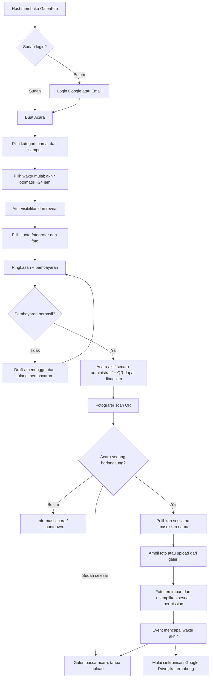
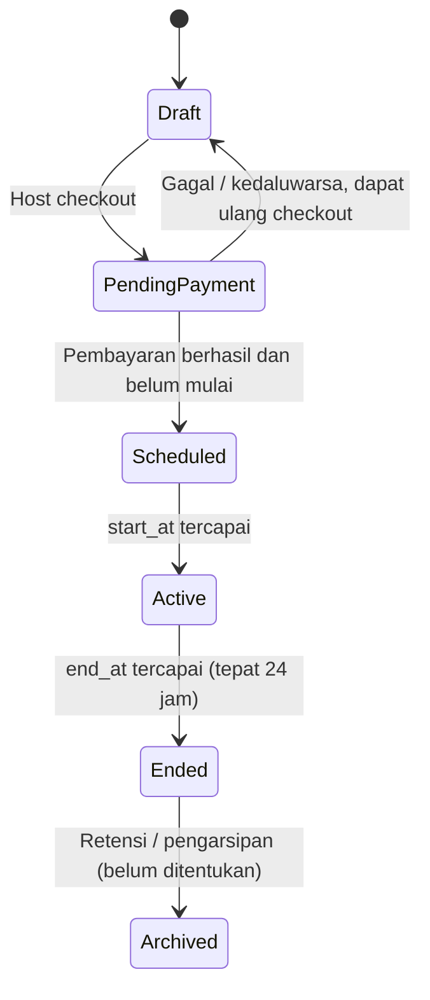

# GaleriKita — Alur Lengkap Host dan Fotografer

> **Jenis dokumen:** Spesifikasi alur pengguna dan aturan bisnis (user flow & business rules)  
> **Versi:** 1.0  
> **Tanggal:** 13 Oktober 2026  
> **Cakupan:** Website GaleriKita (web-only), mulai dari pembuatan acara, pembayaran, pengambilan foto, galeri, hingga setelah acara selesai.  
> **Landasan:** Keputusan produk yang telah ditetapkan dalam percakapan. Hal yang belum diputuskan diberi label **[PERLU KONFIRMASI]** atau **[USULAN]**.

---

## 1. Ringkasan Produk

**GaleriKita** adalah platform album foto kolaboratif berbasis acara. Pemilik acara (**Host**) membuat acara berbayar, mengatur akses dan kuota, lalu membagikan tautan/QR code. Peserta (**Fotografer**) bergabung tanpa akun dengan memasukkan nama, kemudian mengambil foto melalui kamera browser atau mengunggah dari galeri perangkat.

Ciri utama:

1. **Host wajib login** menggunakan Google atau email sebelum membuat acara.
2. **Acara selalu berdurasi tepat 24 jam** dari waktu mulai yang ditentukan Host.
3. **Unggah foto hanya selama acara berlangsung.** Tautan tetap dapat dipakai untuk akses galeri setelah acara selesai.
4. **Visibilitas galeri diatur Host**: `Private` atau `Public`, dengan opsi penayangan foto `Instant` atau `After Event`.
5. **Paket berbayar membatasi dua kuota**: jumlah fotografer dan jumlah upload foto per fotografer.
6. **Fotografer tanpa login** menggunakan satu sesi pada satu perangkat/browser. Membuka ulang QR dengan sesi yang sama akan memulihkan sesi, **bukan** mengurangi kuota fotografer lagi.
7. **Host dapat meningkatkan kuota** dengan membayar selisih harga. **Downgrade tidak tersedia.**
8. **Filter dan border kamera dipilih sebelum mengambil foto**. Hanya foto yang sudah diproses dengan filter yang disimpan; foto mentah dari kamera tidak disimpan terpisah.
9. **Sinkronisasi ke Google Drive (jika dihubungkan Host) mulai setelah acara selesai**. Menghapus foto di GaleriKita tidak otomatis menghapus salinan di Google Drive.

### 1.1 Aktor

| Aktor | Identitas | Kewenangan utama |
|---|---|---|
| **Host** | Login Google/email | Membuat acara; memilih dan meningkatkan paket; mengelola pengaturan; mengakses seluruh foto; menghapus foto; mengunduh album; menghubungkan Google Drive. |
| **Fotografer** | Guest session + nama tampilan, tanpa akun | Mengambil/mengunggah foto selama acara; melihat dan mengunduh foto sesuai izin; menyukai foto orang lain yang terlihat; menghapus foto miliknya sendiri. |
| **Pengunjung tanpa sesi** | Belum bergabung | Membuka halaman informasi acara sesuai status, tetapi belum memiliki identitas fotografer dan tidak bisa mengunggah. |
| **Sistem** | Proses otomatis | Menghitung status acara; memvalidasi kuota; memproses pembayaran; menyimpan foto; menutup upload setelah 24 jam; menjalankan sinkronisasi Drive. |

### 1.2 Istilah penting

- **Acara/Event:** Ruang album kolaboratif milik Host dengan jendela upload 24 jam.
- **Fotografer/Guest:** Identitas peserta yang bergabung melalui tautan acara.
- **Sesi fotografer:** Token yang dikaitkan ke satu identitas fotografer pada sebuah acara, tersimpan di browser/perangkat dan diverifikasi server.
- **Kuota fotografer:** Jumlah maksimal identitas fotografer yang dapat bergabung pada suatu acara.
- **Kuota foto:** Jumlah maksimal upload foto **per fotografer** pada suatu acara.
- **Reveal:** Waktu foto milik fotografer lain mulai terlihat kepada peserta yang diizinkan.
- **Paket/Plan:** Konfigurasi kapasitas fotografer dan kuota upload foto, beserta harga yang dihitung oleh backend.

---

## 2. Gambaran Alur End-to-End

**Penting:** Pembayaran mengaktifkan **hak penggunaan event**, sedangkan waktu mulai menentukan kapan **fitur upload** aktif. Keduanya tidak sama.

---

## 3. Alur Lengkap Host

### H-01 — Membuka platform dan autentikasi

**Prasyarat:** Belum perlu memiliki acara.

1. Host membuka website GaleriKita.
2. Host menekan **Login / Daftar** atau **Buat Event**.
3. Jika belum login, sistem mengarahkan ke halaman autentikasi.
4. Host memilih **Lanjutkan dengan Google** atau **Masuk/Daftar dengan Email**.
5. Sistem memverifikasi autentikasi.
6. Setelah berhasil, Host diarahkan ke **Dashboard Host**; bila sebelumnya memilih Buat Event, dapat diteruskan ke onboarding acara.
7. Dashboard menampilkan daftar acara, status, kapasitas, dan tindakan yang tersedia.

**Aturan:**
- Akun Host **wajib** sebelum acara dibuat.
- Detail mekanisme login email (password, OTP, atau magic link) **[PERLU KONFIRMASI]**; pilihan Google dan email sudah final.
- Jika login gagal, tampilkan pesan kesalahan dan opsi mencoba kembali.

### H-02 — Memulai onboarding event

1. Dari dashboard, Host menekan **Buat Event Baru**.
2. Sistem membuat **draft onboarding** agar data dapat dilanjutkan jika proses terhenti **[USULAN]**.
3. Host melewati langkah-langkah secara berurutan; tersedia **Kembali/Lanjutkan** tanpa kehilangan isian yang sudah tersimpan.
4. Acara **belum dapat dipakai fotografer untuk upload** sampai pembayaran pertama berhasil dan waktu mulai tiba.

### H-03 — Memilih kategori acara

1. Sistem menampilkan pilihan kategori, misalnya **Pernikahan**, **Ulang Tahun**, **Perjalanan**, **Gathering**, **Wisuda**, dan **Lainnya**.
2. Host memilih satu kategori.
3. Host menekan **Lanjutkan**.
4. Sistem menyimpan pilihan kategori pada draft.

**Validasi:** Kategori wajib diisi. Daftar kategori dapat dikelola sistem dan diperluas di kemudian hari.

### H-04 — Mengisi identitas dan foto sampul

1. Host memasukkan **Nama Event**.
2. Host memilih **Foto Sampul** dari perangkat.
3. Sistem menampilkan pratinjau sampul.
4. Host boleh mengganti foto atau memperbaiki nama sebelum melanjutkan.
5. Host menekan **Lanjutkan**.

**Validasi:** Nama wajib; format, batas ukuran, dan rasio sampul mengikuti kebijakan unggahan yang ditentukan sistem. Batas numeriknya **[PERLU KONFIRMASI]**.

### H-05 — Memilih jadwal acara (durasi tetap 24 jam)

1. Host memilih **Tanggal dan Jam Mulai**.
2. Sistem otomatis mengisi **Waktu Selesai = Waktu Mulai + 24 jam**.
3. Host melihat ringkasan, termasuk zona waktu yang digunakan.
4. Host menekan **Lanjutkan**.

**Contoh:** Mulai **10 November 2026, 12.00 WIB** → Selesai **11 November 2026, 12.00 WIB**.

**Aturan final:**
- Durasi tidak dapat diperpendek atau diperpanjang: **selalu 24 jam**.
- Sebelum acara mulai, Host boleh mengubah **waktu mulai**; waktu selesai dihitung ulang otomatis.
- Setelah acara mulai, **waktu mulai dan selesai terkunci**, termasuk setelah acara berakhir.
- Pemeriksaan waktu dan status upload harus dilakukan di **server**, bukan hanya dari jam perangkat tamu.

### H-06 — Menentukan visibilitas album

1. Host memilih salah satu mode:
   - **Private**: fotografer hanya boleh melihat foto **miliknya sendiri**; Host melihat seluruh foto.
   - **Public**: fotografer dapat melihat foto dari fotografer lain ketika aturan reveal mengizinkannya; Host melihat seluruh foto.
2. Sistem menampilkan penjelasan dampak pengaturan.
3. Host menekan **Lanjutkan**.

**Aturan final:** Dalam mode Private, setiap fotografer tetap bisa melihat fotonya sendiri **langsung**, meskipun foto orang lain disembunyikan.

### H-07 — Menentukan kapan foto orang lain ditampilkan

1. Host memilih salah satu:
   - **Instant**: foto yang diunggah dan berhasil diproses boleh muncul di galeri bersama segera jika mode **Public**.
   - **After Event**: foto orang lain baru muncul saat periode 24 jam selesai jika mode **Public**.
2. Host menekan **Lanjutkan**.
3. Sistem menyimpan `visibility` dan `reveal_mode` sebagai **dua pengaturan berbeda**.

**Aturan:**
- Pada **Private**, reveal tidak membuat foto orang lain menjadi terlihat; peserta tetap hanya melihat foto sendiri.
- Pada **Public + After Event**, perilaku foto milik sendiri sebelum reveal diperlakukan **langsung terlihat** sebagai rekomendasi konsisten dengan mode Private **[USULAN — PERLU KONFIRMASI]**.
- Foto yang sudah dilihat/diunduh tidak dapat benar-benar “ditarik kembali” hanya dengan mengubah pengaturan setelahnya.

### H-08 — Memilih kapasitas dan paket berbayar

1. Host membuka langkah **Pilih Plan**.
2. Host memilih **maksimum jumlah fotografer**.
3. Host memilih **maksimum jumlah foto per fotografer**.
4. Backend menghitung harga berdasarkan kombinasi kuota.
5. UI menampilkan ringkasan:
   - Jumlah fotografer yang diizinkan.
   - Batas foto untuk setiap fotografer.
   - Potensi kapasitas foto maksimum = `jumlah fotografer × foto per fotografer`.
   - Harga paket dan rincian pembayaran.
6. Host menyetujui konfigurasi dan menekan **Lanjutkan Pembayaran**.

**Aturan final:**
- **Kedua kuota** adalah bagian dari hak penggunaan paket.
- Angka harga, jenjang pilihan, dan formula pricing final **[PERLU KONFIRMASI]**.
- Contoh Rp50.000 untuk 10 fotografer dan Rp500.000 untuk 100 fotografer adalah **ilustrasi**, bukan tarif final yang telah ditetapkan.

### H-09 — Checkout dan aktivasi event

1. Sistem menampilkan **Ringkasan Event**: kategori, nama, sampul, waktu mulai/selesai, permission, reveal, kuota, dan total tagihan.
2. Host menekan **Bayar**.
3. Sistem membuat transaksi pending melalui payment gateway.
4. Host menyelesaikan pembayaran.
5. Backend memvalidasi notifikasi/status pembayaran dari penyedia pembayaran.
6. Jika **berhasil**:
   - Pembayaran ditandai **Paid**.
   - Konfigurasi paket aktif diterapkan ke event.
   - Event dinyatakan **teraktivasi**, dengan status jadwal `Scheduled` jika waktu mulai belum tiba.
   - Host diarahkan ke halaman **Event Detail / Dashboard**.
7. Jika **pending**, tampilkan status menunggu pembayaran dan opsi cek status.
8. Jika **gagal/kedaluwarsa**, tampilkan opsi pembayaran ulang tanpa menggandakan event.

**Aturan final:** Pembayaran pertama diperlukan untuk aktivasi event. Event tidak boleh mulai menerima unggahan hanya karena pengguna kembali dari halaman pembayaran; aktivasi mengikuti status pembayaran yang diverifikasi backend.

### H-10 — Menerima tautan dan membagikan QR

1. Setelah event berhasil teraktivasi, dashboard menampilkan:
   - Nama/sampul event dan status jadwal.
   - **Link unik event**.
   - **QR code** menuju link tersebut.
   - Tombol salin link / unduh QR / bagikan.
2. Host membagikan link atau QR code kepada calon fotografer.
3. Jika event masih `Scheduled`, pengunjung yang membuka link memperoleh informasi **belum dimulai**, bukan akses upload.
4. Pada waktu mulai, sistem otomatis mengizinkan proses bergabung dan upload, selama kuota masih tersedia.

### H-11 — Mengelola dashboard event

Pada halaman detail event, Host dapat:

1. Melihat **status**: Scheduled, Active, atau Ended.
2. Melihat **waktu mulai/selesai** dan hitung mundur ketika relevan.
3. Melihat **jumlah fotografer** terpakai dari kuota plan.
4. Melihat **pemakaian upload foto**, jumlah foto, dan statistik dasar.
5. Membuka, mencari/memfilter, melihat, dan mengunduh foto dari seluruh fotografer.
6. Menghapus foto tertentu atau beberapa foto sekaligus, termasuk seluruh foto di event melalui tindakan khusus dengan konfirmasi.
7. Mengelola pengaturan event dan permintaan upgrade plan.
8. Melihat status sinkronisasi Google Drive setelah acara selesai, jika fitur dihubungkan.

### H-12 — Mengedit pengaturan event

1. Host membuka **Event Settings**.
2. Host mengubah data yang diizinkan.
3. Backend memvalidasi perubahan dan menyimpannya.
4. Perubahan permission/reveal berlaku untuk **akses berikutnya** sesuai konfigurasi baru.
5. Jika Host hendak mengubah kuota paket menjadi lebih tinggi, sistem mengarahkannya ke proses **upgrade**.

| Pengaturan | Sebelum mulai | Saat event berjalan | Setelah selesai |
|---|---|---|---|
| Kategori | Bisa diedit | Bisa diedit | Bisa diedit |
| Nama event | Bisa diedit | Bisa diedit | Bisa diedit |
| Foto sampul | Bisa diedit | Bisa diedit | Bisa diedit |
| Waktu mulai | Bisa diedit | **Terkunci** | **Terkunci** |
| Waktu selesai | Otomatis `mulai + 24 jam` | **Terkunci** | **Terkunci** |
| Private / Public | Bisa diedit | Bisa diedit | Bisa diedit |
| Instant / After Event | Bisa diedit | Bisa diedit | Bisa diedit* |
| Kuota plan | Hanya upgrade | Hanya upgrade | Upgrade pasca-event **[PERLU KONFIRMASI]** |

\* **Catatan reveal:** bila foto sudah pernah muncul secara publik, perubahan ke mode tertunda tidak dapat membatalkan foto yang telah dilihat, disimpan, atau diunduh. UI harus memberi peringatan.

### H-13 — Upgrade plan (tanpa downgrade)

1. Host membuka **Upgrade Plan** di event detail.
2. Sistem menampilkan **kuota dan harga paket aktif**.
3. Host memilih **kapasitas fotografer** dan/atau **batas foto per fotografer** yang lebih tinggi.
4. Sistem menolak pilihan yang menurunkan hak kuota yang sudah aktif.
5. Backend menghitung **harga upgrade berdasarkan selisih** terhadap nilai paket aktif yang telah dibayar, sesuai aturan harga.
6. UI menampilkan harga lama, harga baru, dan **jumlah tambahan yang harus dibayar**.
7. Host menekan **Bayar Upgrade** dan menyelesaikan pembayaran.
8. Selama pembayaran belum berhasil, **paket lama tetap berlaku**.
9. Setelah pembayaran berhasil diverifikasi backend, **kuota baru langsung berlaku** pada event.
10. Riwayat upgrade disimpan untuk audit dan tampilan tagihan.

**Contoh ilustratif:** Paket lama Rp50.000; paket baru Rp250.000; biaya tambahan Rp200.000 (di luar perlakuan biaya layanan/promo yang belum ditentukan).

**Aturan final:** Tidak ada downgrade. Perhitungan harga harus dilakukan di backend, bukan percaya angka yang dikirim frontend.

### H-14 — Event mencapai batas 24 jam

1. Saat waktu server mencapai `end_at`, event berubah dari `Active` menjadi `Ended` (secara perhitungan waktu; job periodik dapat digunakan untuk pekerjaan lanjutan).
2. **Upload baru ditolak**, termasuk request terlambat yang sudah melewati batas sesuai kebijakan finalisasi upload.
3. Link/QR **tetap valid** untuk akses galeri pasca-event sesuai permission.
4. Jika pengaturan `Public + After Event`, foto orang lain mulai dapat terlihat.
5. Sistem memulai proses **sinkronisasi Google Drive**, bila Host telah menghubungkan Drive dan fitur sinkronisasi diaktifkan.

### H-15 — Sinkronisasi Google Drive setelah event

1. Host menghubungkan akun Google Drive melalui izin akses resmi bila ingin menyimpan salinan foto di Drive.
2. Setelah event `Ended`, sistem membuat pekerjaan background untuk foto yang masih memenuhi syarat sinkron.
3. Worker menyalin foto dari storage GaleriKita ke folder yang terkait event pada Google Drive Host.
4. UI menunjukkan status seperti **Belum Dimulai / Berjalan / Selesai / Sebagian Gagal**.
5. Upload yang gagal disinkronkan dapat dicoba ulang tanpa menduplikasi foto di Drive.
6. **Menghapus foto di GaleriKita tidak menghapus salinan yang sudah ada di Google Drive.**

**Catatan:** Sinkronisasi dilakukan **setelah** event, tidak otomatis saat foto pertama kali diunggah. Jika Google Drive belum dihubungkan, perilaku pengingat/koneksi setelah acara **[USULAN]** dan dapat dirancang kemudian.

### H-16 — Pengelolaan pasca-event

Setelah acara berakhir, Host tetap dapat:

- Melihat seluruh album sesuai hak kepemilikan.
- Mengunduh foto secara individual atau sebagai arsip, bila fitur unduh massal tersedia.
- Menghapus foto dari GaleriKita (dengan konfirmasi untuk tindakan massal).
- Melihat/menangani status sinkronisasi Google Drive.
- Mengedit pengaturan non-jadwal, dengan memperhatikan efek permission terhadap konten yang sudah pernah terlihat.

**Masa penyimpanan album, mekanisme arsip permanen, dan kebijakan penghapusan otomatis masih [PERLU KONFIRMASI].**

---

## 4. Alur Lengkap Fotografer (Pemakai Link / QR)

### F-01 — Membuka link event

1. Fotografer **scan QR code** atau menekan link yang dikirim Host.
2. Browser membuka halaman event dengan nama, sampul, dan informasi dasar.
3. Backend memeriksa **keberadaan, status pembayaran/aktivasi, serta waktu server**.
4. Sistem menampilkan respons sesuai status:
   - **Scheduled:** halaman “Acara belum dimulai” dan informasi waktu mulai; **tidak bisa upload**.
   - **Active:** fotografer bisa memulihkan sesi atau bergabung untuk mengambil/mengunggah foto.
   - **Ended:** **tidak bisa upload**; fotografer yang sudah memiliki sesi dapat membuka galeri sesuai permission, mengunduh, dan menghapus foto miliknya sendiri.
   - **Tidak aktif / tidak ditemukan:** tampilkan pesan event tidak tersedia, tanpa memberikan akses foto.

### F-02 — Pemulihan sesi pada perangkat yang sama

1. Saat halaman dibuka, browser mengirim token sesi fotografer untuk event tersebut (jika ada).
2. Backend memverifikasi apakah sesi valid dan terkait event yang tepat.
3. Jika **valid**, sistem **langsung memulihkan identitas fotografer**, nama, sisa kuota, dan hak akses galeri.
4. Fotografer **tidak perlu mengisi nama lagi**.
5. **Kuota fotografer tidak berkurang lagi** karena pemulihan sesi bukan pendaftaran baru.
6. Jika tidak ada sesi valid dan event sedang `Active`, sistem melanjutkan ke form nama untuk bergabung sebagai fotografer baru.

**Keputusan final:** Scan QR ulang dari **perangkat/browser dengan sesi tersimpan yang sama** = pulihkan sesi. Perangkat/browser tanpa sesi yang valid = bergabung sebagai identitas baru dan menggunakan satu slot fotografer.

> **Batas teknis:** Mengidentifikasi *perangkat fisik yang sama* secara pasti di semua browser tidak dapat dijamin hanya dengan website. Versi implementasi yang aman memakai token pada profil browser yang sama. Mengganti browser, mode incognito, atau menghapus data situs dapat menyebabkan sistem menganggapnya sesi baru. Mekanisme pemulihan lintas browser/perangkat memerlukan keputusan produk tambahan.

### F-03 — Bergabung sebagai fotografer baru

1. Sistem menampilkan form **Nama Fotografer**.
2. Fotografer memasukkan nama tampilan.
3. Backend memeriksa:
   - Event `Active` dan telah dibayar/diaktivasi.
   - Kuota fotografer **belum penuh**.
   - Nama memenuhi validasi minimum.
4. Jika valid, sistem mendaftarkan fotografer, membuat **guest session** yang aman, dan menyimpan token sesi di browser.
5. **Satu slot kuota fotografer terpakai** setelah registrasi baru berhasil.
6. Fotografer diarahkan ke halaman kamera/galeri miliknya.

**Jika kuota penuh:** fotografer baru tidak dapat bergabung. **Fotografer lama dengan sesi valid tetap bisa masuk lagi** walaupun kuota event sudah penuh.

**Jika event selesai:** peserta baru tidak dapat mulai bergabung untuk upload; akses galeri untuk pengunjung baru tanpa sesi **[PERLU KONFIRMASI]**. Rekomendasi awal: hanya sesi terdaftar yang dapat mengakses foto sesuai permission.

### F-04 — Melihat halaman utama fotografer

Setelah bergabung, fotografer melihat:

1. Identitas event dan nama fotografer.
2. Status event dan indikator waktu (jika masih berlangsung).
3. **Sisa kuota upload foto** miliknya.
4. Aksi **Buka Kamera**, **Upload dari Galeri**, dan **Lihat Foto**.
5. Daftar foto sesuai mode galeri dan reveal.

Jika foto belum boleh dilihat dari peserta lain, UI memberikan penjelasan bahwa foto mereka akan dibuka ketika acara selesai. Foto milik sendiri mengikuti aturan visibility yang telah ditentukan.

### F-05 — Mengambil foto langsung melalui kamera

1. Fotografer menekan **Buka Kamera**.
2. Browser meminta izin kamera jika izin belum diberikan.
3. Setelah izin diberikan, browser menampilkan **live preview** kamera.
4. Fotografer memilih **filter warna** dan **border/bingkai** yang diinginkan.
5. Filter dan border diterapkan pada preview **sebelum shutter**.
6. Fotografer menekan **Ambil Foto**.
7. Sistem membuat hasil foto yang **sudah mengandung filter/border terpilih**.
8. Fotografer melihat halaman konfirmasi hasil foto dengan pilihan **Gunakan Foto** atau **Ambil Ulang**.
9. Jika memilih Ambil Ulang, kembali ke kamera untuk memilih filter sebelum foto berikutnya.
10. Jika memilih Gunakan Foto, lanjut ke upload.

**Aturan final:**
- Filter hanya dipilih **sebelum** mengambil foto, bukan diedit pada foto yang telah diambil.
- **Tidak ada penyimpanan file kamera mentah/original terpisah**; hanya gambar hasil filter/border yang disimpan jika upload berhasil.
- Izin kamera ditolak / perangkat tidak mendukung kamera → tawarkan upload dari galeri sebagai alternatif.

### F-06 — Mengunggah foto dari galeri perangkat

1. Fotografer menekan **Upload dari Galeri**.
2. Sistem membuka pemilih file foto perangkat.
3. Fotografer memilih satu atau lebih file sesuai aturan upload UI **[PERLU KONFIRMASI: maksimum file per batch]**.
4. Sistem menampilkan preview foto yang dipilih dan jumlah sisa kuota.
5. Fotografer mengonfirmasi upload.
6. Sistem memvalidasi dan mengunggah foto.

**Asumsi implementasi [USULAN]:** Filter/border khusus kamera tidak diterapkan lagi pada foto yang diimpor dari galeri, karena keputusan saat ini adalah filter dipilih **sebelum pemotretan**. File impor dapat disimpan dalam bentuk yang telah dioptimasi, tanpa membuat salinan ganda yang tidak perlu.

### F-07 — Validasi kuota dan proses upload

1. Sebelum upload, backend memeriksa apakah event **masih Active** dan kuota foto fotografer **masih tersedia**.
2. Sistem membuat **reservasi upload** untuk mencegah kuota terlewati akibat beberapa permintaan bersamaan.
3. Browser mengirim file foto ke penyimpanan objek menggunakan alur upload aman.
4. Setelah file tersimpan, sistem memverifikasi upload dan mencatat metadata foto.
5. Foto dinyatakan **berhasil diupload** dan dimasukkan ke galeri event.
6. UI mengurangi indikator sisa kuota berdasarkan perhitungan backend.
7. Jika upload gagal, tampilkan **Coba Lagi** tanpa menggandakan foto atau mengonsumsi kuota karena kegagalan.

**Aturan:** Fotografer tidak dapat melampaui batas foto per fotografer yang diberikan oleh paket aktif. Saat batas tercapai, tombol upload dinonaktifkan dengan penjelasan yang jelas.

**[PERLU KONFIRMASI]:** Apakah penghapusan foto mengembalikan jatah upload? Rekomendasi saat ini: **tidak**; kuota dihitung dari upload yang berhasil, bukan foto yang masih tersisa, agar tidak bisa diakali dengan upload-hapus berulang.

### F-08 — Melihat foto dan galeri

1. Setelah upload berhasil, foto milik fotografer muncul di tampilan **Foto Saya**.
2. Tampilan foto fotografer lain mengikuti konfigurasi Host:
   - **Private** → tidak terlihat sama sekali.
   - **Public + Instant** → dapat terlihat selama event aktif setelah upload berhasil.
   - **Public + After Event** → baru terlihat setelah event berakhir.
3. Foto yang dapat diakses bisa dibuka untuk preview dan diunduh.
4. Saat event selesai, upload ditutup namun galeri tetap tersedia bagi fotografer dengan sesi valid.

### F-09 — Memberi like pada foto fotografer lain

1. Fotografer membuka galeri yang memang memperlihatkan foto orang lain.
2. Fotografer menekan ikon **Like** pada foto tersebut.
3. Backend memverifikasi sesi dan hak melihat foto.
4. Sistem menyimpan like dan memperbarui jumlah like yang ditampilkan.

**Aturan final:** Like dapat dilakukan pada foto **orang lain yang boleh dilihat**. Pada galeri `Private` atau foto yang belum ter-reveal, tombol like untuk foto orang lain tidak tersedia.

**[USULAN]:** Satu sesi fotografer hanya boleh memiliki satu like aktif per foto, bisa membatalkan like, dan tidak bisa me-like foto sendiri.

### F-10 — Menghapus foto milik sendiri

1. Fotografer membuka salah satu foto yang diunggah oleh sesinya.
2. Fotografer memilih **Hapus Foto**.
3. Sistem meminta konfirmasi.
4. Backend memverifikasi bahwa foto benar-benar milik sesi fotografer tersebut.
5. Jika valid, foto dihapus dari galeri/platform dan tidak dapat diakses lagi dari sana.
6. Penghapusan **boleh dilakukan saat event Active maupun setelah Ended**.
7. Jika foto sudah tersalin ke Google Drive Host, **salinan Google Drive tidak dihapus**.

**Batasan:** Fotografer tidak dapat menghapus foto fotografer lain. Perilaku pengembalian kuota setelah menghapus masih **[PERLU KONFIRMASI]** sebagaimana F-07.

### F-11 — Akses setelah acara selesai

1. Fotografer membuka kembali link/QR, pada perangkat/browser yang masih memiliki sesi valid.
2. Sistem memulihkan sesi tanpa memakai slot baru.
3. Sistem menampilkan status **Acara Selesai**.
4. Tombol kamera/upload **tidak dapat digunakan**.
5. Fotografer tetap dapat:
   - Melihat foto sendiri.
   - Melihat foto orang lain jika mode `Public` mengizinkan, termasuk foto yang baru ter-reveal setelah selesai.
   - Mengunduh foto yang dapat diakses.
   - Memberi like pada foto orang lain yang terlihat.
   - Menghapus foto **milik sendiri**.
6. Foto yang sudah disalin ke Google Drive Host tetap berada di Drive meskipun fotografer menghapusnya dari GaleriKita.

---

## 5. Matriks Permission dan Reveal

### 5.1 Apa yang terlihat oleh fotografer?

| Visibility | Reveal | Saat event aktif — foto sendiri | Saat event aktif — foto orang lain | Setelah event selesai — foto sendiri | Setelah event selesai — foto orang lain |
|---|---|---|---|---|---|
| **Private** | Instant | Terlihat langsung | Tidak terlihat | Terlihat | Tidak terlihat |
| **Private** | After Event | Terlihat langsung | Tidak terlihat | Terlihat | Tidak terlihat |
| **Public** | Instant | Terlihat langsung | Terlihat setelah upload | Terlihat | Terlihat |
| **Public** | After Event | Terlihat langsung **[USULAN]** | Tidak terlihat | Terlihat | Terlihat |

**Host selalu boleh melihat seluruh foto**, tanpa menunggu reveal. Foto yang dihapus atau dinonaktifkan karena alasan moderasi tidak termasuk foto yang dapat ditampilkan.

### 5.2 Hak tindakan

| Tindakan | Host | Fotografer dengan sesi valid | Pengunjung tanpa sesi |
|---|---|---|---|
| Membuat event | Ya, setelah login | Tidak | Tidak |
| Mengubah event & plan | Ya | Tidak | Tidak |
| Melihat seluruh foto | Ya | Hanya jika permission mengizinkan | Tidak (default) |
| Melihat foto sendiri | Tidak relevan (Host melihat semuanya) | Ya | Tidak |
| Upload saat `Active` | **[PERLU KONFIRMASI]** apakah Host juga fotografer | Ya, jika kuota cukup | Tidak |
| Upload setelah `Ended` | Tidak | Tidak | Tidak |
| Like foto orang lain | **[PERLU KONFIRMASI]** | Ya, jika foto terlihat | Tidak |
| Hapus foto sendiri | Ya, sebagai pengelola | Ya | Tidak |
| Hapus foto peserta lain | Ya | Tidak | Tidak |
| Hapus semua foto event | Ya, dengan konfirmasi | Tidak | Tidak |
| Unduh foto yang diizinkan | Ya | Ya | Tidak (default) |

---

## 6. Aturan Kuota dan Plan

| Konsep | Definisi operasional |
|---|---|
| `photographer_limit` | Maksimum fotografer terdaftar pada event. |
| `photos_per_photographer` | Maksimum upload berhasil yang diperbolehkan untuk setiap fotografer. |
| Pemakaian slot fotografer | Bertambah saat **pendaftaran guest session baru** berhasil. |
| Scan ulang dengan sesi valid | **Tidak** menambah slot fotografer. |
| Bergabung dari sesi/perangkat baru | Menggunakan slot baru jika event aktif dan kuota tersedia. |
| Kuota fotografer penuh | Tidak menerima fotografer baru; sesi lama tetap bisa dipulihkan. |
| Kuota foto habis | Tidak menerima upload baru dari fotografer tersebut. |
| Upload gagal | Tidak dihitung sebagai upload berhasil; reservasi yang gagal harus dilepas. |
| Upgrade | Hanya menaikkan hak paket; berlaku setelah pembayaran berhasil. |
| Downgrade | **Tidak tersedia.** |
| Perubahan harga | Dihitung **backend**, bukan frontend. |

### 6.1 Contoh alur upgrade

1. Host mempunyai paket **10 fotografer × 20 foto/orang**.
2. Sudah ada 10 fotografer terdaftar, sehingga fotografer ke-11 tidak dapat bergabung.
3. Host membuka **Upgrade Plan** dan memilih paket **50 fotografer × 20 foto/orang** (contoh).
4. Sistem menghitung selisih harga dan membuat pembayaran upgrade.
5. **Sebelum pembayaran berhasil:** kuota tetap 10 fotografer.
6. **Setelah pembayaran berhasil:** kuota menjadi 50 fotografer; fotografer ke-11 bisa bergabung bila event masih berlangsung.

### 6.2 Catatan pricing yang belum diputuskan

- Jenjang kuota fotografer dan kuota foto per fotografer (pilihan bebas, slider bertingkat, atau katalog preset).
- Formula harga untuk kombinasi dua kuota.
- Batas maksimal ukuran file/foto dan total kapasitas storage.
- Perlakuan diskon, biaya payment gateway, dan pajak pada perhitungan selisih upgrade.
- Apakah upgrade masih boleh dilakukan setelah event `Ended`.

---

## 7. Status Event, Pembayaran, Upload, dan Drive

### 7.1 Event lifecycle

**Catatan:** Jika pembayaran berhasil tetapi jadwal mulai sudah terlewati, kebijakan aktivasi khusus perlu ditentukan. Rekomendasi: validasi agar Host memilih waktu mulai yang masih di masa depan pada saat checkout dan menangani pembayaran terlambat dengan aman.

### 7.2 Perilaku sistem berdasarkan waktu

| Kondisi | Link/QR | Sesi baru | Upload | Akses galeri peserta lama | Google Drive |
|---|---|---|---|---|---|
| Draft / Belum bayar | Belum dibagikan sebagai link aktif | Tidak | Tidak | Tidak | Belum sync |
| Scheduled | Buka halaman informasi/countdown | Tidak | Tidak | Tidak untuk foto (belum ada) | Belum sync |
| Active | Aktif | Ya, selama slot tersedia | Ya, selama kuota tersedia | Sesuai visibility/reveal | Belum sync |
| Ended | Tetap aktif | **[PERLU KONFIRMASI]** untuk peserta baru; default ditolak | **Tidak** | Ya, sesuai visibility/reveal | Mulai sync jika terhubung |
| Archived | **[PERLU KONFIRMASI]** | Tidak | Tidak | Bergantung retensi | Bergantung retensi |

### 7.3 Status payment dipisahkan dari status event

- `Pending`: pembayaran belum sukses.
- `Paid`: pembayaran berhasil, entitlement paket boleh aktif.
- `Failed/Expired`: transaksi gagal atau masa bayar habis.

**Upgrade pending tidak mengganti plan aktif.** Entitlement baru hanya diterapkan setelah transaksi upgrade dibayar dan tervalidasi.

### 7.4 Status sinkronisasi Google Drive

- `Not Connected`: Host belum menghubungkan Drive.
- `Waiting`: event belum selesai atau job belum diproses.
- `Syncing`: sistem sedang menyalin foto ke Drive.
- `Completed`: foto yang ditargetkan selesai disalin.
- `Partial Failure`: sebagian file gagal dan dapat di-retry.

---

## 8. Kondisi Khusus dan Penanganan Error

| Skenario | Perilaku yang harus ditampilkan/dilakukan |
|---|---|
| Host belum login lalu menekan Buat Event | Arahkan login terlebih dahulu. |
| Host menutup onboarding sebelum bayar | Simpan draft dan izinkan lanjut **[USULAN]**. |
| Pembayaran belum berhasil | Event belum menerima upload; tampilkan status pending. |
| Pembayaran gagal / webhook berulang | Tampilkan status akurat; proses webhook idempotent. |
| Fotografer scan QR sebelum jadwal | Halaman informasi/countdown, tidak bisa join/upload. |
| Fotografer membuka QR setelah acara selesai | Jika punya sesi valid, buka galeri; jangan tampilkan upload. |
| Kuota fotografer penuh | Blok sesi baru; tetap izinkan pemulihan sesi lama. |
| QR discan lagi di browser yang sama | Pulihkan sesi, tidak menambah kuota. |
| QR dibuka di browser lain tanpa token | Perlakukan sebagai sesi baru sesuai batas teknis. |
| Kuota upload fotografer habis | Nonaktifkan upload; foto lama tetap terlihat. |
| Browser menolak kamera | Tawarkan upload dari galeri. |
| Upload gagal/jaringan putus | Berikan retry; jangan menggandakan foto/kuota. |
| Beberapa upload bersamaan | Periksa kuota secara atomik pada backend. |
| Upload dimulai sesaat sebelum `end_at` | **[PERLU KONFIRMASI]** apakah harus selesai sebelum `end_at` atau boleh finalisasi dari upload yang sah sebelum deadline. |
| Event diubah Private saat foto sudah publik | Akses berikutnya dibatasi; beri peringatan bahwa unduhan terdahulu tidak bisa ditarik. |
| Foto belum direveal | Jangan tampilkan foto orang lain maupun akses file privat tanpa otorisasi. |
| Fotografer menghapus foto | Hapus dari platform; jangan hapus file yang sudah ada di Drive. |
| Host menghapus seluruh foto | Minta konfirmasi eksplisit; status Google Drive tetap mengikuti keputusan penghapusan Drive yang belum final. |
| Sinkronisasi Drive gagal | Tampilkan status dan retry yang aman tanpa duplikasi. |
| Google Drive belum dihubungkan saat event selesai | Tandai sync belum tersedia; Host dapat diberikan tindakan Hubungkan Drive **[USULAN]**. |

---

## 9. Daftar Halaman Minimum (untuk UI/UX dan Pengembangan)

### 9.1 Host

1. Landing Page.
2. Login/Register (Google dan email).
3. Dashboard — daftar event.
4. Onboarding — Pilih Kategori.
5. Onboarding — Nama + Foto Sampul.
6. Onboarding — Tanggal/Jam Mulai; Selesai otomatis 24 jam.
7. Onboarding — Visibility Private/Public.
8. Onboarding — Reveal Instant/After Event.
9. Onboarding — Konfigurasi Plan (fotografer + foto/orang).
10. Ringkasan Event & Checkout.
11. Status Pembayaran (pending/success/failed).
12. Event Detail (status, QR, kapasitas, statistik).
13. Event Settings (edit yang diizinkan).
14. Upgrade Plan + Pembayaran Selisih.
15. Host Gallery (lihat, unduh, hapus satu/banyak foto).
16. Google Drive Connection & Sync Status.

### 9.2 Fotografer

1. Event Link Landing (sampul dan informasi acara).
2. Scheduled / Countdown.
3. Form Nama Fotografer (hanya sesi baru).
4. Guest Home (nama, sisa kuota, tombol foto dan galeri).
5. Camera + Pilih Filter/Border sebelum capture.
6. Preview hasil capture (Gunakan Foto / Ambil Ulang).
7. Upload dari Galeri Perangkat.
8. Upload Progress / Berhasil / Retry.
9. Foto Saya.
10. Shared Gallery (sesuai permission).
11. Photo Detail (download, like jika berhak, hapus milik sendiri).
12. Event Ended Gallery (tanpa tombol upload).
13. Halaman Kuota Penuh / Event Tidak Tersedia.

---

## 10. Acceptance Criteria Utama

Fitur inti dianggap sesuai keputusan produk jika:

- [ ] Host harus login Google/email sebelum dapat membuat event.
- [ ] Onboarding berurutan: kategori → nama/sampul → waktu mulai → visibility → reveal → dua kuota → ringkasan/pembayaran.
- [ ] `end_at` selalu `start_at + 24 jam` dan keduanya tidak bisa diubah setelah event mulai.
- [ ] Event menerima upload **hanya** pada rentang waktu aktif dan setelah pembayaran pertama sukses.
- [ ] QR membuka event, tetapi mengunjungi sebelum mulai tidak memberikan akses upload.
- [ ] Fotografer baru cukup memasukkan nama, tidak wajib membuat akun.
- [ ] Memindai ulang dari browser/perangkat dengan sesi valid memulihkan peserta tanpa menambah kuota.
- [ ] Sesi baru mengonsumsi satu slot fotografer, dan slot penuh tidak memblok peserta lama.
- [ ] Paket membatasi jumlah fotografer serta foto per fotografer.
- [ ] Upload kamera menyimpan **hasil filter/border saja**, tanpa file mentah tambahan.
- [ ] Filter/border dipilih sebelum shutter, tidak ada pengubahan filter pasca-capture.
- [ ] Upload galeri perangkat tersedia sebagai alternatif kamera.
- [ ] Fotografer Private langsung melihat **foto sendiri** namun tidak melihat foto orang lain.
- [ ] Shared gallery pada mode Public mengikuti Instant atau After Event.
- [ ] Like hanya tersedia pada foto orang lain yang dapat dilihat fotografer.
- [ ] Fotografer hanya dapat menghapus foto miliknya sendiri, termasuk setelah event selesai.
- [ ] Host dapat mengakses dan menghapus seluruh foto dalam event.
- [ ] Setelah event selesai, link tetap bisa dibuka oleh fotografer dengan sesi valid untuk melihat/mengunduh/menghapus; **upload dinonaktifkan**.
- [ ] Pembayaran upgrade hanya menagih selisih yang benar, tanpa downgrade, dan plan lama tetap aktif sampai pembayaran sukses.
- [ ] Sinkronisasi Google Drive dimulai **setelah** event selesai, bila integrasi terhubung.
- [ ] Menghapus foto dari GaleriKita **tidak** menghapus salinan yang sudah berada di Google Drive.
- [ ] Semua pemeriksaan akses, kuota, pembayaran, dan waktu divalidasi di backend.

---

## 11. Keputusan Final vs Keputusan yang Masih Terbuka

### 11.1 Sudah diputuskan (final)

- Login Host wajib, metode Google atau email.
- Alur onboarding: kategori, nama/sampul, jadwal, permission, reveal, plan, pembayaran, QR.
- Durasi acara selalu **24 jam**; jadwal tidak bisa diedit setelah mulai.
- Link masih bisa digunakan setelah selesai untuk **melihat dan mengunduh** foto, bukan upload.
- Foto Private tetap terlihat oleh fotografer pemiliknya sebelum reveal.
- Sesi pada browser/perangkat yang sama **dipulihkan** dan tidak menambah slot kuota.
- Plan membatasi fotografer dan foto per fotografer; hanya upgrade dengan bayar selisih, tidak ada downgrade.
- Fotografer bisa menyukai foto orang lain yang terlihat dan menghapus foto miliknya, termasuk setelah selesai.
- Host bisa menghapus seluruh foto.
- Sinkronisasi Drive baru dimulai setelah acara berakhir; penghapusan GaleriKita tidak menghapus salinan Drive.
- Filter kamera dipilih sebelum foto diambil; hanya hasil filter yang disimpan.

### 11.2 Masih perlu keputusan (tidak boleh diasumsikan sudah final)

| ID | Topik | Keputusan yang diperlukan | Rekomendasi sementara |
|---|---|---|---|
| P-01 | Kuota setelah menghapus foto | Apakah upload yang dihapus mengembalikan kuota? | **Tidak**, hitung upload berhasil seumur event. |
| P-02 | Public + After Event | Apakah foto sendiri langsung terlihat? | **Ya**, seperti mode Private. |
| P-03 | Upload dari galeri | Apakah foto impor boleh memakai filter/border? | **Tidak** pada MVP. |
| P-04 | Peserta baru setelah event selesai | Apakah orang tanpa sesi bisa masuk untuk melihat foto? | Hanya peserta dengan sesi valid. |
| P-05 | Perangkat vs browser | Perlu pemulihan lintas browser pada perangkat sama? | Tidak pada MVP; identitas diikat ke token browser. |
| P-06 | Like | Bisa batal like? Like diri sendiri? | Satu like per foto/sesi, bisa dibatalkan, tidak untuk foto sendiri. |
| P-07 | Pricing | Formula, tier, batas kapasitas, biaya tambahan | Hitung seluruhnya di backend. |
| P-08 | Retensi | Berapa lama album dan file tetap tersimpan? | Tentukan kebijakan yang jelas sebelum rilis. |
| P-09 | Penghapusan oleh Host | Apakah Host juga ingin menghapus salinan di Drive? | Pisahkan aksi hapus platform dan pengelolaan Drive. |
| P-10 | Akun email | Password, OTP, atau magic link? | Tentukan saat spesifikasi autentikasi. |
| P-11 | Deadline upload | Bagaimana jika upload dimulai sebelum akhir tetapi selesai setelahnya? | Gunakan upload intent yang dibuat sebelum deadline, diberi grace period singkat. |
| P-12 | Upgrade pasca-event | Boleh meningkatkan plan setelah event berakhir? | Tidak diperlukan untuk upload; tentukan bila ada manfaat premium lain. |
| P-13 | Event deletion | Bisa menghapus keseluruhan event? Bagaimana konsekuensi bayar/foto? | Buat kebijakan eksplisit dan konfirmasi kuat. |

---

## 12. Rekomendasi Urutan Pengembangan

1. **Autentikasi Host + Event Draft + Onboarding.**
2. **Payment & aktivasi event**, dengan waktu aktif 24 jam.
3. **QR Link + registrasi/pemulihan sesi fotografer** serta penerapan kuota.
4. **Kamera browser, filter sebelum capture, unggah dari galeri, direct upload**.
5. **Foto Saya + Shared Gallery**, mode Private/Public dan Instant/After Event.
6. **Like, penghapusan foto, unduhan**, pengelolaan galeri Host.
7. **Upgrade Plan**, pembayaran selisih tanpa downtime kuota aktif.
8. **Google Drive Sync pasca-event**, monitoring kegagalan dan retry.
9. **Hardening & pengujian** concurrency, kuota, privasi, dan jaringan buruk.

### Prinsip implementasi yang tidak boleh dilanggar

- Hak akses foto harus divalidasi **setiap kali file diminta**; jangan hanya menyembunyikan tombol di frontend.
- Kuota fotografer/foto harus diperiksa secara **atomik** agar dua request bersamaan tidak melampaui paket.
- Pemulihan sesi tidak boleh membuat akun fotografer duplikat untuk sesi yang sama.
- Setiap unggahan harus memiliki identitas unik agar retry tidak menghasilkan foto ganda.
- Foto Private/belum reveal tidak boleh dapat diakses hanya dengan menebak atau membagikan URL penyimpanan permanen.
- Proses sinkronisasi Google Drive harus **asynchronous**, tidak menahan navigasi dan upload fotografer.
- Sistem tidak boleh pernah menjanjikan bahwa perubahan permission dapat mencabut salinan yang sudah diunduh pengguna.

---

**Status dokumen:** Alur inti Host dan Fotografer telah terdokumentasi sesuai keputusan yang sudah final. Butir bertanda **[PERLU KONFIRMASI]** dan **[USULAN]** disertakan secara eksplisit agar tidak salah dianggap keputusan yang sudah ditetapkan.
