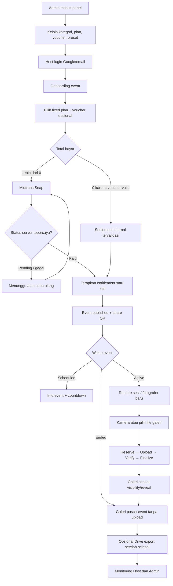
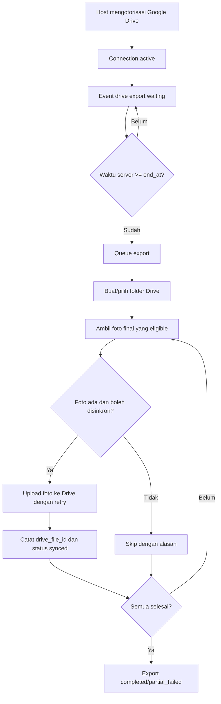
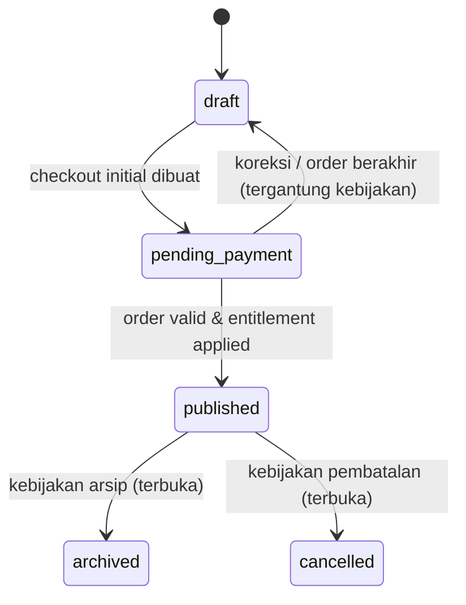

# GaleriKita — Alur Lengkap 3 Peran: Admin, Host, dan Fotografer

> **Versi dokumen:** 1.0  
> **Disusun:** 16 Oktober 2026  
> **Tujuan:** spesifikasi alur fungsional dan aturan bisnis dari persiapan platform, pembuatan event, penggunaan tamu, sampai pengarsipan.  
> **Dokumen acuan:** `GaleriKita_PRD_Lengkap_v1.md` dan `GaleriKita_Database_v4_Midtrans_No_Refund.dbml`.  
> **Cakupan database:** 28 tabel, 27 enum, 49 relasi FK pada DBML v4.  
> **Arsitektur:** website responsif; Laravel + Inertia.js 3 + React + TypeScript + PostgreSQL; Redis/queue; storage local saat development dan Cloudinary di production; Midtrans Snap; Google Drive opsional.  
> **Ketentuan:** *tidak ada refund dalam fitur aplikasi; tidak ada downgrade plan; durasi event selalu 24 jam.*

---

## Daftar isi

1. [Cara membaca, lingkup, dan istilah](#1-cara-membaca-lingkup-dan-istilah)
2. [Gambaran perjalanan produk end-to-end](#2-gambaran-perjalanan-produk-end-to-end)
3. [Hak akses tiga peran](#3-hak-akses-tiga-peran)
4. [Alur lengkap Admin](#4-alur-lengkap-admin)
5. [Alur lengkap Host](#5-alur-lengkap-host)
6. [Alur lengkap Fotografer](#6-alur-lengkap-fotografer)
7. [Alur lintas peran dan proses otomatis](#7-alur-lintas-peran-dan-proses-otomatis)
8. [Matriks status, waktu, privasi, dan akses](#8-matriks-status-waktu-privasi-dan-akses)
9. [Contoh skenario lengkap](#9-contoh-skenario-lengkap)
10. [Kesalahan, edge case, dan penanganannya](#10-kesalahan-edge-case-dan-penanganannya)
11. [Pemetaan ke 28 tabel database](#11-pemetaan-ke-28-tabel-database)
12. [Kriteria penerimaan dan checklist QA](#12-kriteria-penerimaan-dan-checklist-qa)
13. [Keputusan yang sudah final dan yang masih terbuka](#13-keputusan-yang-sudah-final-dan-yang-masih-terbuka)
14. [Urutan implementasi yang direkomendasikan](#14-urutan-implementasi-yang-direkomendasikan)

---

# 1. Cara membaca, lingkup, dan istilah

## 1.1. Konvensi keputusan

- **[FINAL]**: sudah disepakati dalam pembahasan GaleriKita; implementasi tidak boleh mengubah tanpa keputusan produk baru.
- **[REKOMENDASI]**: perilaku operasional yang disarankan supaya alur lengkap dan aman, tetapi belum dikonfirmasi sebagai kebijakan final.
- **[PERLU KEPUTUSAN]**: kebijakan masih terbuka; jangan menganggap contoh atau default sebagai keputusan pemilik produk.
- **MUST / wajib**: ketentuan yang harus dipenuhi jika fitur tersebut diimplementasikan.
- **P0 / P1**: prioritas fungsi. P0 adalah inti agar tiga alur berjalan; P1 adalah penguatan/pengembangan berikutnya.

Jika satu keputusan terbuka memengaruhi database, API, tampilan, atau pembayaran, developer perlu memperoleh keputusan sebelum fitur tersebut diluncurkan.

## 1.2. Tiga peran fungsional vs dua role akun

Produk mempunyai **tiga peran dalam pengalaman pengguna**, tetapi hanya **dua role pada tabel `users`**:

| Peran produk | Akses | Identitas database | Login? |
|---|---|---|---|
| **Admin** | Panel operasional sistem | `users.role = admin` | Ya, dengan akun terotorisasi |
| **Host / User** | Dashboard milik pembuat event | `users.role = user` | Wajib: Google atau email/password |
| **Fotografer / Guest** | Halaman event via link/QR | `event_guests` + `guest_sessions` | Tidak; input nama dan sesi browser |

**Penting:** Fotografer **bukan** `users.role = photographer`. Jangan membuat akun wajib atau menambahkan role ketiga di enum `user_role` hanya karena dokumen ini membagi alur menjadi tiga peran.

## 1.3. Definisi utama

| Istilah | Definisi |
|---|---|
| **Event** | Acara milik satu Host; punya kategori, sampul, jadwal, izin galeri, paket, link dan QR. |
| **Draft** | Data event selama onboarding, belum berhak menerima fotografer/upload. |
| **Published** | Event sudah menerima hak paket dari order awal yang sah dan `fulfillment_status = applied`. |
| **Scheduled** | Event yang telah published tetapi belum mencapai `start_at`. |
| **Active** | Event published dan waktu server berada pada `start_at <= now < end_at`. |
| **Ended** | Event published dan `now >= end_at`; upload baru ditutup, akses galeri tetap mengikuti izin. |
| **Fixed plan** | Paket dengan jumlah fotografer, kuota foto per fotografer, dan harga **ditetapkan admin**; Host tidak meng-custom. |
| **Plan version** | Revisi penawaran paket yang menyimpan harga dan kuota historis. |
| **Entitlement** | Hak plan/kuota aktif untuk event setelah pembayaran disahkan **dan** diterapkan. |
| **Guest session** | Token rahasia per fotografer/per event; digunakan untuk mengenali browser yang telah bergabung. |
| **Photo intent** | Reservasi kuota dan identitas upload sebelum file dikirim. |
| **Final photo** | Foto yang benar-benar disimpan: hasil filter/border saat kamera, atau file galeri sesuai kebijakan upload. |
| **Visibility** | `private` (tamu hanya foto sendiri) atau `public` (boleh melihat foto tamu lain sesuai reveal). |
| **Reveal** | `instant` atau `after_event`, berlaku pada **foto tamu lain dalam galeri public**. |
| **Order** | Niat pembelian paket awal/upgrade beserta snapshot nominal, diskon, dan status bisnis. |
| **Payment attempt** | Satu sesi pembayaran Midtrans untuk sebuah order. |
| **Fulfillment** | Penerapan pembelian yang sudah paid ke entitlement/event. |
| **Drive export** | Penyalinan foto final ke Google Drive Host **setelah** event selesai, jika koneksi diaktifkan. |

## 1.4. Batasan produk yang final

1. [FINAL] Hanya website responsif; **tidak membangun aplikasi Android/iOS native**.
2. [FINAL] Host harus login sebelum membuat event.
3. [FINAL] Acara **selalu berlangsung tepat 24 jam**; Host memilih waktu mulai, akhir dihitung sistem.
4. [FINAL] Setelah `start_at` terlewati, waktu mulai/selesai tidak bisa diubah.
5. [FINAL] Tautan event tetap dapat dibuka setelah event selesai, untuk melihat/mengunduh foto sesuai izin dan menghapus foto sendiri; tidak boleh upload baru.
6. [FINAL] Fotografer dalam mode Private tetap bisa langsung melihat foto sendiri; Host selalu dapat melihat semua foto di event-nya.
7. [FINAL] Jika browser yang sama masih memiliki guest session valid, scan ulang QR **memulihkan sesi, tanpa memakai slot baru**; browser/perangkat lain tanpa token valid memakai slot baru.
8. [FINAL] Kuota fotografer **dan** kuota foto per fotografer ditentukan oleh **fixed plan buatan Admin**.
9. [FINAL] Pembayaran awal mengaktifkan event; upgrade membayar **selisih harga katalog**; **tidak ada downgrade**.
10. [FINAL] Fotografer bisa menghapus foto miliknya bahkan setelah event berakhir; Host bisa menghapus foto di event-nya termasuk semua sekaligus.
11. [FINAL] Sinkronisasi ke Google Drive, bila diaktifkan, **baru dimulai setelah event selesai**. Foto yang sudah masuk Drive **tidak ikut terhapus** ketika salinan GaleriKita dihapus.
12. [FINAL] Filter warna dan border dipilih **sebelum shutter**, bukan setelah capture. Foto mentah kamera tidak perlu disimpan.
13. [FINAL] Platform tidak menyediakan fitur refund maupun proses downgrade.

---

# 2. Gambaran perjalanan produk end-to-end

## 2.1. Urutan dari persiapan sampai selesai

**Fase 0 — Admin menyiapkan platform:** kategori event, katalog fixed plans beserta versinya, voucher (jika ada), dan preset kamera. Tanpa plan yang aktif, Host tidak dapat menyelesaikan checkout.

**Fase 1 — Host masuk dan membuat event:** login, melewati wizard kategori → nama/sampul → jadwal mulai 24 jam → visibilitas → reveal → fixed plan → ringkasan/voucher → pembayaran.

**Fase 2 — Sistem mengaktifkan event:** Laravel menerima hasil pembayaran yang dipercaya (webhook/Status API atau penyelesaian internal order diskon penuh), lalu menerapkan entitlement tepat satu kali. Host mendapat link dan QR; sebelum waktu mulai, fotografer hanya melihat halaman informasi.

**Fase 3 — Fotografer menggunakan event:** saat Active, scan QR, pulihkan sesi atau input nama, masuk kamera/unggah galeri, menerima kuota, mengambil foto, melihat/like/mengunduh/menghapus sesuai izin.

**Fase 4 — Host dan Admin mengawasi:** Host memantau jumlah peserta/foto, mengatur privasi, menghapus foto, dan melakukan upgrade berbayar bila diperlukan. Admin memantau kualitas layanan, pembayaran, voucher, kegagalan upload, dan moderasi sesuai kewenangan.

**Fase 5 — Event berakhir:** pada `end_at`, server menolak pendaftaran baru (rekomendasi) dan upload baru; sesi yang valid masih bisa memakai galeri. Jika Public + After Event, foto tamu lain mulai boleh dilihat. Google Drive export yang telah dikonfigurasi mulai diproses.

**Fase 6 — Pasca-event:** Host melihat progres Drive/galeri/transaksi; fotografer yang punya sesi sah melihat dan mengunduh foto, serta menghapus foto miliknya; status arsip dan masa retensi mengikuti kebijakan yang masih perlu diputuskan.

## 2.2. Diagram alur utama



## 2.3. Prinsip lintas peran

- **Database/server adalah sumber kebenaran** untuk waktu, kuota, harga, kepemilikan, hak melihat foto, dan status pembayaran.
- React boleh memberi respons UI cepat (Instant Visits, Deferred Props, skeleton) tetapi tidak boleh melewati pengecekan Laravel.
- File media selalu diakses lewat mekanisme yang mematuhi permission; mengetahui link/URL storage tidak boleh menjadi jalan pintas untuk melihat foto Private.
- Setiap pembayaran/penggunaan voucher/upload/upgrade harus aman terhadap retry, webhook duplikat, dan permintaan paralel.
- Event yang sudah `paid` tetapi entitlement belum `applied` **belum boleh** menerima fotografer/upload.

---

# 3. Hak akses tiga peran

| Tindakan | Admin | Host | Fotografer |
|---|---|---|---|
| Login akun platform | Ya | Ya | Tidak perlu |
| Kelola semua akun user | Ya, berizin | Tidak | Tidak |
| Kelola kategori event | Ya | Pilih yang aktif | Tidak |
| Buat/update fixed plan dan versi harga | Ya | Memilih saja | Tidak |
| Buat dan kelola voucher | Ya | Memakai jika memenuhi syarat | Tidak |
| Kelola preset warna dan border | Ya | Tidak | Memilih yang aktif sebelum foto |
| Buat event | Bukan alur konsumsi Admin | Ya, setelah login | Tidak |
| Edit event | Pengawasan/moderasi terbatas | Miliknya sendiri | Tidak |
| Bayar plan/upgrade | Monitoring | Ya | Tidak |
| Membagikan QR | Operasional jika diperlukan | Ya | Bisa meneruskan tautan yang diterima |
| Bergabung jadi fotografer | Bukan hak otomatis sebagai Admin | Dapat masuk melalui alur guest terpisah | Ya, saat Active |
| Upload foto | Tidak melalui panel Admin | Melalui sesi fotografer jika ikut event | Ya, saat Active dan kuota masih ada |
| Melihat semua foto | Hanya untuk moderasi sah dan diaudit | Semua foto event miliknya | Bergantung visibility/reveal |
| Melihat foto sendiri | Tidak relevan | Semua miliknya sebagai Host | Ya, segera |
| Like foto orang lain | Tidak melalui panel Admin | Melalui sesi fotografer jika ikut event | Ya, jika foto terlihat dan fitur diperbolehkan |
| Menghapus foto event | Moderasi sah & tercatat | Satu/batch/semua | Hanya fotonya sendiri |
| Hubungkan Drive untuk ekspor | Tidak atas nama Host | Ya | Tidak |
| Monitoring webhook dan rekonsiliasi | Ya | Status order sendiri | Tidak |

**Pemisahan identitas:** Host yang ingin ikut memotret harus mengikuti alur guest. Akun Host tidak otomatis membuat `event_guests` atau memakai kuota tanpa keputusan bisnis khusus.

---

# 4. Alur lengkap Admin

> **Prasyarat:** Admin memiliki akun valid `users.role=admin`. Operasi Admin dilindungi autentikasi, otorisasi, dan audit. Bagian ini diurutkan dari konfigurasi sebelum penjualan hingga operasi saat dan setelah acara.

## A-01 — Masuk ke panel Admin [P0]

**Tujuan:** hanya petugas berwenang dapat mengakses pengelolaan platform.

1. Admin membuka halaman login panel Admin.
2. Admin memasukkan kredensial yang diizinkan sistem (Google atau email sesuai mekanisme akun).
3. Laravel mengautentikasi akun, memeriksa `users.role` dan kondisi akun.
4. Jika role `admin`, arahkan ke Dashboard Admin; jika role `user`, tolak akses Admin dan arahkan ke area Host.
5. Catat perubahan/kejadian keamanan yang relevan tanpa menyimpan password/token mentah.

**Jika gagal:** kredensial salah menampilkan kesalahan generik; akses tidak berizin memberikan 403/redirect sesuai kebijakan. **Data:** `users`, `social_accounts`, `activity_logs`.

## A-02 — Melihat dashboard dan kesehatan platform [P0]

1. Dashboard menampilkan jumlah Host, event (draft, published, scheduled, active, ended), fotografer, foto, order paid/pending, nilai transaksi berhasil, dan masalah operasional.
2. Admin dapat memilih filter rentang waktu/status dan membuka daftar/detail asal angka statistik.
3. Widget perhatian khusus menampilkan `orders.status=paid` tetapi `fulfillment_status != applied`, payment `requires_review`, webhook gagal, dan Drive export gagal.
4. Semua daftar besar memakai pagination; statistik diperbarui tanpa memuat seluruh row ke React.

**Aturan:** jumlah event Active dihitung dari waktu server dan status published, bukan dari status enum `active` tersendiri. Total pemasukan didasarkan pada order paid terverifikasi; nominal adalah transaksi, bukan laba bersih. **Data:** `users`, `events`, `orders`, `payments`, `event_entitlements`, `photos`, `media_assets`, `event_drive_exports`, `activity_logs`.

## A-03 — Mengelola akun Host/User [P0]

1. Admin membuka **Users** dan melihat daftar nama, email, tanggal daftar, role, metode login, serta jumlah event milik akun.
2. Admin mencari berdasarkan nama/email, memfilter role, dan membuka detail akun beserta event/transaksi.
3. Jika fitur manajemen role/penonaktifan tersedia, setiap perubahan melewati policy, konfirmasi, dan pencatatan audit.
4. Akun Host yang login dengan Google memiliki relasi di `social_accounts`; akun email/password memakai hash `users.password`, tidak boleh dibaca Admin.
5. Fitur lupa password dikelola melalui alur reset terpisah, bukan Admin mengirim password pengguna.

**[PERLU KEPUTUSAN]:** cakupan penonaktifan/hapus akun dan dampaknya pada event yang telah dibayar. **Data:** `users`, `social_accounts`, `password_reset_tokens`, `events`, `activity_logs`.

## A-04 — Mengelola kategori event [P0]

1. Admin membuka **Event Categories**.
2. Klik **Tambah Kategori**, isi nama (`Pernikahan`, `Ulang Tahun`, `Perjalanan`, `Wisuda`, dll.), slug, deskripsi, dan urutan.
3. Sistem memastikan slug unik; kategori dibuat sebagai `is_active=true` atau disimpan nonaktif untuk persiapan.
4. Admin dapat mengubah nama, deskripsi, urutan, serta status aktif.
5. Kategori aktif muncul pada langkah pertama onboarding Host.
6. Menonaktifkan kategori hanya mencegah pemilihan baru; event historis tetap menunjuk kategori tersebut.

**Contoh:** kategori `Pernikahan / pernikahan` dipilih oleh Host ketika membuat event. **Data:** `event_categories`, `events.event_category_id`, `activity_logs`.

## A-05 — Membuat fixed plan dan menerbitkan versi harga [P0]

1. Admin membuka **Plans** → **Tambah Plan**.
2. Isi identitas paket: `code`, `name`, `description`, `sort_order`, `is_active` pada `plans`.
3. Buat versi penawaran pada `plan_versions` berisi `version_number`, `photographer_limit`, `photos_per_photographer`, `price_idr`.
4. Validasi: kedua kuota bilangan bulat > 0, harga sesuai aturan bisnis; Host **tidak mempunyai input untuk mengubah dua kuota tersebut**.
5. Tinjau kartu plan: nama, harga, fotografer maksimum, foto/orang, dan potensi total maksimum foto.
6. Publikasikan versi dengan `published_at` dan `is_current=true`. Hanya **satu versi current untuk setiap plan**.
7. Untuk mengubah harga/kapasitas paket yang sudah dijual, **buat versi baru**; jangan menimpa penawaran historis.
8. Jika perlu menutup penjualan, set plan `is_active=false`; event yang telah membeli tetap memegang snapshot entitlement semula.

**Contoh ilustrasi:** `Celebration v1: 50 fotografer × 20 foto/orang = 1.000 foto; Rp79.000`; kemudian Admin menerbitkan `v2: Rp89.000`. Pembeli v1 tetap memiliki hak v1. **Data:** `plans`, `plan_versions`, `orders`, `event_entitlements`, `activity_logs`.

## A-06 — Membuat dan mengelola voucher [P0]

1. Admin membuka **Vouchers** → **Tambah Voucher**.
2. Isi kode unik, nama, deskripsi, jenis diskon `percentage` atau `fixed`, `discount_value`, cap `max_discount_idr` bila berlaku, dan minimum subtotal `min_order_idr`.
3. Tentukan cakupan `initial`, `upgrade`, atau `both`.
4. Tetapkan batas penggunaan global (`usage_limit`) dan per Host (`usage_limit_per_user`), masa aktif mulai/sampai, dan status aktif.
5. Jika voucher hanya berlaku untuk plan tertentu, pilih plan; buat relasi `voucher_plans`. Jika **tidak ada baris pembatas** untuk voucher, berlaku untuk semua plan yang memenuhi syarat.
6. Simpan, pratinjau, aktifkan, dan bagikan **kode** kepada pengguna yang ditargetkan (mekanisme distribusi di luar cakupan inti).
7. Pantau penggunaan `reserved`, `redeemed`, `released`; penonaktifan tidak mengubah histori order yang sudah dibuat.

**Validasi:** kode dinormalisasi; persentase 1–100; fixed >0; diskon ≤ subtotal; minimum pembelian diuji pada **subtotal sebelum diskon**; cek tanggal dan limit secara transaksional, termasuk reservasi yang masih sah.

**Contoh:** `LAUNCH20` = diskon 20%, maksimum potongan Rp30.000, minimum subtotal Rp50.000, hanya initial, maksimal 100 kali dan satu per akun. **Data:** `vouchers`, `voucher_plans`, `voucher_redemptions`, `orders`, `plans`, `users`, `activity_logs`.

## A-07 — Mengelola preset kamera: warna dan border [P0]

1. Admin membuka **Photo Presets**.
2. Pilih jenis `color` atau `border`, masukkan nama, kode, dan `effect_settings` (JSON konfigurasi efek, bukan JavaScript yang dapat dijalankan).
3. Atur thumbnail/preview preset (jika tersedia), urutan, dan aktif/nonaktif.
4. Render preview untuk memeriksa warna, border, posisi, dan performa pada browser mobile.
5. Simpan preset baru atau terbitkan revisi versi sebelum mengubah efek yang telah dikenal pengguna.
6. Hanya preset aktif ditampilkan pada antarmuka kamera. Foto yang sudah diambil **tidak berubah**, karena file hasil final telah menyimpan efek saat capture.

**Data:** `photo_presets`, `media_assets`, `photos.filter_snapshot`, `activity_logs`.

## A-08 — Memantau semua event [P0]

1. Admin membuka **Events** dan melihat host, kategori, jadwal, status admin, status waktu turunan, plan aktif, fotografer, dan jumlah foto.
2. Admin memfilter Scheduled, Active, Ended atau status Draft/Pending/Published/Cancelled/Archived.
3. Admin membuka detail event untuk meninjau pengaturan, kegiatan, kapasitas, dan error tanpa otomatis menjadikan foto privat sebagai konten publik.
4. Dalam keadaan penyalahgunaan, petugas berwenang dapat melakukan tindakan moderasi sesuai kebijakan yang berlaku; setiap tindakan dicatat.
5. Status `cancelled` atau `archived` ada dalam DB, tetapi **prosedur pembatalan, dampak akses, dan retensinya masih [PERLU KEPUTUSAN]**.

**Data:** `events`, `event_categories`, `event_settings`, `event_entitlements`, `event_guests`, `photos`, `activity_logs`.

## A-09 — Moderasi foto dan penyimpanan [P1]

1. Admin membuka detail event → daftar foto berbasis metadata dan status.
2. Bila ada laporan/indikasi pelanggaran, petugas dengan izin dapat meninjau foto secara terbatas dan terlog.
3. Aksi yang dapat diimplementasikan: `hidden` (foto tidak ditampilkan kepada tamu) atau `deleted` (menonaktifkan akses dan menjadwalkan cleanup provider).
4. Penghapusan file GaleriKita **tidak menghapus salinan yang sudah tersinkron ke Drive**.
5. Jangan tampilkan URL media rahasia, token, atau gambar private ke dashboard umum/analytics.

**Catatan:** database v4 belum mempunyai tabel `photo_reports`, sehingga alur pelaporan tamu formal **belum merupakan fitur yang dibangun**. **Data:** `photos`, `media_assets`, `photo_variants`, `event_guests`, `photo_drive_syncs`, `activity_logs`.

## A-10 — Memantau order, pembayaran Midtrans, dan fulfillment [P0]

1. Admin membuka **Orders & Payments** dan melihat order initial/upgrade, host, event, versi paket, subtotal, voucher, discount, `amount_due_idr`, dan status.
2. Admin membuka satu order untuk melihat semua percobaan pembayaran (`payments`), setiap Midtrans order ID, environment, expiry halaman Snap, expiry transaksi gateway, dan status aslinya.
3. Notifikasi Midtrans (`payment_webhooks`) direkam, signature diverifikasi, nominal dan referensi transaksi dicocokkan, serta kondisi status diperiksa. Callback frontend tidak boleh langsung mengubah status paid.
4. Jika status masih ambigu, Admin menjalankan rekonsiliasi **server-to-server** lewat Midtrans Status API (bukan menekan tombol "mark paid" tanpa bukti).
5. Order paid → sistem mencoba fulfillment. Bila sukses, `fulfillment_status=applied`; bila terjadi konflik upgrade/double payment, menjadi `requires_review` dengan alasan tercatat.
6. Admin meninjau kasus `requires_review` secara terbatas dan tidak mengedit harga snapshot/histori secara diam-diam.
7. **Tidak ada** tombol request refund atau downgrade pada website.

**Data:** `orders`, `payments`, `payment_webhooks`, `event_plan_changes`, `event_entitlements`, `voucher_redemptions`, `activity_logs`.

## A-11 — Mengawasi reservasi/pemakaian voucher [P0]

1. Admin membuka tab **Voucher Redemptions**.
2. Filter per voucher, Host, order, dan status `reserved/redeemed/released`.
3. Satu reservasi aktif mengonsumsi kapasitas promosi sesuai aturan limit hingga transaksi berakhir secara sah.
4. Reservasi tidak dilepas hanya karena pengguna menutup popup Snap atau token halaman Snap kedaluwarsa, jika pembayaran pada metode pilihan masih mungkin diselesaikan.
5. Order yang paid mengubah redemption menjadi `redeemed`; yang benar-benar ditutup tanpa pembayaran mengubahnya menjadi `released`.
6. Anomali/retry didokumentasikan agar laporan penggunaan voucher dan pendapatan tidak salah.

**Data:** `vouchers`, `voucher_plans`, `voucher_redemptions`, `orders`, `payments`.

## A-12 — Memantau koneksi dan ekspor Google Drive [P1]

1. Admin melihat status koneksi Google Drive yang digunakan Host: `active`, `needs_reauth`, `revoked`.
2. Daftar export event menampilkan `waiting/queued/syncing/completed/partial_failed/failed/disabled`.
3. Lihat total foto berhasil/gagal dan job per file; izinkan retry yang aman bila `end_at` telah lewat dan OAuth masih valid.
4. Jika koneksi kadaluwarsa/revoked, tandai kebutuhan autentikasi ulang; beri informasi kepada Host.
5. Token OAuth hanya tersedia melalui penyimpanan terenkripsi bagi proses backend; tidak ditampilkan pada Admin UI/log.

**Data:** `google_drive_connections`, `event_drive_exports`, `photo_drive_syncs`, `media_assets`.

## A-13 — Audit log dan tugas sistem [P0]

1. Admin membuka **Activity Logs** untuk perubahan role, plan, harga, voucher, event, privasi, pembayaran/fulfillment, foto, dan Drive.
2. Filter pelaku (`user`, `guest`, `system`), event, action, subject, dan waktu.
3. Detail log menampilkan perubahan yang aman (misalnya `visibility: private → public`) tanpa password, token Snap, atau token Drive.
4. Scheduler/queue memproses cleanup intent expired, webhook failed, provider orphan, sinkronisasi, dan observabilitas.
5. Tindakan otomasi penting ditandai sebagai `actor_type=system`.

**Data:** `activity_logs`, tabel sumber masing-masing modul. **Hasil:** perubahan sensitif dapat ditelusuri secara audit tanpa membocorkan rahasia.

---
# 5. Alur lengkap Host

> **Prasyarat:** Host menggunakan akun `users.role=user`; satu Host dapat membuat dan mengelola banyak event. Semua operasi event harus memeriksa `events.user_id` = akun login.

## H-01 — Mengunjungi website, mendaftar, dan login [P0]

1. Host membuka landing page GaleriKita; melihat penjelasan produk, cara kerja, contoh penggunaan, dan katalog harga bila ditampilkan.
2. Host memilih **Masuk/Daftar** atau **Buat Event**.
3. Bila belum login, sistem mengarahkan ke halaman autentikasi, **tidak** langsung membuat event aktif.
4. Host memilih salah satu metode:
   - **Google:** OAuth login; identitas Google disimpan di `social_accounts`, dikaitkan dengan satu `users`.
   - **Email/password:** registrasi akun dengan nama, email, password; password disimpan sebagai hash. Email verification **[PERLU KEPUTUSAN]** apakah wajib untuk melanjutkan pembelian.
5. Jika sebelumnya sudah memiliki akun dengan email sama, proses penautan akun sosial harus aman; tidak sembarang menggabungkan dua identitas hanya karena email sama.
6. Setelah login berhasil, arahkan ke Dashboard Host atau lanjutkan maksud awal **Buat Event**.
7. Host dapat menggunakan fitur lupa password untuk akun yang memakai password; login dengan Google tidak otomatis memberikan password lokal.

**Gagal/terhalang:** OAuth ditolak → kembali ke login dengan pesan jelas; email sudah dipakai → arahkan login/pemulihan; sesi habis di tengah onboarding → data draft tetap tersedia jika sudah tersimpan. **Data:** `users`, `social_accounts`, `password_reset_tokens`.

## H-02 — Dashboard Host dan daftar event [P0]

1. Dashboard berisi CTA **Buat Event**, daftar event sendiri, ringkasan event Active/Scheduled/Ended, serta status pembayaran yang perlu dilanjutkan.
2. Setiap kartu event menampilkan foto sampul, nama, kategori, jadwal 24 jam, status administratif/waktu, plan, peserta terpakai, dan total foto.
3. Klik kartu membuka detail event; event yang masih Draft/Pending Payment diarahkan untuk melanjutkan onboarding atau pembayaran.
4. Tampilkan skeleton untuk statistik/list yang dimuat bertahap, dan pagination jika event banyak.
5. Host tidak dapat membuka event milik akun lain dengan mengubah ID di URL.

**Data:** `events`, `event_categories`, `media_assets`, `event_entitlements`, `orders`, `photos`.

## H-03 — Memulai wizard pembuatan event [P0]

1. Host menekan **Buat Event**.
2. Laravel membuat **draft event** (atau menyimpan tiap tahap wizard dan kemudian membuat draft) di `events`, status `draft`, owner = user yang login, serta `public_slug` unik acak.
3. Progress wizard ditampilkan agar Host mengetahui langkah yang sedang berlangsung.
4. Setiap langkah divalidasi sebelum melanjutkan; Host dapat kembali ke langkah sebelumnya selama tidak melanggar aturan.
5. **[REKOMENDASI]** Simpan draft secara bertahap agar browser tertutup/tidak sengaja refresh tidak menghilangkan semua data.
6. Draft **tidak** memberi hak upload, meskipun sudah mempunyai slug internal.

**Data:** `events`, `event_settings`. **Hasil:** draft yang terikat ke Host dan siap dilengkapi.

## H-04 — Wizard langkah 1: pilih kategori event [P0]

1. Tampilkan kategori `event_categories.is_active=true` yang diurutkan oleh `sort_order`.
2. Host memilih **satu** kategori (contoh Pernikahan, Ulang Tahun, Perjalanan, Wisuda).
3. Sistem menyimpan `events.event_category_id`.
4. Jika kategori dinonaktifkan oleh Admin di sela wizard, Host harus memilih kategori valid saat submit terakhir.
5. Host dapat mengubah kategori pada langkah ini maupun di Settings setelah event dibuat.

**Data:** `event_categories`, `events`.

## H-05 — Wizard langkah 2: nama dan sampul [P0]

1. Host mengisi **nama event** (contoh: `Pernikahan Dina & Arga`).
2. Host memilih foto sampul dari perangkat; tampilan memperlihatkan preview dan kemampuan mengganti file.
3. Backend memeriksa format/ukuran yang diizinkan; angka maksimal final **[PERLU KEPUTUSAN]**.
4. Upload sampul memakai adapter media: `local` selama development, `cloudinary` saat production.
5. File dibuat sebagai entri `media_assets` lalu direferensikan oleh `events.cover_media_asset_id`.
6. Jika diganti, media baru ditautkan lebih dahulu dan media lama dibersihkan dengan aman agar event tidak tiba-tiba tanpa sampul.
7. Nama dan cover masih boleh diedit setelah event berlangsung.

**Data:** `events`, `media_assets`.

## H-06 — Wizard langkah 3: tentukan jadwal 24 jam [P0]

1. Host memilih **tanggal dan jam mulai** beserta zona waktu tampilan yang didukung, default `Asia/Jakarta`.
2. UI secara otomatis memperlihatkan **tanggal/jam selesai = mulai + tepat 24 jam**, tanpa field durasi terpisah.
3. Laravel menyimpan kedua waktu dengan tipe timezone-aware, `events.start_at`, `events.end_at`, `events.timezone`.
4. Server memvalidasi bahwa `end_at = start_at + interval '24 hours'` dan tanggal/jam mulai memenuhi kebijakan pemesanan **[PERLU KEPUTUSAN]** untuk lead time minimum dan apakah jadwal lampau diperbolehkan.
5. Selama waktu mulai **belum terlewati**, Host boleh mengubah jadwal, termasuk setelah payment applied jika event masih Scheduled.
6. Saat `now >= start_at`, **kedua waktu terkunci permanen**, termasuk setelah event Ended.

**Contoh:** mulai `10 November 2026, 12.00 WIB` → akhir `11 November 2026, 12.00 WIB`. Periode upload valid adalah `[start_at, end_at)`; tepat pada akhir tidak boleh membuat upload baru.

**Data:** `events`.

## H-07 — Wizard langkah 4: izin melihat galeri [P0]

1. Host memilih **Private** atau **Public**; simpan ke `event_settings.visibility`.
2. **Private:** fotografer hanya dapat melihat foto sendiri sejak foto siap; Host melihat seluruh foto.
3. **Public:** fotografer dapat melihat foto orang lain sesuai pengaturan reveal pada langkah berikutnya.
4. UI menjelaskan konsekuensi privasi dalam bahasa sederhana sebelum Host melanjutkan.
5. Setelah event dibuat, Host bisa mengubah Private ↔ Public; sistem harus segera menerapkan policy akses media berdasarkan setting terbaru.
6. Berikan peringatan bahwa foto yang **sudah diunduh** orang lain tidak bisa ditarik kembali saat pengaturan berubah menjadi Private.

**Data:** `event_settings`.

## H-08 — Wizard langkah 5: tentukan kapan foto ditampilkan [P0]

1. Host memilih **Instant** atau **After Event**; simpan ke `event_settings.photo_reveal_mode`.
2. **Instant:** ketika galeri Public, foto orang lain terlihat segera setelah foto berstatus `ready`.
3. **After Event:** ketika galeri Public, foto orang lain disembunyikan selama event dan baru terlihat pada/ setelah `end_at`.
4. Dalam Private, pilihan reveal tidak mengubah hak lihat foto orang lain: mereka tetap tersembunyi.
5. **Foto sendiri selalu terlihat langsung pada mode Private** [FINAL]. **Untuk Public + After Event**, menampilkan foto sendiri langsung adalah **[REKOMENDASI]**, belum keputusan final eksplisit.
6. Host dapat mengubah reveal setelah event dibuat; perubahan hanya mengatur akses mendatang dan tidak dapat mencabut file yang sudah terunduh.

**Data:** `event_settings`, dengan kebijakan aplikasi saat membaca `photos`.

## H-09 — Wizard langkah 6: pilih fixed plan [P0]

1. Sistem menampilkan hanya plan `plans.is_active=true` yang mempunyai `plan_versions.is_current=true` dan `published_at` terisi.
2. Setiap kartu memperlihatkan nama/deskripsi plan, harga, maksimal fotografer, batas upload foto **per fotografer**, dan total kapasitas teoritis.
3. Host memilih **satu** plan yang disediakan Admin. Tidak ada slider, input jumlah fotografer, atau harga custom.
4. Frontend mengirim **ID versi plan**, bukan mengirim harga atau kuota yang dianggap tepercaya.
5. Laravel mengambil harga/kuota versi plan dari database ketika membuat order dan menyimpan snapshot di `orders`.
6. Jika plan baru saja dinonaktifkan/diganti versi, tampilkan pesan bahwa pilihan harus diperbarui, tanpa membebankan harga lama diam-diam.

**Contoh ilustrasi:** Celebration v1: 50 fotografer, 20 foto per fotografer, Rp79.000; 1.000 foto adalah maksimum teoritis, bukan satu pool yang bisa digunakan siapa saja. **Data:** `plans`, `plan_versions`, `orders`.

## H-10 — Wizard langkah 7: ringkasan + voucher + checkout [P0]

1. Host melihat ringkasan kategori, nama, cover, jam mulai/selesai, setting galeri/reveal, dan fixed plan.
2. Host dapat kembali mengoreksi data yang diperbolehkan.
3. Host memasukkan kode voucher (opsional) dan klik **Gunakan**.
4. Laravel menormalisasi/mencari voucher dan memeriksa: aktif, berada dalam masa berlaku, berlaku untuk `initial`, plan termasuk target, minimum subtotal, batas pemakaian global/per akun, serta nominal diskon.
5. UI menampilkan: **harga plan katalog (subtotal) − diskon = total bayar**. Voucher maksimum hanya satu per order.
6. Host menyetujui ringkasan dan klik **Bayar/Buat Event**. Server membuat `orders.type=initial` dan, bila memakai voucher, `voucher_redemptions.status=reserved` secara aman terhadap checkout bersamaan.
7. Jika total **lebih dari Rp0**, server membuat payment attempt `payments` unik, meminta Snap Token melalui backend, lalu frontend menampilkan Midtrans Snap.
8. Jika total **Rp0 akibat voucher penuh yang sah**, server menyelesaikan order secara internal, mengubah voucher menjadi redeemed, dan menerapkan entitlement **tanpa** membuat transaksi Midtrans Rp0.
9. Setelah order dibuat, event dapat berstatus administratif `pending_payment`; **belum** menerima guest dan belum aktif upload.

**Jika voucher invalid:** kode tidak mengurangi harga dan ditampilkan alasannya. **Jika Snap gagal dibuat:** order tetap tercatat dengan kondisi benar; dapat mencoba ulang membuat payment attempt tanpa duplikasi order bisnis.

**Data:** `events`, `plans`, `plan_versions`, `orders`, `vouchers`, `voucher_plans`, `voucher_redemptions`, `payments`.

## H-11 — Menyelesaikan pembayaran Midtrans [P0]

1. Host memilih metode pembayaran yang disediakan Snap (misalnya QRIS/transfer sesuai konfigurasi merchant).
2. Bila belum membayar, UI menampilkan **Pending** dan petunjuk melanjutkan transaksi.
3. Callback dan redirect Snap hanya memperbarui tampilan; **tidak otomatis mengaktifkan event**.
4. Midtrans mengirim notifikasi ke backend; signature dan status diverifikasi, termasuk ID attempt dan nominal. Bila notifikasi terlambat/ambigu, backend memeriksa Midtrans Status API.
5. Setelah pembayaran valid, `payments.status=paid`, `orders.status=paid`, voucher reserved → redeemed, kemudian fulfillment dilakukan tepat satu kali.
6. Fulfillment awal membuat `event_entitlements` dan menyetel `events.status=published` serta `activated_at`, kemudian `orders.fulfillment_status=applied`.
7. Hanya setelah *applied*, Host melihat event siap dibagikan.
8. Jika terjadi masalah fulfillment setelah paid, status menjadi `requires_review`; tampilkan keadaan nyata, **jangan** menerbitkan QR yang dapat dipakai mengunggah sampai selesai.

**Perlu dicatat:** status `paid` dan `applied` adalah hal berbeda. **Data:** `payments`, `payment_webhooks`, `orders`, `event_entitlements`, `event_plan_changes`, `voucher_redemptions`, `events`.

## H-12 — Menangani pembayaran pending, gagal, atau kedaluwarsa [P0]

1. Host yang keluar dari Snap dapat kembali ke daftar transaksi/event pending.
2. Jika Snap Token masih sah, host bisa **Lanjutkan Pembayaran** menggunakan attempt yang sama.
3. Jika halaman Snap habis tetapi transaksi metode pembayaran mungkin masih aktif, Laravel harus rekonsiliasi sebelum membuat attempt baru atau melepas voucher.
4. Jika attempt benar-benar failed/expired/cancelled dan tidak ada pembayaran yang masih bisa lunas, server mengizinkan **Coba Lagi** dengan payment attempt baru dan `provider_order_id` Midtrans baru yang unik (maksimal 50 karakter).
5. Semua attempt tetap terkait ke **satu order**; tidak boleh membuat event/entitlement dobel.
6. Jika order batal/expired secara bisnis dan user hendak memilih plan atau voucher baru, buat order baru dengan snapshot yang benar (jangan mengubah histori order paid).
7. Host tidak dapat menggunakan layanan yang belum dibayar dan belum applied.

**Data:** `orders`, `payments`, `payment_webhooks`, `voucher_redemptions`.

## H-13 — Menerima link, QR, dan membagikan event [P0]

1. Setelah published/applied, detail event menampilkan URL unik misalnya `https://galerikita.id/e/{public_slug}`.
2. Sistem menampilkan QR yang berisi URL tersebut; Host dapat copy link, share, dan unduh QR untuk poster/undangan.
3. Host boleh membagikan QR sebelum event mulai; halaman tamu hanya menampilkan informasi/countdown.
4. QR tidak mengandung token akun Host, password, data pembayaran, atau URL storage foto.
5. Tautan tetap mengarah ke event setelah berakhir, tetapi berubah menjadi mode gallery-only yang tunduk pada izin.

**Data:** `events.public_slug`, `event_entitlements`, `event_settings`.

## H-14 — Mengelola dashboard event [P0]

1. Host membuka event sendiri; menu yang disarankan: **Overview, Gallery, Photographers, Settings, Plan & Billing, Share QR, Google Drive**.
2. Overview menampilkan nama, cover, kategori, jadwal, countdown/sisa waktu, status waktu, plan aktif, fotografer terpakai/sisa, jumlah foto, serta progres Drive bila ada.
3. Statistik berat dimuat deferred agar layout cepat terbuka dan skeleton menggantikan angka/data yang belum siap.
4. Seluruh data event harus difilter berdasarkan pemilik akun.
5. Jika event masih Scheduled, UI menegaskan bahwa upload belum dimulai; jika Ended, UI menegaskan upload sudah ditutup.

**Data:** `events`, `event_settings`, `event_entitlements`, `event_guests`, `photos`, `event_drive_exports`.

## H-15 — Mengubah informasi dan konfigurasi event [P0]

1. Buka **Settings** → edit nama, kategori, cover, visibility, reveal.
2. Jika event belum mencapai waktu mulai, Host juga boleh mengubah `start_at`; sistem menghitung ulang `end_at = start_at +24 jam`.
3. Bila `now >= start_at`, input waktu mulai dan selesai dikunci oleh UI **dan validasi Laravel**; tidak ada endpoint tersembunyi untuk mengubah keduanya.
4. Plan tidak dapat diganti lewat form; hanya melalui alur **Upgrade** yang berhasil dibayar.
5. Ketika mengganti Public→Private atau Instant→After Event, tampilkan dialog konsekuensi akses yang berlaku ke request berikutnya.
6. Simpan perubahan bersama audit (`activity_logs`); jika update gagal, tampilkan kesalahan dan jangan berpura-pura pengaturan tersimpan.

**Data:** `events`, `event_settings`, `media_assets`, `activity_logs`.

## H-16 — Memantau fotografer dan kuota [P0]

1. Buka tab **Photographers**; tampilkan nama tampilan, waktu join, status, foto sukses (`uploads_used`), upload direservasi (`uploads_reserved`), dan kuota per orang.
2. Ringkasan atas menampilkan `photographers_used / photographer_limit`.
3. Jika paket penuh, fotografer yang **belum memiliki sesi** tidak dapat join; fotografer dengan sesi valid tetap boleh masuk.
4. Host dapat melihat kebutuhan upgrade; tidak dapat menaikkan slot maupun foto/orang secara manual.
5. Fitur blokir tamu berdasarkan `guest_status=blocked` **[REKOMENDASI]**; efeknya terhadap pengembalian slot **[PERLU KEPUTUSAN]**.
6. Data guest di event lain tidak dapat dilihat Host ini.

**Data:** `event_guests`, `guest_sessions` (validasi backend, token tidak ditampilkan), `event_entitlements`, `photos`.

## H-17 — Mengelola galeri event [P0]

1. Buka tab **Gallery**; semua foto `ready` di event sendiri terlihat bagi Host, baik event Private, Public, maupun belum reveal.
2. Grid memakai thumbnail, lazy loading, pagination/infinite scroll, skeleton, dan lightbox preview; setiap foto mencantumkan pemilik, waktu, dan jumlah like sesuai kebutuhan UI.
3. Host dapat mengunduh foto final yang telah diizinkan oleh sistem.
4. Host dapat **menghapus satu foto, beberapa foto, atau seluruh foto** di event dengan konfirmasi terutama untuk penghapusan massal.
5. Setelah konfirmasi, foto menjadi `deleted`, akses dari galeri ditutup, dan cleanup media/variant dijalankan asinkron melalui queue.
6. Tindakan tercatat pada `photos.deleted_by_user_id` dan/atau `activity_logs`.
7. Foto yang **sudah tersinkron ke Drive tetap berada di Drive**, walaupun Host menghapus foto dari GaleriKita.
8. Pengunduhan ZIP seluruh album **[REKOMENDASI P1]**; sebaiknya asinkron agar VPS kecil tidak memproses ribuan foto di satu request.

**Data:** `photos`, `media_assets`, `photo_variants`, `event_guests`, `photo_likes`, `activity_logs`, `photo_drive_syncs`.

## H-18 — Upgrade fixed plan dengan membayar selisih [P0]

1. Host membuka **Plan & Billing** → **Upgrade Plan** pada event miliknya.
2. Server membaca entitlement aktif dan menampilkan hanya plan version current yang aktif, **tidak menurunkan salah satu batas**, dan memberikan peningkatan nyata.
3. Host memilih salah satu plan lebih tinggi; UI menampilkan: harga katalog target − `current_plan_value_idr` = subtotal upgrade.
4. Voucher upgrade, jika ada, hanya diterapkan pada **subtotal selisih**, bukan seluruh harga katalog target.
5. Laravel membuat `orders.type=upgrade` dengan snapshot harga/kuota serta `base_entitlement_version` untuk mencegah pembayaran yang diterapkan ke state lama.
6. Host membayar via Midtrans Snap atau settlement internal voucher 100% sesuai aturan umum.
7. Saat pending/gagal, **plan lama tetap berlaku**.
8. Jika paid terverifikasi, sistem mem-lock entitlement, memeriksa versi dasar, menerapkan paket baru **sekali**, menaikkan `event_entitlements.version`, dan mencatat `event_plan_changes`.
9. Jika versi entitlement tidak cocok karena upgrade lain sudah masuk, order masuk `fulfillment_status=requires_review`; sistem **tidak** melakukan downgrade atau double-upgrade.
10. Riwayat order lama tetap utuh; transaksi upgrade baru hanya membayar selisih katalog yang berlaku di snapshot.
11. **[REKOMENDASI]** Hanya satu checkout upgrade aktif per event; upgrade hanya sebelum `end_at`. Keduanya **[PERLU KEPUTUSAN]** jika dijadikan aturan produk tetap.

**Contoh:** Celebration Rp79.000 → Grand Rp129.000 = subtotal Rp50.000; voucher upgrade 10% = diskon Rp5.000; bayar Rp45.000. Nilai entitlement setelah sukses adalah **Rp129.000**, bukan Rp124.000.

**Data:** `plans`, `plan_versions`, `event_entitlements`, `orders`, `payments`, `payment_webhooks`, `event_plan_changes`, `vouchers`, `voucher_redemptions`.

## H-19 — Melihat seluruh transaksi dan status pembayaran [P0]

1. Host membuka **Billing/Transactions**; melihat invoice, tanggal, event, jenis order initial/upgrade, paket, subtotal, voucher, diskon, total, status order, dan status fulfillment.
2. Order `pending` memiliki CTA **Lanjutkan Pembayaran** bila attempt masih dapat dipakai.
3. Attempt yang sudah tidak berlaku bisa diganti hanya setelah server memeriksa tidak ada transaksi aktif yang akan settle terlambat.
4. Order `paid` tetapi `fulfillment_status=requires_review` menunjukkan masalah penerapan, bukan mengklaim plan sudah berubah.
5. Tidak ada tombol refund atau downgrade.

**Data:** `orders`, `payments`, `event_plan_changes`.

## H-20 — Menghubungkan Google Drive dan mengaktifkan ekspor [P1]

1. Host membuka tab **Google Drive** → **Hubungkan Drive**.
2. Google meminta persetujuan OAuth Drive **secara terpisah** dari Google Login; Host memilih akun yang ingin digunakan.
3. Backend menyimpan identitas dan izin serta refresh token bila diberikan, dalam bentuk terenkripsi di `google_drive_connections`.
4. Host mengaktifkan ekspor untuk event; sistem membuat `event_drive_exports` dan mengaitkan `google_drive_connection_id`.
5. Jika event belum berakhir, status export adalah `waiting` — **tidak langsung mengunggah ke Drive**.
6. Setelah `end_at`, queue membuat/menentukan folder Drive dan memproses foto final satu per satu; kemajuan disimpan dalam `photo_drive_syncs`.
7. Host memantau `queued/syncing/completed/partial_failed/failed` serta kemungkinan perlu re-authentication.
8. Penghapusan foto dari GaleriKita setelah berhasil tersalin ke Drive **tidak** menghapus file Drive.
9. Jika baru menghubungkan Drive setelah event berakhir, kemampuan ekspor historis **[REKOMENDASI selama file sumber masih tersedia; PERLU KEPUTUSAN]**.

**Data:** `google_drive_connections`, `event_drive_exports`, `photo_drive_syncs`, `photos`, `media_assets`.

## H-21 — Event selesai dan pengelolaan pasca-event [P0]

1. Pada `now >= end_at`, sistem menampilkan status turunan **Ended** dan menolak semua **upload intent baru**, tanpa perlu mengubah jam event.
2. Host masih dapat melihat/unduh/menghapus foto event, mengubah nama/cover/permission/reveal sesuai aturan, serta memantau transaksi dan Drive export.
3. QR masih berfungsi sebagai pintu galeri, bukan tombol upload.
4. Sinkronisasi Drive baru boleh dimulai setelah event selesai dan koneksi valid.
5. Masa retensi, auto-archive, hard-delete, dan cancel event **[PERLU KEPUTUSAN]**; jangan menghapus file otomatis berdasarkan angka yang belum disepakati.
6. Tidak ada refund meski event sudah selesai/ada masalah internal; kasus pembayaran anomali tetap harus ditangani operasional sesuai kewajiban eksternal, bukan melalui fitur refund dalam aplikasi.

**Data:** `events`, `photos`, `event_settings`, `event_drive_exports`, `activity_logs`.

---
# 6. Alur lengkap Fotografer

> **Prasyarat:** Fotografer tidak membuat akun dan tidak login. Ia menggunakan QR/link event serta sesi tamu yang diterbitkan Laravel. Nama tampilan **bukan** autentikasi. Bagian ini memprioritaskan pengalaman smartphone browser.

## F-01 — Memindai QR atau membuka tautan event [P0]

1. Fotografer memindai QR dari undangan/poster atau mengetuk link yang dibagikan Host.
2. Browser membuka halaman event berdasarkan `events.public_slug`.
3. Laravel memeriksa apakah event ada, status administratif valid, dan entitlement sudah diterapkan dari pembayaran yang sah.
4. Halaman menampilkan cover, nama event, kategori, rentang waktu, dan status waktu yang aman untuk dibagikan.
5. Sistem memeriksa kemungkinan guest session **untuk event ini**, tanpa menampilkan token kepada pengunjung.
6. Lanjut sesuai kondisi:
   - **Scheduled:** tampilkan informasi acara dan countdown; **jangan** izinkan pendaftaran fotografer atau upload.
   - **Active + sesi valid:** langsung pulihkan dashboard fotografer; **tidak** meminta nama lagi dan **tidak** mengurangi kuota.
   - **Active + tidak ada sesi:** tampilkan form nama fotografer jika slot tersedia.
   - **Ended + sesi valid:** buka galeri sesuai izin; tanpa kamera/upload.
   - **Ended + tidak ada sesi:** **[REKOMENDASI]** tampilkan info acara selesai dan jangan membuat fotografer baru; kebijakan viewer tanpa sesi **[PERLU KEPUTUSAN]**.
   - **Draft/Pending/Cancelled/Archived:** tidak boleh masuk alur upload; tampilkan informasi status yang tidak membocorkan data privat.

**Data:** `events`, `event_settings`, `event_entitlements`, `guest_sessions`, `event_guests`.

## F-02 — Memulihkan sesi dari browser yang sama [P0]

1. Browser membawa token guest event yang pernah diterbitkan melalui mekanisme penyimpanan aman (mis. cookie HttpOnly Secure sesuai desain).
2. Laravel mencocokkan **hash token**, memastikan `guest_sessions` masih sah, tidak dicabut, belum expired, serta terhubung dengan `event_guests` pada event yang dibuka.
3. Jika cocok, sistem memakai `event_guests.id` yang sama dan memperbarui aktivitas (`last_seen_at`) bila diperlukan.
4. **Tidak membuat `event_guests` baru dan tidak menaikkan `event_entitlements.photographers_used`.**
5. Fotografer kembali melihat jumlah upload yang pernah berhasil, foto-foto sendiri, dan sisa kuotanya.
6. Jika sesi valid tetapi event sudah Ended, pengguna tetap masuk ke mode baca/unduh/hapus foto sendiri.
7. Jika sesi tidak ditemukan atau dibatalkan: selama Active dapat mencoba bergabung sebagai peserta baru jika slot tersedia; setelah Ended tidak otomatis mendapatkan kembali foto lama hanya bermodal nama.

**[FINAL]:** scan ulang di profil browser yang menyimpan token = pulihkan sesi. **Batas teknis:** browser lain, incognito, atau data situs yang dibersihkan tidak dapat dibuktikan sebagai perangkat/orang yang sama tanpa mekanisme recovery khusus. **Data:** `guest_sessions`, `event_guests`, `event_entitlements`.

## F-03 — Bergabung pertama kali menggunakan nama [P0]

1. Pada event Active, sistem menampilkan form **Nama Fotografer**.
2. Fotografer mengisi nama tampilan (contoh `Andi`) dan menekan **Mulai**.
3. Laravel memvalidasi nama dan memastikan guest session lama tidak tersedia (hindari double submit).
4. Mulai transaksi PostgreSQL dan lock entitlement event untuk mengecek `photographers_used < photographer_limit`.
5. Jika slot ada, buat satu `event_guests` dan satu `guest_sessions` dengan token acak kuat; simpan hanya hash token di DB.
6. Naikkan `photographers_used` **tepat satu** di transaksi yang sama.
7. Kembalikan sesi melalui mekanisme aman dan buka halaman utama fotografer.
8. Jika submit dikirim dua kali dari browser yang sama, server harus mencegah pencatatan dua fotografer **[REKOMENDASI idempotency form join]**.
9. Jika slot telah habis, tampilkan **Kuota fotografer event penuh**; arahkan untuk menghubungi Host mengenai upgrade, bukan mengubah kapasitas secara otomatis.

**Contoh:** plan maksimal 50 fotografer dan baru 49 digunakan; Andi berhasil bergabung menjadi pengguna ke-50. Orang baru berikutnya ditolak, tetapi Andi boleh kembali dengan token sah. **Data:** `events`, `event_entitlements`, `event_guests`, `guest_sessions`.

## F-04 — Menggunakan halaman utama fotografer [P0]

1. Header menampilkan sampul/nama acara dan status waktu.
2. Tampilkan **nama fotografer**, `uploads_used`, kuota total per orang dari entitlement, dan sisa upload (mempertimbangkan intent reserved).
3. Tampilkan tombol **Ambil Foto**, **Unggah dari Galeri**, dan **Foto Saya**.
4. Jika event Public, menu **Galeri Bersama** dapat tersedia; daftar foto yang terlihat tetap bergantung pada reveal.
5. Bila kamera tidak didukung, tombol upload galeri tetap tersedia selama Active.
6. Jika kuota sudah habis atau event Ended, CTA upload nonaktif dan server tetap menolak upaya manual.
7. Layout diprioritaskan mobile: navigasi jelas, loading per bagian dengan skeleton, serta tombol mudah disentuh.

**Data:** `events`, `event_settings`, `event_entitlements`, `event_guests`, `photos`.

## F-05 — Memilih filter dan mengambil foto dengan kamera [P0]

1. Fotografer memilih **Ambil Foto** saat event Active dan kuota masih memungkinkan.
2. Browser meminta izin menggunakan kamera (`getUserMedia`, HTTPS). Jika diblokir, tampilkan panduan izin dan fallback **Unggah dari Galeri**.
3. Kamera menampilkan live preview; bila didukung, ada pilihan kamera depan/belakang.
4. Tampilkan daftar preset `color` dan `border` yang aktif dari Admin (`photo_presets`).
5. **[FINAL]** Fotografer memilih efek warna/border **sebelum menekan shutter**. Tidak ada editor untuk mengganti efek sesudah foto diambil.
6. Browser menerapkan efek pada preview atau memproses hasil capture memakai Canvas/WebGL sesuai implementasi, kemudian menghasilkan **satu file final** dengan filter/border tertanam.
7. Setelah shutter, tampilkan foto hasil dan pilihan **Ulangi Foto** atau **Upload Foto**. Tombol ulangi mengulang proses capture, **bukan** mengganti filter setelah shutter.
8. Foto mentah tanpa efek tidak diunggah/disimpan sebagai file kedua.
9. Simpan referensi preset dan `filter_snapshot` ke metadata saat upload sukses agar sejarah efek tetap diketahui walau Admin mengganti preset.

**Catatan:** memilih efek sebelum capture wajib; detail apakah filter pada preview selalu realtime atau hanya diproses pada shutter merupakan keputusan desain teknis, bukan aturan storage. **Data:** `photo_presets`, `photos`, `media_assets`.

## F-06 — Mengunggah foto yang sudah ada di galeri perangkat [P0]

1. Fotografer klik **Unggah dari Galeri**.
2. Browser membuka pemilih file gambar perangkat.
3. Sistem menampilkan preview dan validasi awal format/ukuran.
4. Fotografer mengonfirmasi file, kemudian file mengikuti pipeline `upload_intents` yang sama dengan kamera.
5. Backend menandai `photos.source=gallery` dan menyimpan file yang diterima sebagai media final.
6. **[PERLU KEPUTUSAN]** apakah upload galeri boleh diberi filter/border. **[REKOMENDASI MVP]** unggah file galeri tanpa editor filter, karena keputusan filter pra-shutter hanya pasti berlaku untuk kamera live.
7. Bila file terlalu besar, rusak, atau format tidak didukung, tampilkan alasan yang jelas dan jangan mengurangi kuota successful upload.

**Data:** `upload_intents`, `photos`, `media_assets`.

## F-07 — Reservasi kuota sebelum upload [P0]

1. Saat fotonya siap dikirim, frontend membuat satu `client_upload_id` unik yang **tetap sama** selama retry file yang sama.
2. Browser meminta izin upload ke Laravel dengan ID tersebut serta informasi file yang aman untuk divalidasi.
3. Laravel memeriksa **semuanya di server**: token sesi valid, guest aktif, event published+Active, entitlement valid, ukuran/MIME diizinkan, dan sisa kuota.
4. Dalam transaksi DB dengan row lock pada data kuota, periksa `uploads_used + uploads_reserved < photos_per_photographer`.
5. Jika memenuhi syarat, buat `upload_intents.status=reserved`, `reserved_storage_key`, batas file dan `expires_at`, lalu naikkan `event_guests.uploads_reserved`.
6. Jika `client_upload_id` sama dengan intent yang sah sebelumnya, gunakan/recover intent tersebut sesuai status, bukan membuat intent duplikat.
7. Jika kuota habis, tolak sebelum browser memulai upload media; tampilkan **Kuota foto habis**.

**Contoh:** fotografer memiliki limit 20; `uploads_used=19`, `uploads_reserved=0`. Request A berhasil reserve slot terakhir (`reserved=1`). Request B simultan ditolak karena 19+1 sudah 20.

**Data:** `event_entitlements`, `event_guests`, `guest_sessions`, `upload_intents`.

## F-08 — Mengirim file dan menyelesaikan upload [P0]

1. Dari intent yang valid, backend memberikan mekanisme upload sesuai environment:
   - **Development — local:** file dikirim ke endpoint Laravel yang menyimpan ke disk privat.
   - **Production — Cloudinary:** browser mengunggah langsung ke Cloudinary menggunakan parameter signed upload dari backend.
2. Frontend menampilkan progres yang nyata dan status **Uploading**, dapat menampilkan retry saat jaringan buruk.
3. Setelah provider menyatakan file diterima, frontend meminta **Finalize** ke Laravel menggunakan intent yang sama.
4. Laravel **memverifikasi ke provider**, bukan mempercayai nama/path/ukuran yang dilaporkan browser begitu saja.
5. Dalam transaksi DB: buat `media_assets` untuk file final; buat `photos` dengan `event_id`, `event_guest_id`, `upload_intent_id`, dan `final_media_asset_id`; perbarui status intent ke `completed`; `uploads_reserved -= 1`, `uploads_used += 1`.
6. Foto masuk keadaan `processing` atau `ready`; bila thumbnail fisik dibutuhkan, queue membuat `photo_variants`/`media_assets` turunan. Cloudinary boleh menghasilkan variant melalui URL transformasi tanpa record `photo_variants`.
7. Frontend menampilkan foto di **Foto Saya** setelah status mengizinkan.
8. Jika proses finalize diulang karena koneksi terputus, pengenal unik intent memastikan **maksimal satu foto final** dari satu permintaan yang sama.
9. Jika upload gagal/kedaluwarsa, sistem melepaskan reservasi kuota **tepat satu kali** dan menangani file orphan yang mungkin tertinggal di provider.

**[PERLU KEPUTUSAN]:** apakah intent valid yang dibuat beberapa detik sebelum `end_at` boleh diselesaikan setelah waktu akhir dalam grace singkat. Yang sudah final hanya **tidak membuat upload baru setelah `end_at`**.

**Data:** `upload_intents`, `media_assets`, `photos`, `photo_variants`, `event_guests`.

## F-09 — Melihat Foto Saya dan Galeri Bersama [P0]

1. Fotografer membuka **Foto Saya**: hanya `photos.event_guest_id` miliknya yang masih boleh ditampilkan (umumnya `status=ready`).
2. Foto sendiri langsung tersedia untuk dilihat setelah siap **dalam mode Private**. Untuk Public + After Event, foto sendiri langsung terlihat adalah **[REKOMENDASI]**.
3. Jika visibilitas event `private`, jangan menampilkan foto fotografer lain, sekalipun mereka menebak ID/URL.
4. Jika `public + instant`, tampilkan seluruh foto `ready` yang diizinkan.
5. Jika `public + after_event` dan event masih Active, sembunyikan foto tamu lain; setelah `end_at`, tampilkan foto tamu lain.
6. Daftar menampilkan thumbnail teroptimasi dengan lazy loading/cursor pagination; klik membuka preview dan tombol unduh bila diizinkan.
7. Sembunyikan foto `processing`, `hidden`, dan `deleted` dari tampilan umum sesuai hak akses; Host/moderator mengikuti policy terpisah.
8. Server memeriksa permission tiap request metadata maupun file media; **jangan** hanya mengandalkan conditional rendering tombol React.

**Data:** `photos`, `photo_variants`, `media_assets`, `event_settings`, `event_guests`.

## F-10 — Memberi dan membatalkan like [P1]

1. Like hanya tersedia jika foto **tamu lain** saat ini boleh dilihat.
2. Fotografer klik icon like pada foto yang ditampilkan.
3. Backend memastikan: sesi aktif, event sama, foto `ready`, bukan terhapus, dan aturan visibility/reveal membolehkan akses.
4. Buat `photo_likes(photo_id,event_guest_id)` dengan constraint unik; naikkan `photos.likes_count` dengan operasi atomik.
5. Klik lagi dapat menghapus like dan menurunkan counter **[REKOMENDASI]**.
6. Mode Private atau Public sebelum reveal: tidak boleh memberi like pada foto orang lain yang belum terlihat.
7. Like foto sendiri **[REKOMENDASI: tidak boleh]**; kebijakan finalnya masih perlu keputusan.
8. Setelah foto dihapus, jangan biarkan like aktif terhadap foto yang tidak lagi tersedia.

**Data:** `photo_likes`, `photos`, `event_guests`, `event_settings`.

## F-11 — Mengunduh foto [P0]

1. Fotografer membuka foto yang dapat dilihat menurut setting event dan status file.
2. Klik **Download**; backend memeriksa izin lagi saat permintaan unduh (foto sendiri atau foto publik yang sudah reveal).
3. Provider mengirim file final yang telah diberi filter saat capture (untuk foto sumber kamera), bukan file mentah.
4. Link download harus bersifat protected/signed sesuai penyimpanan; jangan mengekspos public URL permanen untuk media privat.
5. Jika event sudah Ended, download tetap boleh untuk sesi yang sah selama foto tersedia dan izin memungkinkan.
6. Jika foto sudah dihapus/hidden, akses ditolak sesuai policy dan statusnya.

**Data:** `photos`, `media_assets`, `event_settings`, `guest_sessions`.

## F-12 — Menghapus foto sendiri [P0]

1. Dari **Foto Saya**, fotografer menekan **Hapus** pada foto yang diunggah oleh sesinya.
2. Tampilkan dialog konfirmasi; informasikan bahwa foto akan hilang dari galeri GaleriKita dan, bila sudah pernah diekspor, **salinan Drive Host tetap ada**.
3. Laravel memeriksa kepemilikan foto dengan `photos.event_guest_id` terhadap guest session yang sah.
4. Setelah konfirmasi, tandai `photos.status=deleted`, `deleted_at`, `deleted_by_guest_id`; hilangkan dari daftar publik dan jadwalkan cleanup file/variant.
5. Jika foto sudah memiliki `photo_drive_syncs.status=synced`, **jangan memanggil penghapusan Google Drive**.
6. Fotografer boleh melakukan penghapusan saat Active maupun setelah Ended selama sesi masih valid dan data masih disimpan.
7. Perihal pengembalian kuota setelah hapus masih **[PERLU KEPUTUSAN]**. **[REKOMENDASI]** kuota `uploads_used` tidak dikembalikan untuk mencegah siklus upload-hapus tanpa batas.
8. Jika menghapus foto yang sama dua kali, proses harus idempoten dan tidak mengurangi counter dua kali.

**Data:** `photos`, `media_assets`, `photo_variants`, `event_guests`, `photo_drive_syncs`, `activity_logs`.

## F-13 — Saat event selesai [P0]

1. Begitu waktu server mencapai `end_at`, browser menampilkan label **Event Selesai**.
2. Tombol kamera dan unggah galeri disembunyikan/dinonaktifkan; backend menolak permintaan intent baru setelah `end_at`.
3. QR dan link tetap bisa dibuka.
4. Fotografer dengan sesi sah bisa mengakses **Foto Saya**, mengunduh foto yang boleh dilihat, dan menghapus fotonya sendiri.
5. Jika Public + After Event, foto peserta lain baru dapat dilihat pada saat ini; jika Private, tetap hanya foto sendiri.
6. Tidak ada pendaftaran fotografer baru setelah event (default rekomendasi; masih perlu keputusan jika ingin view-only untuk pengunjung baru).
7. Jika token sesi hilang setelah event selesai, sistem tidak boleh mempercayai input nama untuk membuka album pribadi milik orang lain.
8. Lamanya akses setelah event dan waktu hapus arsip mengikuti kebijakan retensi yang **belum final**.

**Data:** `events`, `event_settings`, `guest_sessions`, `photos`, `media_assets`.

## F-14 — Kondisi jaringan, perangkat, dan keamanan [P0]

- **Kamera ditolak:** minta permission dengan penjelasan; fallback upload galeri.
- **Kamera gagal di browser tertentu:** tampilkan fallback; jangan bergantung pada satu device API tertentu.
- **Offline ketika foto belum diunggah:** tampilkan status penyimpanan sementara dan pilihan retry; mekanisme antrian lokal IndexedDB **[REKOMENDASI]**, dengan penjelasan risiko jika browser data dihapus.
- **Upload berhasil ke provider tetapi frontend timeout:** gunakan intent sama untuk finalize/recover, bukan buat foto ganda.
- **Browser di-refresh atau QR di-scan ulang:** pulihkan guest session valid, tidak menambah kuota.
- **Link dibuka di browser lain:** tanpa token valid dianggap fotografer baru; nama sama tidak menggabungkan identitas.
- **Token tidak valid/expired/blocked:** tolak operasi yang memerlukan kepemilikan; jangan bocorkan foto lama.
- **Foto Private dicoba lewat API/URL langsung:** Laravel dan media delivery menolak berdasarkan permission.
- **Batas waktu melewati 24 jam saat halaman masih terbuka:** server tetap menolak upload baru; UI memperbarui status dan menjelaskan alasan.

---
# 7. Alur lintas peran dan proses otomatis

Bagian ini merinci pekerjaan yang berlangsung di antara Admin–Host–Fotografer atau dipicu oleh backend tanpa interaksi langsung. Tujuannya mencegah alur yang tampak berhasil pada UI tetapi belum benar pada database.

## 7.1. Proses order, Midtrans Snap, dan aktivasi [P0]

```mermaid
sequenceDiagram
  participant H as Host / React
  participant L as Laravel
  participant DB as PostgreSQL
  participant M as Midtrans
  H->>L: Checkout(plan_version_id, kode voucher?)
  L->>DB: Baca plan current + validasi voucher + simpan snapshot order
  alt Total > Rp0
    L->>DB: Payment attempt initiating + order_id gateway unik
    L->>M: Buat Snap transaction (gross_amount = total)
    M-->>L: Snap token + redirect_url
    L->>DB: Simpan token terenkripsi dan expiry
    L-->>H: Buka Snap
    H->>M: Pembayaran dari user
    M-->>L: Webhook status
    L->>DB: Simpan event webhook + verifikasi + cocokkan pembayaran
  else Total = Rp0, voucher penuh valid
    L->>DB: Internal settlement terotorisasi
  end
  L->>DB: Mark order paid setelah bukti sah
  L->>DB: Lock event/entitlement; apply tepat sekali
  L-->>H: Event published / upgrade applied
```

**Keputusan kritis:**

1. `orders` menyimpan **satu keputusan pembelian**; dapat mempunyai **banyak** `payments` jika host perlu retry.
2. `payments.provider_order_id` unik untuk **setiap payment attempt** dan panjangnya sesuai batas Midtrans (maksimum 50 karakter pada skema v4).
3. `payments.snap_expires_at` ≠ `payments.gateway_expires_at`. Penutupan popup atau habisnya halaman Snap belum tentu berarti transaksi kanal bayar sudah tidak bisa dilunasi.
4. Webhook diterima lalu dicatat dalam `payment_webhooks`; verifikasi signature, status, transaction/order ID, jumlah `gross_amount`, dan fraud status bila relevan. Pengecekan Midtrans Status API dapat menjadi sumber verifikasi alternatif yang tepercaya.
5. Redirect/callback di frontend hanya berguna untuk UX; **tidak** mengubah `orders.status` menjadi paid.
6. Satu order **baru fulfilled satu kali**. `event_plan_changes.order_id` unik membantu mencegah penerapan entitlement ganda.
7. Jika benar-benar paid tetapi entitlement tidak bisa diterapkan, set `fulfillment_status=requires_review`, bukan secara keliru menandai transaksi gagal atau menerapkan upgrade yang sudah stale.
8. Tidak ada refund flow dalam aplikasi. Kasus eksternal seperti sengketa/chargeback/duplikasi yang berasal dari gateway tetap masuk antrean investigasi operasional; tidak disamakan dengan fitur refund pelanggan.

### Urutan status pembayaran dan hak produk

| Kondisi | Order | Attempt | Fulfillment | Hak event |
|---|---|---|---|---|
| Sebelum checkout | Belum ada / draft | — | — | Tidak aktif |
| Snap dibuat | `pending` | `initiating/pending` | `pending` | Tidak aktif |
| Pembayaran belum diselesaikan | `pending` | `pending` | `pending` | Tidak aktif |
| Attempt failed/expired | Tergantung masih ada retry/order | `failed/expired` | `pending` | Tidak aktif |
| Gateway payment sah | `paid` | `paid` | `pending` sesaat | **Belum** aktif sampai apply |
| Initial applied | `paid` | `paid` atau internal settlement | `applied` | Event published + kuota aktif |
| Upgrade applied | `paid` | `paid` atau internal settlement | `applied` | Kuota target berlaku |
| Paid tetapi konflik | `paid` | `paid` | `requires_review` | Pertahankan entitlement sebelumnya |

## 7.2. Voucher dari checkout sampai penebusan [P0]

1. Host mengetik kode pada checkout initial atau upgrade.
2. Laravel membaca `vouchers`, target plan melalui `voucher_plans` (jika dibatasi), dan semua syarat promo.
3. Subtotal yang divalidasi untuk minimum pembelian adalah **harga sebelum diskon**; pada upgrade subtotal adalah **selisih katalog**, bukan harga penuh paket target.
4. Sistem menghitung diskon, membatasi maksimum potongan agar `amount_due_idr` tidak negatif, serta menyimpan snapshot voucher dan diskon pada `orders`.
5. Ketika order dibuat, `voucher_redemptions` direservasi secara atomik; limit global/per user mempertimbangkan reservasi yang masih sah dan redeemed.
6. Jika pembayaran berhasil dan fulfillment diproses sesuai aturan, redemption menjadi `redeemed` (status pembayaran dan status apply tetap dibedakan).
7. Jika seluruh kemungkinan pembayaran order tidak lagi dapat settle dan order sah ditutup tanpa sukses, redemption dapat menjadi `released`.
8. Jika `amount_due_idr=0`, lakukan settlement internal yang tervalidasi, bukan memanggil Midtrans dengan gross amount Rp0.
9. Admin dapat melihat rekap penggunaan voucher tanpa mengubah transaksi historis.

**Contoh diskon awal:** plan Rp79.000, voucher 20% → potongan Rp15.800 → bayar Rp63.200. **Contoh diskon upgrade:** nilai katalog lama Rp79.000, baru Rp129.000 → subtotal Rp50.000 → voucher 10% → bayar Rp45.000. **Nilai entitlement baru tetap Rp129.000**.

## 7.3. Perubahan plan saat event sedang dipakai [P0]

1. Upgrade tidak menutup sesi fotografer lama; `event_guests` dan foto yang sudah ada tetap dipertahankan.
2. Saat upgrade dibayar dan `applied`, angka batas pada `event_entitlements` berubah menjadi kapasitas versi target; `photographers_used` **tidak** direset.
3. Batas foto per fotografer meningkat sesuai paket; fotografer yang sebelumnya sudah habis kuotanya dapat upload lagi jika event masih Active dan batas baru lebih tinggi.
4. Upgrade harus meningkatkan sedikitnya satu dari dua kapasitas tanpa menurunkan yang lain; tidak boleh mengubah plan langsung dari frontend tanpa order.
5. Upgrade dua order bersamaan/terlambat yang tidak dapat diterapkan secara konsisten ditandai `requires_review`; rencana penyelesaian manual mengikuti prosedur internal dan tidak boleh mengubah harga lama diam-diam.

## 7.4. Sinkronisasi Google Drive setelah 24 jam [P1]



**Aturan operasional:**

- Google login untuk Host **tidak otomatis** memberi izin Drive. `google_drive_connections` memerlukan persetujuan OAuth terpisah.
- Jika koneksi tidak ada, tidak ada kewajiban membuat folder Drive. Event dan galeri tetap berfungsi normal.
- `event_drive_exports` mengendalikan ekspor satu event; `photo_drive_syncs` menyimpan hasil per foto dan dapat di-retry.
- Sync tidak dijalankan sebelum `end_at`. Worker harus mengecek ulang koneksi sah dan status file pada saat mengirim.
- Jika foto dihapus **sebelum** job membacanya, jangan ekspor foto yang tidak lagi eligible; catat skipped. Jika penghapusan dan sinkronisasi beradu, simpan hasil sebenarnya dan jangan hapus file Drive yang sudah berhasil dibuat.
- Jika file berhasil ada di Drive lalu dihapus di GaleriKita, **Drive file tetap ada** [FINAL].
- Jika token Drive tidak valid, status koneksi menjadi `needs_reauth` dan Host diminta menghubungkan kembali; jangan menandai semua foto sebagai synced secara palsu.
- **[REKOMENDASI]** Ekspor retroaktif setelah Host menghubungkan Drive belakangan diperbolehkan selama source file masih tersedia; kebijakan ini belum final.

## 7.5. Pipeline cleanup media dan intent [P0]

1. Scheduler menemukan intent `reserved` yang benar-benar melewati masa izin dan tidak dapat difinalisasi.
2. Kunci record intent/guest dan ubah status satu kali, lalu kurangi counter `uploads_reserved` jika masih tertahan.
3. Periksa objek yang mungkin sudah terunggah di provider walau frontend tidak menyelesaikan finalize; selamatkan/rekonsiliasi jika valid atau jadwalkan cleanup orphan.
4. Ketika foto dihapus, gunakan status foto/media (`deleted`, `delete_pending`) agar galeri tidak melayani file tersebut, lalu proses penghapusan fisik provider dan variant asinkron.
5. Pastikan retry cleanup idempoten. Media untuk foto yang masih diperlukan oleh job legal/operasional tidak boleh terhapus secara prematur.
6. Jangan menyamakan cleanup media GaleriKita dengan penghapusan **salinan Google Drive**.

## 7.6. Monitoring, audit, dan kegagalan layanan [P0]

- Log event penting memakai `activity_logs` dengan aktor `user`, `guest`, atau `system`, dan subjek yang relevan.
- Jangan menulis password, raw guest token, refresh token Drive, encrypted Snap token terdekripsi, signature payment, atau URL foto private ke activity log.
- Notifikasi kegagalan internal yang perlu tampil bagi Admin: webhook failed, payment `requires_review`, paid belum applied, Drive sync gagal, dan upload intent banyak yang macet.
- Semua pekerjaan queue mempertahankan kemampuan retry aman dan mengenali job yang sudah selesai.

---

# 8. Matriks status, waktu, privasi, dan akses

## 8.1. Lifecycle administratif dan status waktu

Status `events.status` di DB merupakan status **administratif** (`draft`, `pending_payment`, `published`, `cancelled`, `archived`). Label Scheduled/Active/Ended adalah **turunan waktu**, bukan nilai enum yang tersimpan.



| Keadaan | Syarat | Tamu baru boleh join? | Upload baru? | Link QR | Tampilan utama |
|---|---|---|---|---|---|
| Draft | `events.status=draft` | Tidak | Tidak | Belum operasional | Lanjutkan wizard Host |
| Pending payment | Order initial belum paid+applied | Tidak | Tidak | Tidak menerima upload | Bayar / pending |
| Scheduled | Published + `now < start_at` | Tidak | Tidak | Bisa dibuka | Info + countdown |
| Active | Published + `start_at <= now < end_at` | Ya, jika slot | Ya, jika kuota/sesi | Bisa dibuka | Kamera & galeri |
| Ended | Published + `now >= end_at` | Tidak **[REKOMENDASI]** | **Tidak** | Bisa dibuka | Galeri/unduh/hapus milik sendiri |
| Cancelled / Archived | Status administrasi khusus | Tidak | Tidak | Bergantung kebijakan final | Pesan dan akses yang ditentukan kemudian |

**Catatan boundary:** menit/detik batas dievaluasi oleh backend. Timer React mungkin masih berjalan ketika jaringan terlambat; keputusan server harus tetap menang.

## 8.2. Matriks visibilitas dan waktu reveal

| Setting event | Foto fotografer sendiri saat Active | Foto fotografer lain saat Active | Setelah Ended (dengan sesi sah) | Like foto orang lain |
|---|---|---|---|---|
| Private + Instant | **Langsung terlihat** [FINAL] | Tidak | Hanya sendiri | Tidak |
| Private + After Event | **Langsung terlihat** [FINAL] | Tidak | Hanya sendiri | Tidak |
| Public + Instant | Terlihat | Terlihat begitu ready | Semua foto ready yang diizinkan | Ya |
| Public + After Event | **Terlihat [REKOMENDASI]** | Tidak | Semua foto ready yang diizinkan | Setelah reveal |

- Host melihat seluruh foto event miliknya tanpa tunduk reveal untuk tamu; foto hidden/deleted tetap mengikuti policy internal.
- Akses pada photo metadata, thumbnail, preview, **dan** file final wajib memakai kebijakan izin yang sama.
- Tidak ada jaminan bahwa media yang telah diunduh bisa ditarik kembali sesudah setting berubah.

## 8.3. Matriks perubahan Host terhadap event

| Pengaturan | Draft | Scheduled paid | Active | Ended |
|---|:---:|:---:|:---:|:---:|
| Nama | Boleh | Boleh | Boleh | Boleh |
| Kategori | Boleh | Boleh | Boleh | Boleh |
| Sampul | Boleh | Boleh | Boleh | Boleh |
| Waktu mulai | Boleh | Boleh jika belum `start_at` | **Tidak** | **Tidak** |
| Waktu selesai | Hasil otomatis +24h | Hasil otomatis +24h | **Tidak** | **Tidak** |
| Visibility | Boleh | Boleh | Boleh, dengan warning | Boleh, dengan warning |
| Reveal | Boleh | Boleh | Boleh, dengan warning | Boleh, efek historis tidak bisa ditarik |
| Kapasitas plan | Pilih sebelum bayar | Via upgrade saja | Via upgrade jika kebijakan mengizinkan | **[PERLU KEPUTUSAN]** |
| Hapus foto | Setelah ada foto | Setelah ada foto | Boleh | Boleh |
| Aktivasi Drive | Boleh siapkan | Boleh siapkan | Boleh siapkan | Sesuai kebijakan ekspor retroaktif |

## 8.4. Matriks status upload, foto, dan Drive

| Proses | Status database | Makna |
|---|---|---|
| Upload intent | `reserved` | Kuota sementara dipakai, file belum final |
| Upload intent | `completed` | File terverifikasi dan foto dicatat |
| Upload intent | `expired/cancelled` | Reservasi ditutup, counter dilepas aman |
| Foto | `processing` | Metadata/file menunggu kesiapan turunannya bila diperlukan |
| Foto | `ready` | Boleh ditampilkan sesuai izin |
| Foto | `hidden` | Tidak ditampilkan ke tamu; administrasi/moderasi |
| Foto | `deleted` | Tidak aktif di galeri; cleanup media mengikuti |
| Drive export | `waiting` | Event belum selesai atau menunggu syarat operasional |
| Drive export | `queued/syncing` | Job ekspor berlangsung |
| Drive export | `completed` | Semua target yang eligible terselesaikan |
| Drive export | `partial_failed/failed` | Ada masalah yang perlu retry/investigasi |
| Foto Drive | `pending/processing/synced/failed/skipped` | Status ekspor per foto |

---

# 9. Contoh skenario lengkap

> Semua nama, harga, ID, kuota, dan tanggal berikut merupakan **contoh ilustratif**, bukan harga paket final GaleriKita. Tujuan contoh adalah menunjukkan perjalanan data yang nyata.

## Skenario A — Pernikahan, Host membeli plan pertama, dan fotografer aktif

**Kondisi awal:** Admin sudah membuat kategori `Pernikahan`, plan `Celebration v1` (50 fotografer, 20 foto/orang, Rp79.000), voucher `LAUNCH20` (20% untuk pembelian awal), preset warna `Warm Film`, dan border `Classic Frame`.

1. **Admin (persiapan):** menambahkan kategori di `event_categories`, plan identity di `plans`, versi harga di `plan_versions`, voucher di `vouchers`, dan preset di `photo_presets`.
2. **Host Dina (login):** login Google. Sistem memiliki `users.id=8`, `social_accounts` terkait.
3. **Dina (wizard):** pilih `Pernikahan`, isi `Pernikahan Dina & Arga`, upload sampul; muncul `events.id=105`, cover `media_assets.id=301`.
4. **Dina (jadwal):** mulai `10 Nov 2026 12.00 WIB`; berakhir otomatis `11 Nov 2026 12.00 WIB` (tepat 24 jam).
5. **Dina (izin):** pilih `public + after_event`. Selama event foto tamu lain disembunyikan; setelah selesai dibuka.
6. **Dina (paket):** pilih Celebration v1; subtotal Rp79.000, voucher `LAUNCH20` memberikan potongan Rp15.800, total Rp63.200.
7. **Sistem (checkout):** buat order initial dengan snapshot harga dan redemption reserved; buat payment attempt Midtrans unik dan Snap Token.
8. **Dina (bayar):** membayar Rp63.200 di Snap. Backend menerima/verifikasi status, order menjadi paid, entitlement diterapkan → event `published`.
9. **Dina (share):** mengunduh QR untuk acara dan membagikannya sebelum tanggal mulai. Pengunjung awal hanya mendapat informasi + countdown.
10. **Andi (10 Nov, saat Active):** scan QR, input nama `Andi`, sistem membuat `event_guests` dan `guest_sessions`; satu slot dari 50 terpakai.
11. **Andi (kamera):** pilih Warm Film + Classic Frame sebelum shutter; file akhir dibuat di browser; foto original mentah tidak disimpan di GaleriKita.
12. **Andi (upload):** intent reserved, upload Cloudinary, finalize, tersimpan `media_assets` dan `photos`, `uploads_used` naik satu.
13. **Andi (galeri):** langsung melihat fotonya sendiri adalah rekomendasi untuk mode Public+After Event; ia **belum** dapat melihat foto peserta lain sebelum `end_at`.
14. **Tamu lain (aktif):** ikut memotret sampai maksimum kuota plan. Mereka menggunakan sesi masing-masing.
15. **Andi (scan ulang):** membuka QR kembali dengan browser yang sama dan token valid; sistem memulihkan akun tamunya, **tidak** memakan slot ke-2.
16. **Waktu mencapai 11 Nov 12.00 WIB:** status turunan Ended, intent baru ditolak, galeri Public+After Event sekarang boleh menampilkan foto peserta lain.
17. **Andi (setelah selesai):** melihat dan mengunduh foto yang diizinkan, memberi like pada foto lain jika aturan like aktif, dan boleh menghapus fotonya sendiri.
18. **Dina (Drive):** jika sebelumnya mengotorisasi Drive, export berjalan setelah event berakhir dan mencatat status tiap foto.
19. **Dina (galeri):** dapat menghapus satu/seluruh foto dari GaleriKita; foto yang sudah berhasil disalin ke Drive tetap ada di sana.

## Skenario B — Upgrade plan di tengah acara

1. Plan Celebration aktif: 50 fotografer × 20 foto/orang dengan nilai katalog Rp79.000.
2. Ketika 50 fotografer bergabung, tamu baru tanpa sesi ditolak; tamu lama tetap bisa masuk.
3. Dina membuka **Upgrade** dan memilih plan Grand: 100 fotografer × 20 foto/orang, harga katalog Rp129.000.
4. Server menghitung subtotal upgrade Rp50.000 (129.000 − 79.000), lalu menerapkan voucher upgrade 10% Rp5.000 bila valid → bayar Rp45.000.
5. Selama pembayaran masih pending, semua kuota tetap memakai Celebration; tidak ada kenaikan sebelum settlement terverifikasi.
6. Payment paid dan fulfillment applied → entitlement menjadi Grand: 100 fotografer, kuota 20/orang, nilai katalog Rp129.000. `photographers_used` tetap 50.
7. Tamu baru dapat bergabung lagi selama event masih Active; histori upgrade tersimpan dalam `event_plan_changes`.
8. Jika pembayaran valid tetapi entitlement sudah berubah karena order lain, sistem menandai `requires_review` alih-alih mengubah kapasitas salah.

## Skenario C — Event Private, foto sendiri, dan penghapusan pascaevent

1. Host memilih `visibility=private`, `reveal=instant` atau `after_event` (keduanya tetap Private).
2. Fotografer Bima masuk dengan sesi valid dan mengunggah 4 foto.
3. Bima langsung bisa melihat 4 fotonya sendiri, tetapi tidak dapat melihat foto milik Andi.
4. Bima mencoba membuka URL/ID foto Andi secara langsung → backend menolak.
5. Setelah event berakhir, Bima tetap boleh membuka QR dengan sesi valid, melihat/mengunduh 4 foto sendiri, dan menghapus satu foto.
6. Galeri GaleriKita tidak lagi menampilkan foto yang dihapus. Jika file itu sudah tersinkron sebelumnya ke Drive Host, salinannya **tetap** berada di Drive.
7. Karena efek hapus terhadap kuota upload belum final, jangan menganggap penghapusan otomatis mengembalikan kesempatan upload.

## Skenario D — Voucher diskon 100% tanpa Midtrans

1. Host membuat event dengan plan Mini Rp29.000 (contoh) dan memasukkan voucher 100% yang valid, kuota voucher masih tersedia.
2. Laravel membuat order dengan subtotal Rp29.000, diskon Rp29.000, `amount_due_idr=0`, dan redemption reserved.
3. Backend melakukan validasi akhir dan settlement internal, menandai redemption redeemed, order paid, fulfillment applied, serta membuat entitlement.
4. **Tidak dibuat payment attempt Midtrans sebesar Rp0.**
5. Host memperoleh QR dan akses yang sama sesuai fixed plan.

## Skenario E — Upload terputus dan pengguna mencoba kembali

1. Fotografer memiliki batas 20 foto, berhasil upload 19, lalu mengirim file ke-20.
2. `upload_intents` mengambil slot terakhir: `uploads_reserved=1`.
3. Provider menerima file, tetapi browser kehilangan koneksi sebelum finalize.
4. Saat kembali, frontend memakai `client_upload_id` yang sama. Backend mencari intent lama dan memeriksa objek provider.
5. Jika objek sah, finalize menghasilkan **satu** row `photos`, lalu `uploads_reserved=0`, `uploads_used=20`.
6. Jika file tidak pernah berhasil tersimpan dan intent benar-benar kedaluwarsa, reservasi dilepas agar kegagalan upload tidak memakan kuota berhasil.
7. Percobaan ulang tidak boleh menciptakan dua foto dari intent yang sama.

---
# 10. Kesalahan, edge case, dan penanganannya

| ID | Situasi | Perilaku yang benar | Tanggung jawab utama |
|---|---|---|---|
| EC-01 | Host belum login klik Buat Event | Arahkan login, lanjutkan proses sesudah autentikasi | Host/Auth |
| EC-02 | Google OAuth gagal/ditolak | Tampilkan pesan dan opsi mencoba kembali; jangan buat akun palsu | Auth |
| EC-03 | Kategori/plan dinonaktifkan ketika wizard berlangsung | Validasi ulang pada submit, minta pilih yang tersedia | Host/Admin |
| EC-04 | Cover gagal upload | Jangan tautkan media gagal sebagai cover final; tampilkan retry | Host/Media |
| EC-05 | Host mengubah jam mulai setelah event berjalan | Tolak dari backend meskipun UI dimanipulasi | Host/Event |
| EC-06 | Host memilih plan sudah berubah versi | Ambil versi yang benar, tampilkan harga baru sebelum pembayaran | Host/Billing |
| EC-07 | Voucher salah/tidak berlaku/kedaluwarsa | Tolak voucher, jangan beri diskon; berikan pesan sesuai alasan yang aman | Host/Billing |
| EC-08 | Dua checkout berebut sisa kuota voucher terakhir | Transaksi dan lock mencegah usage limit terlampaui | Billing/DB |
| EC-09 | Host menutup popup Snap | Order tetap pending; tampilkan opsi lanjutkan transaksi valid | Host/Billing |
| EC-10 | Snap page expired namun QRIS/VA masih bisa dilunasi | Jangan melepas voucher atau membuat attempt paralel tanpa rekonsiliasi | Billing |
| EC-11 | Webhook Midtrans duplikat | Log boleh berulang, tetapi apply entitlement hanya sekali | Billing/DB |
| EC-12 | Midtrans paid, Laravel apply entitlement gagal | Set `requires_review`; jangan aktifkan event/upgrade secara palsu | Admin/Billing |
| EC-13 | Status callback React menyebut success tetapi webhook/status API belum memverifikasi | Tetap pending; cek status server-to-server | Billing |
| EC-14 | Payment attempt ID duplikat | Tolak; setiap attempt harus `provider_order_id` unik | Billing/DB |
| EC-15 | Dua upgrade event yang sama dibayar bergantian | Validasi `base_entitlement_version`, jangan overwrite stale; review jika konflik | Billing/DB |
| EC-16 | QR dibuka sebelum event mulai | Tampilkan info/countdown; join/upload belum tersedia | Fotografer |
| EC-17 | QR dibuka tepat setelah waktu selesai | Tampilkan akses galeri menurut aturan; upload baru ditolak | Fotografer |
| EC-18 | Scan ulang QR browser sama | Restore `guest_sessions`; kuota fotografer tidak bertambah | Fotografer/DB |
| EC-19 | Browser baru memakai nama sama | Jangan satukan identitas hanya berdasarkan nama; cek slot baru | Fotografer/Auth |
| EC-20 | Slot peserta penuh | Tolak join baru; sesi peserta lama tetap dapat dipulihkan | Fotografer/DB |
| EC-21 | Fotografer blocked | Tolak operasi sesuai guest policy; audit tindakan block | Host/Admin |
| EC-22 | Dua intent ketika sisa kuota satu | Hanya satu reserve berhasil, gunakan locking | Fotografer/DB |
| EC-23 | Browser tidak memberi izin kamera | Fallback unggah dari galeri; jangan menahan pengguna | Fotografer/UI |
| EC-24 | File salah format/terlalu besar | Tolak sebelum/finalize sesuai pipeline; kuota sukses tidak bertambah | Upload |
| EC-25 | Upload Cloudinary sukses, finalize frontend terputus | Recover dengan intent yang sama, verifikasi objek, buat maksimal satu foto | Upload |
| EC-26 | Intent expired tetapi objek cloud masih ada | Rekonsiliasi sebelum cleanup, hindari orphan atau kehilangan foto sah | Upload/Queue |
| EC-27 | Event berakhir saat upload berlangsung | Tolak intent baru; aturan finalize intent lama mengikuti keputusan grace yang belum final | Upload |
| EC-28 | Foto sendiri belum siap tampil | Placeholder status processing, lalu munculkan ketika ready | Gallery/UI |
| EC-29 | Mode Private tetapi seseorang meminta foto orang lain | Tolak akses metadata **dan media** | Gallery/Security |
| EC-30 | Public + After Event sebelum end | Foto orang lain tetap tidak dapat dilihat/di-like | Gallery |
| EC-31 | Foto dihapus dan link gambar lama dikunjungi | Cabut akses delivery; pertimbangkan cache invalidation yang sesuai | Media/Security |
| EC-32 | Guest klik hapus foto orang lain | 403; jangan ubah data | Gallery/Security |
| EC-33 | Host menghapus banyak foto ketika Drive sedang sync | Worker cek kelayakan terbaru; foto yang sudah disalin tetap di Drive | Media/Drive |
| EC-34 | Koneksi Drive perlu login ulang | Status needs_reauth, job tidak dilanjutkan diam-diam, Host diberi instruksi | Drive |
| EC-35 | Galeri ribuan foto membuat browser berat | Gunakan thumbnail, pagination, lazy load, skeleton | Frontend |
| EC-36 | Penyimpanan lokal dipindahkan ke Cloudinary | Provider adapter menangani operasi; pindah konfigurasi tidak memigrasikan file lama otomatis | Media/Ops |
| EC-37 | Foto sudah tidak tersedia akibat retensi | Gunakan pesan transparan sesuai kebijakan retensi final, bukan broken image tanpa penjelasan | Produk/Media |
| EC-38 | Status gateway chargeback/duplikat dilaporkan | Tandai dan audit sebagai masalah operasional; jangan membuat flow refund self-service | Admin/Billing |

**Kebijakan penanganan kesalahan:** setiap kegagalan harus membedakan antara *aksi pengguna gagal*, *file sudah diterima provider tetapi metadata belum committed*, dan *pembayaran telah sah tetapi fulfillment tertunda*. Ketiganya tidak dapat diselesaikan dengan sekadar menampilkan error generik.

---

# 11. Pemetaan ke 28 tabel database

Tabel berikut membantu developer menelusuri skenario UI/API ke sumber kebenaran database. Nama-nama tabel merujuk persis pada `GaleriKita_Database_v4_Midtrans_No_Refund.dbml`.

| No | Tabel | Peran/alur utama | Kapan dibuat/diubah | Relasi penting |
|---:|---|---|---|---|
| 1 | `users` | Admin dan Host login | Registrasi; update akun/role | Pemilik `events`; pemilik `orders`; pencipta voucher |
| 2 | `social_accounts` | Host/Admin login Google | Login/tautkan akun Google | `user_id → users` |
| 3 | `password_reset_tokens` | Akun email/password | Permintaan reset password | `email` mencocokkan email user; tidak ber-FK pada DBML |
| 4 | `event_categories` | Admin membuat kategori; Host memilih | CRUD kategori dan wizard | Direferensikan `events.event_category_id` |
| 5 | `media_assets` | File sampul/foto/preset/variant | Upload, verifikasi, cleanup | Direferensikan oleh `events`, `photos`, `photo_variants`, `photo_presets` |
| 6 | `plans` | Admin mengelola identitas paket | Buat/nonaktifkan paket | Parent `plan_versions`; target `voucher_plans` |
| 7 | `plan_versions` | Admin menerbitkan harga/kuota tetap | Terbitkan revisi paket | `plan_id → plans`; direferensikan oleh order, entitlement, plan change |
| 8 | `events` | Host wizard dan lifecycle | Draft → pending → published; edit event | `user_id → users`; kategori dan cover; banyak guest/photo/order |
| 9 | `event_settings` | Host Private/Public + reveal | Wizard dan perubahan setting | Satu-ke-satu dengan `events` |
| 10 | `event_entitlements` | Hak plan dan kuota event | Aktivasi initial, upgrade, join guest | Satu-ke-satu `events`; plan version aktif |
| 11 | `orders` | Pembelian initial/upgrade | Checkout, status paid, fulfillment | `user_id`, `event_id`, target plan version, `voucher_id` |
| 12 | `payments` | Sesi Snap dan status gateway | Create/retry attempt, verifikasi status | Banyak payment ke satu `orders` |
| 13 | `payment_webhooks` | Audit notifikasi Midtrans | Setiap notifikasi diterima/diproses | Opsional `payment_id → payments` |
| 14 | `event_plan_changes` | Histori penerapan entitlement | Sukses initial atau upgrade | Event, order unik, versi paket lama/baru |
| 15 | `event_guests` | Fotografer bergabung | Join baru; counter/reserved/upload | `event_id → events`; punya session/photo/intent/like |
| 16 | `guest_sessions` | Pemulihan tamu | Join pertama; restore; revoke | Satu-ke-satu dengan `event_guests` dalam skema v4 |
| 17 | `photo_presets` | Preset warna/border dari Admin | Kelola preset; dipakai capture | Preview file di `media_assets`; direferensikan oleh `photos` |
| 18 | `upload_intents` | Reservasi upload/kuota | Sebelum upload, finalize/expire | `event_id`, `event_guest_id`; satu photo maksimum |
| 19 | `photos` | Foto final dan status galeri | Sukses upload; hide/delete/like count | Event, guest, intent, media final, preset, deleted actor |
| 20 | `photo_variants` | Thumbnail/preview fisik opsional | Setelah pemrosesan gambar | Banyak variant per `photos`, media per variant |
| 21 | `photo_likes` | Like tamu pada foto | Like/unlike | `photo_id → photos`; `event_guest_id → event_guests` |
| 22 | `google_drive_connections` | Izin Drive Host | OAuth Drive; re-auth/revoke | `user_id → users` |
| 23 | `event_drive_exports` | Satu ekspor Drive per event | Aktivasi ekspor; queue/status | Event satu-ke-satu; relasi koneksi Drive |
| 24 | `photo_drive_syncs` | Salinan Drive per foto | Queue, retry, synced/skipped | Export dan photo; unik per pasangan |
| 25 | `activity_logs` | Aktivitas Admin/Host/Guest/System | Perubahan penting atau tindakan sistem | Event opsional; actor user atau guest opsional |
| 26 | `vouchers` | Promo buatan Admin | Buat/aktif/nonaktif | `created_by_user_id → users`; digunakan order, redemption, voucher plan |
| 27 | `voucher_plans` | Batas plan voucher | Admin memilih plan untuk voucher | Junction voucher ↔ plan |
| 28 | `voucher_redemptions` | Kuota pemakaian voucher | Reserve saat order; redeemed/released | Voucher, User, satu Order unik |

**Catatan integritas:** relasi SQL menjaga keberadaan target FK, tetapi tidak otomatis menjamin bahwa sebuah foto benar-benar berada di event yang sama dengan fotografernya, atau satu kupon tidak melebihi kuota. Aturan lintas tabel tersebut harus dijaga dengan validasi service, transaksi PostgreSQL, serta constraint/index tambahan yang relevan.

## 11.1. Sumber kebenaran pada masing-masing tahap

| Pertanyaan operasional | Sumber utama | Bukan sumber utama |
|---|---|---|
| Siapa pemilik event? | `events.user_id` | ID yang dikirim React tanpa autentikasi |
| Event sudah dapat dipakai? | `events.status`, `activated_at`, `orders.fulfillment_status`, entitlement | Halaman selesai checkout atau URL QR semata |
| Event masih boleh upload? | Perhitungan server `start_at <= now < end_at` + state event | Countdown browser |
| Berapa fotografer boleh bergabung? | `event_entitlements.photographer_limit` dan `photographers_used` | Jumlah nama di UI |
| Berapa foto boleh diunggah guest? | Entitlement + `event_guests.uploads_used/uploads_reserved` | LocalStorage counter |
| Apakah orang ini fotografer yang sama? | `guest_sessions.token_hash` valid | Nama tampilannya |
| Berapa harga plan? | `plan_versions.price_idr` lalu snapshot `orders` | Harga payload frontend |
| Pembayaran berhasil? | Verifikasi server dari Midtrans atau settlement internal sah | Callback/redirect Snap |
| Voucher sudah digunakan? | `voucher_redemptions` + order state | Pesan sukses di UI |
| Foto boleh dilihat? | `photos`, owner session, `event_settings` dan waktu | Sekadar mengetahui media URL |
| File ada di mana? | `media_assets.storage_disk/storage_key` | Hardcode URL Cloudinary di komponen |
| Sudah masuk Drive? | `photo_drive_syncs.status= synced` + remote file id | Status event ended saja |

---

# 12. Kriteria penerimaan dan checklist QA

Checklist ini dapat diubah menjadi test case Laravel/Pest, frontend Vitest, dan Playwright end-to-end.

## 12.1. Admin

- [ ] Hanya akun `role=admin` bisa masuk panel Admin.
- [ ] Admin membuat kategori dan hanya kategori aktif tampil saat Host onboarding.
- [ ] Admin membuat fixed plan serta menerbitkan versi yang memuat harga/kuota.
- [ ] Hanya satu versi plan `is_current` untuk tiap plan; versi lama masih dapat dirujuk transaksi.
- [ ] Host tidak dapat mengubah kuota plan secara manual saat checkout.
- [ ] Admin membuat voucher initial/upgrade/both, persentase/fixed, batas tanggal, pemakaian, dan target plan.
- [ ] Pemakaian voucher bersamaan tidak melampaui usage limit.
- [ ] Admin membuat preset warna/border; preset yang tidak aktif tidak muncul pada kamera baru.
- [ ] Dashboard menampilkan paid-belum-applied dan error transaksi dengan benar.
- [ ] Admin dapat merekonsiliasi Midtrans secara server-side tanpa tombol arbitrary mark-paid.
- [ ] Retry webhook dan Drive tidak menghasilkan efek bisnis ganda.
- [ ] Moderasi foto sesuai izin dan semua aksi sensitif tercatat.
- [ ] Token rahasia tidak muncul di Admin UI atau log.

## 12.2. Host

- [ ] Pembuatan event tidak bisa dimulai sebagai pengguna anonim tanpa login.
- [ ] Host bisa login via Google maupun email sesuai pengaturan auth.
- [ ] Wizard memaksa urutan kategori → nama/cover → jadwal → visibility → reveal → fixed plan → checkout.
- [ ] `end_at` selalu `start_at +24 jam` dan tidak ada input durasi custom.
- [ ] Host dapat memperbaiki draft; event belum paid+applied tidak menerima tamu/upload.
- [ ] Harga yang tertera pada checkout berasal dari versi plan terverifikasi, bukan frontend.
- [ ] Voucher diskon dihitung server dengan snapshot yang konsisten.
- [ ] Pembayaran Midtrans pending/gagal tidak mengaktifkan event.
- [ ] Pembayaran berhasil tetapi belum applied tidak ditampilkan sebagai event siap pakai.
- [ ] Order dengan diskon 100% valid terselesaikan tanpa panggilan Midtrans Rp0.
- [ ] Host mendapat URL/QR setelah entitlement applied; QR menunjukkan countdown sebelum event dimulai.
- [ ] Host hanya bisa melihat/mengubah event miliknya.
- [ ] Host tidak bisa mengubah start/end setelah waktu mulai terlewati.
- [ ] Host bisa mengubah nama, kategori, cover, visibility, dan reveal dengan validasi.
- [ ] Host bisa melihat seluruh foto event miliknya dan menghapus satu/batch/semua.
- [ ] Upgrade hanya ke kuota tidak lebih rendah dan hanya applied setelah pembayaran sah.
- [ ] Pembayaran upgrade gagal mempertahankan entitlement lama.
- [ ] Host bisa melihat status Drive export bila layanan sudah dihubungkan.
- [ ] Foto dihapus di GaleriKita tidak menghapus foto yang sudah berhasil diekspor ke Drive.
- [ ] Tidak ada fitur refund atau downgrade.

## 12.3. Fotografer

- [ ] QR event Scheduled menunjukkan countdown dan tidak memberi izin join/upload.
- [ ] Saat Active, input nama membuat identitas guest dan memotong satu slot secara atomik.
- [ ] Refresh/scan ulang browser yang membawa sesi valid tidak menambah slot.
- [ ] Nama sama di perangkat/browser tanpa sesi tidak otomatis menggabungkan identitas.
- [ ] Saat slot penuh, tamu baru ditolak tetapi tamu lama valid dapat masuk.
- [ ] Kamera bisa dipakai lewat browser dengan permission; ada fallback galeri saat izin gagal.
- [ ] Filter warna/border dipilih sebelum shutter; tidak ada penggantian filter setelah capture.
- [ ] Hanya satu file final hasil kamera berfilter disimpan, bukan raw original terpisah.
- [ ] Validasi `uploads_used+uploads_reserved` mencegah dua upload melebihi limit.
- [ ] Retry upload dengan client ID sama tidak menghasilkan foto ganda.
- [ ] Foto sendiri terlihat segera pada mode Private.
- [ ] Pada Public+Instant, foto orang lain baru tampil setelah ready.
- [ ] Pada Public+After Event, foto orang lain tersembunyi sampai end_at.
- [ ] Pada Private, API maupun media tidak membocorkan foto peserta lain.
- [ ] Like hanya bisa pada foto yang diizinkan dan dibatasi unik per guest/foto.
- [ ] Tamu hanya boleh menghapus foto miliknya.
- [ ] Setelah 24 jam, upload baru ditolak oleh backend dan link tetap dapat dibuka untuk foto yang diizinkan.
- [ ] Setelah Ended, guest dengan sesi sah dapat mengunduh dan menghapus foto sendiri.

## 12.4. Ketahanan dan keamanan lintas role

- [ ] Uji batas waktu tepat pada `start_at` dan `end_at` memakai waktu server.
- [ ] Uji 2–10 join paralel ketika sisa slot tinggal satu.
- [ ] Uji beberapa upload paralel ketika kuota tinggal satu.
- [ ] Uji Snap callback success tetapi webhook/status server masih pending.
- [ ] Uji webhook berulang dan datang tidak berurutan.
- [ ] Uji Snap expired namun transaksi gateway masih aktif.
- [ ] Uji voucher yang sama digunakan oleh banyak checkout bersamaan.
- [ ] Uji upgrade stale entitlement yang sudah paid menjadi `requires_review`.
- [ ] Uji kegagalan setelah upload provider berhasil tetapi sebelum DB finalize.
- [ ] Uji delete foto saat Drive job masih berjalan.
- [ ] Uji akses file media privat memakai URL/ID yang ditebak.
- [ ] Uji loading galeri berisi ribuan foto dengan pagination dan thumbnail.
- [ ] Uji environment development local dan production Cloudinary melalui adapter yang sama.

---

# 13. Keputusan yang sudah final dan yang masih terbuka

## 13.1. Keputusan final — harus konsisten di UI/API/database

| No | Keputusan final | Implikasi implementasi |
|---:|---|---|
| 1 | Host login Google/email sebelum membuat event | `users`, `social_accounts`, route authorization |
| 2 | Host memakai wizard event yang berurutan | Event draft dan validasi per langkah |
| 3 | Host memilih satu kategori; nama dan sampul event dapat diedit | `events` dan `media_assets` |
| 4 | Durasi event persis 24 jam | `end_at=start_at+24h`; lock jadwal setelah mulai |
| 5 | Link tetap terbuka pasca-event, tetapi upload baru ditutup | Pemisahan hak upload dan hak galeri |
| 6 | Visibility Private/Public dan reveal Instant/After Event | `event_settings` dan media authorization |
| 7 | Mode Private: tamu selalu boleh melihat foto sendiri sebelum reveal | Ownership policy berbasis session |
| 8 | Fotografer tidak perlu akun, cukup nama + sesi | `event_guests`, `guest_sessions` |
| 9 | Scan ulang dengan browser/token valid memulihkan sesi tanpa slot baru | Session recovery di server |
| 10 | Fixed plans disediakan Admin; batas peserta dan foto/orang ditetapkan Admin | `plans`, `plan_versions`, `event_entitlements` |
| 11 | Pembayaran awal diperlukan untuk aktivasi event | Order paid + fulfillment applied |
| 12 | Upgrade membayar selisih katalog; tidak ada downgrade | Snapshot order & version entitlement |
| 13 | Tidak ada fitur refund di website | Tidak ada refund self-service/tabel khusus |
| 14 | Kamera dengan filter warna/border sebelum shutter | `photo_presets`, `filter_snapshot` |
| 15 | Hanya foto final kamera berfilter yang disimpan | `photos`, `media_assets` |
| 16 | Fotografer boleh like foto lain jika izin melihat ada | `photo_likes` dan policy |
| 17 | Tamu dapat hapus foto sendiri bahkan setelah selesai | Session ownership + delete status |
| 18 | Host dapat menghapus semua foto dalam event | Batch delete dengan audit |
| 19 | Google Drive sync dimulai setelah event berakhir jika terhubung | OAuth terpisah dan queue export |
| 20 | Penghapusan di GaleriKita tidak menghapus file yang sudah di Drive | Pisahkan local delete dari remote archive |

## 13.2. Keputusan belum final — jangan diam-diam dianggap telah disetujui

| ID | Hal yang belum final | Rekomendasi desain awal | Mengapa perlu keputusan |
|---|---|---|---|
| TBD-01 | Apakah verifikasi email wajib? | Email/password + verifikasi email | Bisa mengubah onboarding auth |
| TBD-02 | Apakah foto sendiri segera terlihat pada Public+After Event? | Ya | Konsistensi UX dengan Private |
| TBD-03 | Apakah hapus foto mengembalikan kuota successful upload? | Tidak | Mencegah penyalahgunaan kuota |
| TBD-04 | Apakah like foto sendiri diperbolehkan dan unlike? | Tidak boleh like sendiri, unlike boleh | Aturan sosial/validasi |
| TBD-05 | Apakah file dari galeri perangkat diberi filter? | Upload galeri tanpa editor pada MVP | Scope editor dan penyimpanan |
| TBD-06 | Batas format, ukuran, resolusi foto final & cover | Definisikan dari pengujian kualitas dan storage | Validasi upload/cost |
| TBD-07 | Berapa lama foto, event, dan sesi disimpan setelah selesai? | Tetapkan kebijakan retensi eksplisit | Biaya storage dan janji pengguna |
| TBD-08 | Apakah fotografer baru tanpa sesi boleh melihat Public gallery setelah event Ended? | Tidak join baru; hanya sesi valid | Privasi dan batas peserta |
| TBD-09 | Recovery sesi setelah cookie/browser data hilang | Tidak tersedia pada MVP | Keamanan foto pribadi |
| TBD-10 | Apakah upgrade diperbolehkan setelah event Ended? | Tidak | Menghindari pembayaran kapasitas tak terpakai |
| TBD-11 | Apa dampak guest diblokir terhadap slot? | Jangan otomatis mengembalikan slot | Antiabuse dan kapasitas |
| TBD-12 | Cancel/archive/delete event dan dampaknya pada pembayaran/media/link | Tetapkan prosedur tersendiri | Tidak ada refund & data dapat hilang |
| TBD-13 | Apakah Host boleh mulai ekspor Drive saat baru konek setelah Ended? | Ya, selama sumber foto tersedia | UX backup dan retry |
| TBD-14 | Bolehkah intent yang dibuat sebelum end difinalisasi setelah end? | Grace period singkat dan terukur | Upload yang sedang berlangsung |
| TBD-15 | Umur guest session setelah Ended | Selaras dengan retensi galeri | Hak pascaevent |
| TBD-16 | Apakah download ZIP semua foto masuk MVP? | P1 via background queue | Biaya resource VPS |
| TBD-17 | Harga katalog resmi semua plan/voucher | Tetap ditetapkan melalui panel Admin | Harga contoh bukan komitmen |
| TBD-18 | Viewer tanpa sesi untuk galeri Public setelah Ended | Default hanya sesi yang sah | Privasi dan definisi user link |
| TBD-19 | Efek host hapus semua ketika Drive sync sedang berjalan | Skip foto yang belum diekspor; hasil synced tetap | Konsistensi arsip |
| TBD-20 | Expiry order, Snap, dan masing-masing kanal pembayaran | Selaras dengan status nyata gateway | Keamanan pembayaran dan voucher |
| TBD-21 | Lead time membuat event dan tanggal mulai yang valid | Batasi event masa lampau dan validasi jadwal | Menghindari pembayaran untuk waktu terlewat |
| TBD-22 | Prosedur Admin menonaktifkan akun dan perlakuan event berbayar | Keputusan operasional tertulis | Dampak hak penggunaan host |
| TBD-23 | Aturan siapa yang bisa download foto orang lain ketika Public | Izinkan unduh atas foto yang terlihat | Privasi dan persetujuan tamu |

**Prinsip:** jika butir TBD berpengaruh pada hak pelanggan atau biaya, tampilkan keputusan tersebut pada kebijakan produk/checkout sebelum dipublikasikan. Dokumentasi ini tidak mengubahnya menjadi aturan final secara otomatis.

---

# 14. Urutan implementasi yang direkomendasikan

Urutan implementasi sebaiknya mengikuti **dependency bisnis** daripada urutan halaman desain.

| Tahap | Ruang lingkup | Peran yang dapat diuji | Bukti selesai |
|---|---|---|---|
| **0. Fondasi** | Laravel/Inertia/React, auth, PostgreSQL v4, policy, adapter media, queue | Admin dan Host login | Akun dan role terjaga; database migrasi valid |
| **1. Admin Catalog** | Kategori, fixed plans & versi, voucher, preset | Admin | Host dapat membaca penawaran aktif yang benar |
| **2. Host Onboarding** | Draft wizard, cover, jadwal 24h, privacy/reveal | Host | Draft benar dan setiap langkah tervalidasi |
| **3. Billing & Activation** | Order snapshot, Midtrans Snap, webhook, voucher, entitlement, QR | Admin & Host | Paid/applied benar, retry tidak double grant |
| **4. Guest Join & Camera** | QR access, input nama, restore token, camera/filter, upload intent, Cloudinary/local | Fotografer | Kuota aman, foto terkumpul, retry idempoten |
| **5. Gallery & Moderation** | Gallery policy, variants, like, delete, host overview, audit | Semua | Akses private/public aman dan UX cepat |
| **6. Upgrade & Post-Event** | Delta upgrade, 24h end, galeri setelah selesai | Host & Fotografer | Upgrade tidak downgrade; upload tutup tepat waktu |
| **7. Drive Archive** | Google OAuth, export job, retry, status | Host & Admin | Export setelah end; delete tidak menyentuh Drive synced |
| **8. Hardening** | Load tests, error monitoring, keamanan media, payment reconciliation, retensi | Semua | Uji e2e dan simulasi beban lolos |

## Definition of Done untuk setiap modul

1. Ada route dan policy yang menjaga role/kepemilikan/sesi.
2. Database migration, enum, indeks, dan FK konsisten dengan `GaleriKita_Database_v4_Midtrans_No_Refund.dbml`.
3. Semua validasi sensitif berada di Laravel, bukan hanya React.
4. Status loading, empty state, error, retry, dan success jelas.
5. Proses yang bisa berulang harus idempoten (join, upload, webhook, apply plan, Drive sync, delete).
6. Foto privat terlindungi hingga tingkat file delivery, termasuk thumbnail.
7. Tindakan sensitif diaudit tanpa menyimpan rahasia.
8. Acceptance criteria pada Bagian 12 dapat dibuktikan dengan test.
9. Keputusan berlabel **[PERLU KEPUTUSAN]** belum dijadikan asumsi final tersembunyi.

---

## Penutup

**GaleriKita memiliki tiga pengalaman pengguna: Admin mengelola platform dan katalog; Host membuat, membayar, dan mengatur acara; Fotografer mengikuti acara via QR tanpa akun.** Keberhasilan bisnis dan teknis bergantung pada pemisahan yang ketat antara status pembayaran dan penerapan plan, hak upload dan hak melihat galeri, identitas Host dan guest session, serta media GaleriKita dan salinan Google Drive.

Dokumen ini dimaksudkan sebagai **panduan alur produk menyeluruh**. Spesifikasi tiap endpoint, kode controller, desain UI, migrasi database, kebijakan retensi, dan keputusan TBD dapat diturunkan menjadi artefak implementasi tersendiri tanpa mengubah aturan final di atas.
