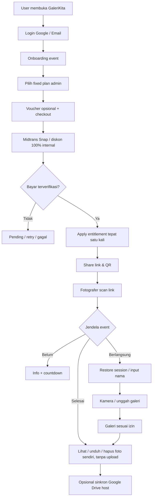
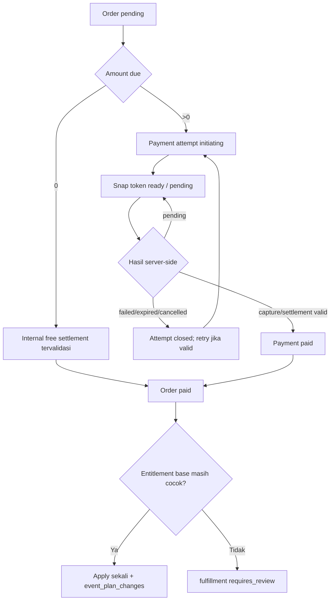
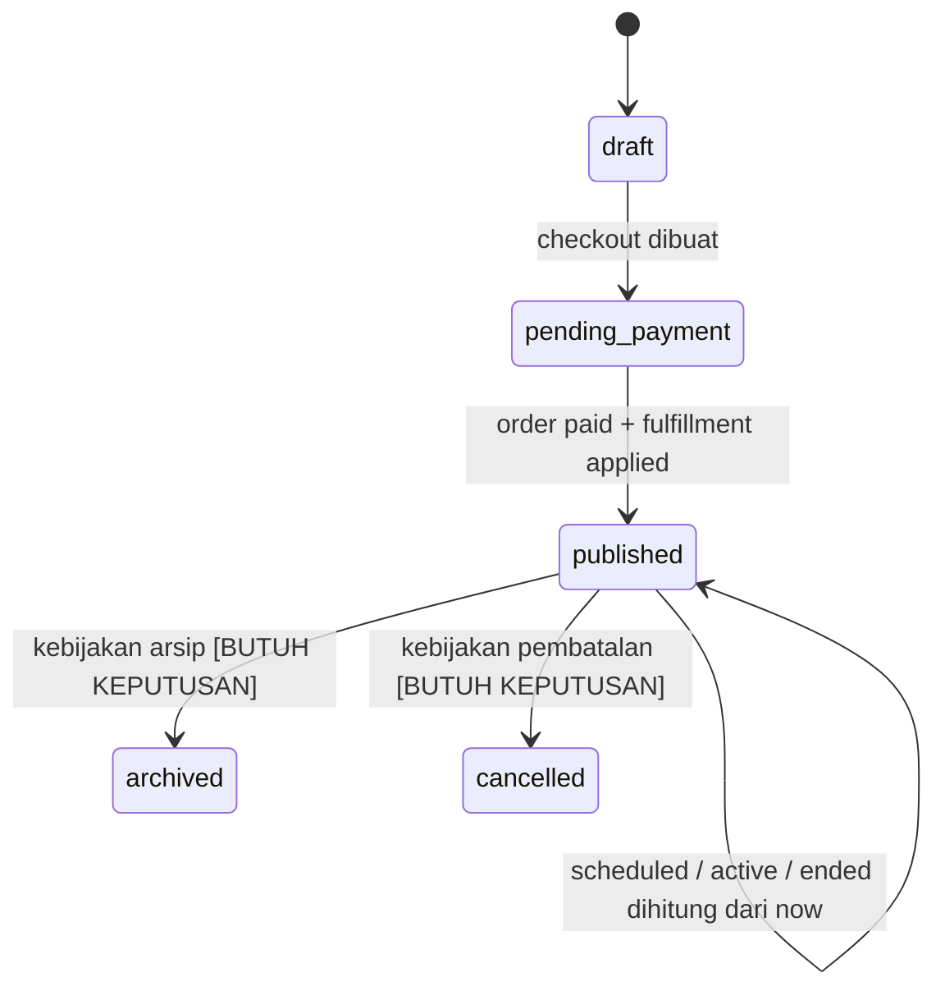

# PRODUCT REQUIREMENTS DOCUMENT (PRD) — GALERIKITA

> **Versi:** 1.0 — baseline pengembangan web  
> **Tanggal dokumen:** 15 Oktober 2026  
> **Produk:** GaleriKita — platform album foto kolaboratif berbasis acara  
> **Platform:** Website responsif (desktop dan mobile browser), **tanpa aplikasi native**  
> **Basis data acuan:** `GaleriKita_Database_v4_Midtrans_No_Refund.dbml` — **28 tabel, 27 enum, 49 relasi FK**  
> **Stack target:** Laravel + Inertia.js v3 + React + TypeScript + PostgreSQL; Redis/queue; Laravel Local Storage (development), Cloudinary (production); Midtrans Snap; Google Drive API opsional  
> **Status:** PRD fungsional untuk perencanaan dan development. Butir bertanda **[BUTUH KEPUTUSAN]** bukan keputusan final dan tidak boleh dianggap otomatis disetujui.

---

## Cara membaca dokumen

- **[FINAL]**: aturan yang sudah diputuskan melalui percakapan.
- **[REKOMENDASI]**: perilaku implementasi yang disarankan untuk menutup celah alur, dapat diubah sebelum build.
- **[BUTUH KEPUTUSAN]**: kebijakan produk belum ditetapkan; jangan hard-code tanpa persetujuan.
- **MUST / WAJIB**: perilaku wajib bagi cakupan fitur yang dipilih untuk rilis.
- **SHOULD / SEBAIKNYA**: optimasi/fitur pendukung yang tidak boleh mengalahkan kebutuhan inti.
- **P0 / P1 / P2**: prioritas fitur (*P0* = peluncuran dasar, *P1* = penting setelah alur inti stabil, *P2* = pengembangan).

**Pembagian role sesuai permintaan:** hanya terdapat **dua role akun terdaftar**, yakni `admin` dan `user` (Host). **Fotografer/Tamu bukan role di `users`**: ia mengakses halaman event menggunakan `event_guests` + `guest_sessions`, tanpa login/registrasi. Alur fotografer dijelaskan dalam **Bagian B: User — Pengalaman Tamu** agar tetap konsisten dengan pembagian dua role.

---

# I. GAMBARAN PRODUK

## 1.1 Latar belakang dan masalah

Pada acara seperti pernikahan, ulang tahun, perjalanan, gathering, dan wisuda, foto tersebar di banyak ponsel tamu. Host kesulitan mengumpulkan foto secara terstruktur tanpa meminta setiap orang mengirim berkas melalui chat. GaleriKita memberi satu ruang acara dengan QR code, kamera browser berfilter, pembatasan fotografer/foto, kontrol visibilitas, serta galeri yang tetap bisa dibuka sesudah acara selesai.

## 1.2 Proposisi nilai

1. **Host:** membuat event berbayar melalui onboarding terpandu, membagikan satu QR code, dan mengelola semua kenangan.
2. **Fotografer:** masuk tanpa akun, foto dari kamera atau unggah galeri, memilih filter warna/border sebelum memotret, lalu mengakses foto sesuai izin host.
3. **Bisnis:** monetisasi melalui **fixed plans yang dikelola admin** dan voucher, dibayar menggunakan Midtrans Snap; upgrade hanya membayar selisih harga katalog.
4. **Arsip:** penyimpanan media di layanan yang bisa diganti; integrasi Google Drive host **dimulai setelah event selesai**, bila dihubungkan.

## 1.3 Tujuan produk

- Membuat alur **login → onboarding → pemilihan plan → pembayaran → share QR** lengkap dan jelas.
- Menjamin akses upload hanya dalam **jendela event tepat 24 jam**.
- Menjamin privasi foto sesuai izin host dan kepemilikan sesi tamu.
- Menjaga kuota peserta/foto meskipun banyak pengguna bergabung/upload bersamaan.
- Menjaga integritas order, voucher, pembayaran, dan upgrade secara idempoten.
- Memberi UX mobile-web cepat, navigasi instan, skeleton ketika data ditunda, galeri berhalaman, dan upload retry.

## 1.4 Batasan dan non-goals

- **Tidak membuat aplikasi Android/iOS native.** Semua kamera bekerja melalui mobile browser.
- **Tidak ada fitur refund bagi user** dan **tidak ada tabel `payment_refunds`**. Anomali gateway/sengketa tetap perlu dicatat dan ditinjau admin sesuai kewajiban hukum/penyedia pembayaran.
- **Tidak ada downgrade plan.** Host tidak menentukan sendiri jumlah fotografer atau foto/orang.
- **Durasi event tidak bisa dipilih:** tepat 24 jam dari `start_at`.
- **Tidak menyimpan foto kamera mentah** selain hasil akhir yang sudah menerapkan filter/border.
- **Tidak wajib instal aplikasi** bagi fotografer.
- Tidak mencakup video capture, chat antar-tamu, cetak fisik, AI face recognition, live streaming, dan white-label pada versi inti.

## 1.5 Terminologi

| Istilah | Definisi |
|---|---|
| Admin | Akun `users.role = admin`, mengelola katalog dan operasional sistem. |
| User / Host | Akun `users.role = user` yang memiliki event dan membeli plan. |
| Fotografer / Guest | Identitas peserta per event di `event_guests`; **bukan** akun `users`. |
| Guest session | Token acak terikat ke satu fotografer/event, hanya hash-nya disimpan di `guest_sessions`. |
| Event window | `[start_at, end_at)` dengan `end_at = start_at + 24 jam`. |
| Event published | Event administrasi telah diaktifkan oleh pembayaran awal valid, belum tentu waktunya sedang aktif. |
| Plan | Produk/katalog paket tetap, ditetapkan admin (`plans`). |
| Plan version | Versi immutable harga dan batas kuota (`plan_versions`). |
| Entitlement | Hak pemakaian plan aktif pada satu event (`event_entitlements`). |
| Reveal | Aturan kapan foto **fotografer lain** ditampilkan kepada tamu pada galeri Public. |
| Upload intent | Reservasi kapasitas + izin upload sebelum file sungguhan disimpan. |
| Final photo | File akhir foto (berfilter jika diambil dari kamera) yang digunakan untuk galeri, unduh, dan Drive export. |
| Fulfillment | Penerapan hasil order berhasil ke entitlement event. Terpisah dari status pembayaran. |

## 1.6 Ringkasan pengalaman produk



---

# II. ROLE, HAK AKSES, DAN BATASAN

## 2.1 Matriks hak akses

| Aksi | Admin | User / Host (event sendiri) | Fotografer (sesi valid) | Pengunjung tanpa sesi |
|---|:---:|:---:|:---:|:---:|
| Login Google/email | Ya | Ya | Tidak perlu | Bisa menuju login |
| Kelola user dan peran | Ya | Tidak | Tidak | Tidak |
| Kelola kategori, paket/versi, voucher, preset | Ya | Tidak | Tidak | Tidak |
| Buat event dan bayar | Operasional saja | Ya | Tidak | Tidak |
| Edit data event sendiri | Via admin audit jika diperlukan | Ya sesuai aturan | Tidak | Tidak |
| Bagikan QR event | Via operasional | Ya | Link boleh dibagikan | Boleh membuka link |
| Bergabung sebagai fotografer | Bukan alur admin | Bisa mengakses sebagai tamu terpisah jika diperlukan | Ya, selama event aktif | Ya, selama event aktif |
| Ambil/unggah foto | Tidak sebagai admin | Bisa sebagai fotografer dengan sesi tamu | Ya, selama aktif dan kuota ada | Tidak |
| Lihat semua foto event | Hanya untuk moderasi sah & diaudit | Ya | Tergantung visibilitas dan reveal | Tergantung kebijakan akses publik pascaevent [BUTUH KEPUTUSAN] |
| Lihat foto sendiri | — | Ya | Ya, segera | Tidak |
| Like foto orang lain | — | Bukan fitur host utama | Ya jika terlihat | Tidak |
| Hapus foto sendiri | Moderasi | Host bisa hapus semua | Ya | Tidak |
| Hapus semua foto event | Aksi moderasi khusus | Ya, dengan konfirmasi | Tidak | Tidak |
| Upgrade plan | Tidak untuk konsumsi admin | Ya, tanpa downgrade | Tidak | Tidak |
| Hubungkan Google Drive | Tidak atas nama host | Ya | Tidak | Tidak |
| Pantau webhook/order/queue | Ya | Hanya transaksi sendiri | Tidak | Tidak |

**Batas akses admin:** role admin memberi kewenangan operasional, tetapi akses ke foto pribadi dan token tidak boleh tanpa kebutuhan sah, pengamanan, dan audit. Admin **tidak** boleh bisa melihat refresh token mentah, password hash asli, Snap token terdekripsi, atau data pembayaran sensitif melalui UI.

## 2.2 Aturan sesi fotografer [FINAL + batas teknis]

- Scan ulang QR di **browser/perangkat yang sama dengan token sesi masih ada dan valid** → **pulihkan fotografer yang sama, tidak memotong kuota kedua kali**.
- Perangkat atau browser baru **tanpa token valid** → identitas baru dan memakai satu slot fotografer jika masih tersedia.
- Kesamaan **nama tampilan bukan bukti** bahwa dua browser adalah orang yang sama.
- Satu identitas guest terikat ke satu event; tidak dapat menggunakan sesi event A untuk event B.
- **Catatan teknis:** sistem berbasis cookie/token tidak dapat menjamin identifikasi *perangkat fisik yang sama* jika browser berbeda, mode privat, atau data browser dibersihkan. Pemulihan yang dijamin adalah **browser profile yang menyimpan token**; mekanisme recovery lintas browser **[BUTUH KEPUTUSAN]**.

---

# III. ATURAN BISNIS GLOBAL (WAJIB)

## 3.1 Event & waktu

| ID | Aturan |
|---|---|
| BR-E01 | User harus login sebelum membuat event. |
| BR-E02 | Draft event boleh dibuat ketika onboarding dimulai; QR dan upload tidak aktif sebelum order awal `paid` **dan** `fulfillment_status = applied`. |
| BR-E03 | Host memilih `start_at`; sistem menetapkan `end_at = start_at + interval '24 hours'` dan tidak menerima durasi lain. |
| BR-E04 | Waktu ditampilkan menurut `events.timezone`; waktu disimpan sebagai `timestamptz` (UTC secara operasional). |
| BR-E05 | Jika `now < start_at`, event **Scheduled**: informasi/countdown boleh terlihat, upload/join belum aktif. |
| BR-E06 | Jika `start_at <= now < end_at` dan published/activated, event **Active**: join dan upload boleh berjalan sesuai kuota. |
| BR-E07 | Jika `now >= end_at`, event **Ended**: **tidak boleh membuat upload baru**; link tetap dapat dibuka untuk galeri/unduh/hapus sendiri sesuai akses. |
| BR-E08 | Setelah `start_at` terlewati, `start_at` dan `end_at` **tidak dapat diedit** termasuk setelah acara selesai. Sebelum mulai, host boleh mengubah `start_at` dan `end_at` dihitung ulang. |
| BR-E09 | `events.status` menyimpan status administratif `draft/pending_payment/published/cancelled/archived`; Scheduled/Active/Ended **dihitung** dari pembayaran, status administratif, dan waktu server. |
| BR-E10 | Slug/link event harus unik, sulit ditebak; mengetahui tautan **bukan** otorisasi untuk melihat foto Private. |

## 3.2 Galeri & visibilitas

| ID | Aturan |
|---|---|
| BR-G01 | `event_settings.visibility = private`: host dapat melihat semua foto; fotografer hanya foto sendiri, **segera**, baik sebelum maupun sesudah event selesai. |
| BR-G02 | `visibility = public` dan `photo_reveal_mode = instant`: fotografer dapat melihat foto peserta lain setelah siap, termasuk selama event berlangsung. |
| BR-G03 | `visibility = public` dan `photo_reveal_mode = after_event`: foto peserta lain **tidak** tampil sebelum `end_at`, kemudian terlihat sesudahnya. |
| BR-G04 | Fotografer melihat **foto sendiri segera** di semua mode, termasuk Public + After Event **[REKOMENDASI; belum dikonfirmasi eksplisit]**. |
| BR-G05 | Foto yang `hidden/deleted/processing` tidak dapat dilihat tamu kecuali alur operasional yang berwenang. |
| BR-G06 | Perubahan Private↔Public/Instant↔After Event berlaku ke request berikutnya; foto yang sudah diunduh tidak dapat ditarik kembali. Tampilkan warning konfirmasi. |
| BR-G07 | Like hanya diperbolehkan pada foto **milik fotografer lain yang memang boleh dilihat**. Satu like per tamu per foto; dapat di-*unlike* **[REKOMENDASI]**. |

## 3.3 Plan, pembayaran, voucher

| ID | Aturan |
|---|---|
| BR-P01 | Hanya admin mengelola fixed plan. Host memilih **paket yang tersedia**, tidak custom quota/harga. |
| BR-P02 | Plan version memuat `photographer_limit`, `photos_per_photographer`, `price_idr`. Versi yang sudah dipublikasikan/terjual dianggap immutable. |
| BR-P03 | Pembayaran awal yang terverifikasi mengaktifkan event dan membuat entitlement; sebelum itu event tidak bisa dipakai. |
| BR-P04 | Upgrade **tidak** boleh menurunkan salah satu kuota; tidak ada downgrade. |
| BR-P05 | Subtotal upgrade = harga katalog versi target − `current_plan_value_idr` versi aktif; diskon voucher upgrade diterapkan pada **subtotal selisih**. |
| BR-P06 | Harga dan kuota transaksi di-snapshot ke `orders` saat checkout; frontend tidak pernah menentukan harga final. |
| BR-P07 | Kegagalan pembayaran upgrade **tidak** mengubah entitlement aktif. |
| BR-P08 | Order bisa memiliki beberapa `payments` (percobaan), tetapi satu order tidak boleh terpenuhi lebih dari sekali. |
| BR-P09 | Callback Snap frontend **bukan bukti sukses**; hanya webhook terverifikasi atau Midtrans Status API server-to-server dapat menandai `paid`. |
| BR-P10 | Jika voucher menghasilkan `amount_due_idr = 0`, proses settlement internal tervalidasi dan **jangan** membuat pembayaran Midtrans nol rupiah. |
| BR-P11 | `orders.status=paid` bisa terjadi sebelum entitlement berhasil diterapkan; UI dan operasional harus memeriksa `fulfillment_status=applied`. |
| BR-P12 | Voucher punya batas waktu, cakupan initial/upgrade, plan targeting, kuota global/per user; pemakaian direservasi saat checkout dan menjadi redeemed setelah pelunasan valid. |
| BR-P13 | Snap page expiry berbeda dari jatuh tempo transaksi pembayaran; jangan melepas reservasi voucher hanya karena Snap page habis. |
| BR-P14 | Website **tidak menyediakan refund atau downgrade**. Peristiwa eksternal seperti chargeback/duplikasi pembayaran ditandai `requires_review` bagi admin, bukan alur refund user. |

## 3.4 Fotografer, kuota, upload

| ID | Aturan |
|---|---|
| BR-U01 | Kuota fotografer dihitung saat identitas `event_guests` baru berhasil dibuat, bukan saat QR sekadar dibuka. |
| BR-U02 | Restore `guest_sessions` yang sah tidak menambah `photographers_used`. |
| BR-U03 | Kuota foto adalah **maksimum successful upload per fotografer**, bukan kuota bebas tanpa batas. |
| BR-U04 | Reservasi kuota: `uploads_used + uploads_reserved < photos_per_photographer`. Buat `upload_intents` secara atomik, lalu tingkatkan `uploads_reserved`. |
| BR-U05 | Satu `(event_guest_id, client_upload_id)` hanya menghasilkan satu reservasi; retry yang sama tidak menggandakan foto. |
| BR-U06 | Setelah provider file memverifikasi upload, buat `media_assets` dan `photos`, `reserved -= 1`, `used += 1`, intent → completed; seluruh perubahan DB transaksional. |
| BR-U07 | Reservasi gagal/kedaluwarsa harus dilepas satu kali; file orphan dibersihkan secara asinkron. |
| BR-U08 | Menghapus foto **tidak mengembalikan `uploads_used`** **[REKOMENDASI dari catatan skema v4; belum diputuskan final oleh user]**. |
| BR-U09 | Kamera: pilih filter warna/border **sebelum shutter**; hasil final yang berfilter saja disimpan. |
| BR-U10 | Fotografer bisa unggah dari galeri perangkat; perlakuan filter untuk upload galeri **[BUTUH KEPUTUSAN]**, default usulan: file galeri diunggah tanpa editor filter. |
| BR-U11 | Fotografer hanya boleh menghapus foto yang dimiliki `event_guest_id` miliknya; host boleh menghapus foto event miliknya termasuk batch/all. |
| BR-U12 | Setelah `end_at`, tamu masih dapat melihat, mengunduh, menghapus foto sesuai izin; **tidak dapat membuat upload baru**. |

## 3.5 Media & Google Drive

| ID | Aturan |
|---|---|
| BR-S01 | Metadata file di `media_assets`; dev bisa local, production Cloudinary, `storage_disk` + `storage_key` menjadi identitas file. |
| BR-S02 | Media Private/After Event tidak boleh bocor hanya karena mengetahui URL; gunakan authorization dan protected/signed delivery. |
| BR-S03 | `photo_variants` opsional untuk thumbnail/preview fisik; Cloudinary boleh memakai dynamic transform tanpa record variant. |
| BR-S04 | Google login **tidak otomatis** memberi izin Google Drive; user harus menghubungkan OAuth Drive terpisah. |
| BR-S05 | Export Google Drive baru boleh mulai ketika `now >= end_at` dan koneksi sah tersedia. |
| BR-S06 | Foto yang sudah tersinkron ke Google Drive **tidak ikut dihapus** ketika dihapus dari GaleriKita, baik oleh tamu maupun host. |
| BR-S07 | Sinkronisasi harus idempoten per `(event_drive_export_id, photo_id)` dan bisa retry. |
| BR-S08 | Masa simpan file/album GaleriKita **[BUTUH KEPUTUSAN]**, tidak diasumsikan permanen atau otomatis 30 hari. |

---

# IV. BAGIAN A — ROLE ADMIN

## 4.1 Dashboard admin (ADM-01) — P0

**Tujuan:** memberi gambaran kondisi bisnis, event, penyimpanan, dan pembayaran.

**Menu:** Overview, Users, Categories, Plans, Vouchers, Photo Presets, Events, Orders & Payments, Drive Exports, Activity Logs.

**Widget utama:** jumlah akun host, event draft/terpublikasi, event aktif berdasar jam server, order pending/paid, total pendapatan dari order `paid`, pembayaran `requires_review`, voucher aktif, failed exports, jumlah foto siap, penggunaan media (berdasarkan `media_assets.file_size_bytes`).

**Aturan:** gunakan agregasi/pagination; hanya transaksi terverifikasi yang dihitung sebagai pendapatan; `paid` tetapi belum `applied` ditunjukkan sebagai perhatian operasional. Seluruh statistik harus bisa ditelusuri ke data sumber, tidak berdasarkan contoh statis.

**DB:** `users`, `events`, `event_entitlements`, `orders`, `payments`, `media_assets`, `event_drive_exports`, `activity_logs`.

**Kriteria terima:** admin masuk dashboard; angka selaras dengan filter; tidak menampilkan rahasia; list masalah dapat diklik menuju halaman investigasi.

## 4.2 Kelola akun user/host (ADM-02) — P0

1. Admin melihat daftar akun dengan nama, email, metode login terhubung, tanggal pendaftaran, jumlah event, status soft-delete.
2. Admin mencari nama/email, memfilter role/status, membuka detail host dan event miliknya.
3. Admin dapat mengubah role hanya sesuai kewenangan yang dibatasi dan diaudit. Tindakan penonaktifan/penghapusan akun **[BUTUH KEPUTUSAN]** mengingat dampak terhadap event dan arsip.
4. Tidak boleh melihat password plaintext atau refresh token Google.

**DB:** `users`, `social_accounts`, `events`, `activity_logs`. Password reset email menggunakan `password_reset_tokens` pada alur user, bukan admin membacakan password.

**Validasi:** email unik; admin tidak boleh sembarang mencabut satu-satunya admin tanpa pengamanan operasional; perubahan role dicatat.

## 4.3 Kelola kategori event (ADM-03) — P0

**Create/Edit:** `name`, `slug`, `description`, `sort_order`, `is_active`. **Read:** daftar dan jumlah event pada kategori. **Disable:** kategori tidak muncul saat onboarding baru, event lama tetap memakai relasi kategorinya.

**Aturan:** slug unik dan stabil; bila kategori sudah dipakai, jangan hard-delete. Kategori dipilih maksimal satu per event.

**Contoh:** Admin membuat kategori `Pernikahan` (`pernikahan`) lalu host memilihnya pada wizard.

**DB:** `event_categories`, `events.event_category_id`.

## 4.4 Kelola fixed plans & versi harga (ADM-04) — P0

**Definisi penting:** admin mengendalikan penawaran, host **tidak boleh** mengubah kuota secara manual.

**Alur admin:**
1. Buat identitas plan: `code`, `name`, `description`, `sort_order`, `is_active` (`plans`).
2. Buat versi penawaran: `version_number`, `photographer_limit`, `photos_per_photographer`, `price_idr`, `published_at`, `is_current` (`plan_versions`).
3. Pratinjau kartu plan di layar user termasuk kapasitas maksimal teoritis (perkalian kuota).
4. Publikasikan versi baru; versi lama tetap tersimpan, **tidak** ditimpa.
5. Tetapkan **maksimal satu versi current per plan**, enforced melalui partial unique index PostgreSQL.
6. Nonaktifkan plan untuk pembelian baru; event yang sudah membeli tetap mempertahankan entitlement.

**Validasi:** harga IDR nonnegatif sesuai kebijakan; kapasitas fotografer > 0, foto per fotografer > 0; versi published historis immutable; kode plan unik; jangan memunculkan plan tanpa versi publik current pada katalog.

**Contoh ilustrasi (bukan harga final):** `Celebration v1 = 50 fotografer / 20 foto per orang / Rp79.000` kemudian admin menerbitkan `v2 = Rp89.000`, sementara pemilik v1 tetap mempunyai snapshot v1.

**DB:** `plans`, `plan_versions`, `orders`, `event_entitlements`, `event_plan_changes`.

## 4.5 Kelola voucher (ADM-05) — P0 untuk fitur voucher

**Form admin:** `code`, `name`, `description`, `discount_type` (`percentage`/`fixed`), `discount_value`, `max_discount_idr` (opsional), `min_order_idr`, `applicability` (`initial`, `upgrade`, `both`), `usage_limit` total, `usage_limit_per_user`, `starts_at`, `expires_at`, `is_active`, plan yang diizinkan (opsional).

**Alur:** buat → validasi → aktifkan → tampilkan jumlah redeemed/reserved/available → nonaktifkan jika dibutuhkan. Voucher dibatasi ke plan identity melalui `voucher_plans`, bukan ke satu versi harga; jika `voucher_plans` kosong berarti semua plan yang memenuhi syarat.

**Validasi WAJIB:**
- Simpan kode uppercase/trim, unik case-insensitive. Persentase 1–100; fixed > 0; diskon maksimal sebesar subtotal.
- `min_order_idr` diperiksa terhadap **subtotal sebelum diskon**.
- Waktu sekarang dalam `[starts_at, expires_at)` jika batas disetel.
- `usage_limit` dan per-user dibatasi secara transaksional termasuk reservasi yang masih sah.
- Satu order maksimal satu voucher. Voucher bisa diterapkan pada pembelian awal, upgrade, atau keduanya sesuai konfigurasi.
- Editing voucher yang sudah digunakan tidak boleh mengubah snapshot order lama.

**Contoh:** `LAUNCH20` diskon 20%, maksimum Rp30.000, minimum order Rp50.000, limit 100 penggunaan, 1 per host, hanya plan Grand pada pembelian pertama.

**DB:** `vouchers`, `voucher_plans`, `voucher_redemptions`, `orders`, `users`, `plans`.

## 4.6 Kelola preset kamera (ADM-06) — P0

1. Buat preset `kind=color` atau `kind=border`.
2. Isi `name`, `code`, `effect_settings` JSON deklaratif, `version_number`, urutan, dan preview media opsional.
3. Aktif/nonaktifkan preset untuk sesi kamera baru.
4. Foto lama tetap menampilkan hasil lama karena file final sudah diproses; `photos.filter_snapshot` menjaga informasi efek saat diambil.

**Validasi:** `effect_settings` harus mengikuti schema whitelist; jangan menerima JavaScript mentah; render filter sebelum shutter; perubahan preset historis diberi versi.

**DB:** `photo_presets`, `media_assets`, `photos`.

## 4.7 Monitor & moderasi event (ADM-07) — P0/P1

1. Lihat semua event, host, kategori, jadwal, status administratif, status waktu, entitlement, jumlah guest dan foto.
2. Filter Scheduled/Active/Ended yang dihitung dari waktu server, bukan enum terpisah.
3. Masuk detail untuk meninjau pengaturan, log perubahan, dan keluhan.
4. Untuk penyalahgunaan, admin dapat melakukan tindakan moderasi yang telah mendapat kewenangan dan dicatat (`activity_logs`).
5. **Cancel/archive** tersedia di enum data, tetapi prosedur operasionalnya dan dampak akses perlu disahkan **[BUTUH KEPUTUSAN]**. Tidak boleh dipakai sebagai proses refund karena fitur refund tidak ada.

**DB:** `events`, `event_settings`, `event_entitlements`, `event_guests`, `photos`, `activity_logs`, `users`.

## 4.8 Monitor foto dan penghapusan/moderasi (ADM-08) — P1

**Tujuan:** penyelesaian laporan konten dan masalah penyimpanan, tanpa menjadikan semua foto publik untuk admin.

- Tampilkan metadata foto: event, pemilik, waktu unggah, sumber, status, ukuran media, dan pelaporan bila nantinya ditambahkan.
- Tindakan `hidden`/`deleted` terbatas bagi admin yang sah; catat actor, alasan, dan perubahan.
- Saat foto dihapus, nonaktifkan akses URL, jadwalkan cleanup file provider dan variants. Jangan menghapus file Drive yang sudah tersinkron.
- Hindari preview media privat oleh admin di log/analytics umum.

**DB:** `photos`, `media_assets`, `photo_variants`, `event_guests`, `activity_logs`, `photo_drive_syncs`.

## 4.9 Manajemen order & Midtrans (ADM-09) — P0

**Halaman order:** kode order, host, event, `initial/upgrade`, target version, harga awal, subtotal, voucher, diskon, `amount_due_idr`, status finansial, settlement source, fulfillment status, seluruh attempts, dan timestamp.

**Halaman attempt:** provider order ID unik ≤50 karakter, environment, token Snap (JANGAN tampil mentah), expiry Snap terpisah dari expiry transaksi gateway, metode, raw gateway status, verification source, checked time, error.

**Operasional:**
1. Admin dapat membuka detail dan meminta rekonsiliasi Midtrans Status API secara server-side.
2. Status `paid` dari gateway diverifikasi signature/status/API, `gross_amount`, order ID, dan fraud status bila berlaku.
3. Jika `paid` tetapi fulfillment `requires_review`, tampilkan prioritas tinggi; proses perbaikan manual harus aman dan dicatat.
4. Jangan ada tombol menandai `paid` tanpa bukti tepercaya; frontend callback bukan sumber kebenaran.
5. Tidak menyediakan alur refund, tetapi catat gateway status yang anomali untuk investigasi.

**DB:** `orders`, `payments`, `payment_webhooks`, `event_plan_changes`, `event_entitlements`, `activity_logs`, `voucher_redemptions`.

## 4.10 Monitor voucher redemption (ADM-10) — P0

Daftar reservasi/penebusan berdasarkan host, voucher, order, status (`reserved/redeemed/released`), diskon aktual, waktu dan expiry. Jika payment masih bisa diselesaikan, jangan melepas reservasi walau jendela Snap tertutup. Admin dapat melihat tingkat pemakaian dan menonaktifkan voucher baru, tetapi transaksi historis tidak berubah.

**DB:** `vouchers`, `voucher_redemptions`, `orders`, `payments`.

## 4.11 Monitor Drive sync (ADM-11) — P1

Menampilkan host yang telah menghubungkan Drive, export waiting/queued/syncing/completed/partial_failed/failed/disabled, jumlah foto berhasil/gagal, dan retry per foto. **Jangan tampilkan refresh token**, folder ID boleh dipakai sebagai identitas teknis. Retry hanya setelah `end_at` dan ketika grant masih valid. Kondisi `needs_reauth` dikomunikasikan kepada host.

**DB:** `google_drive_connections`, `event_drive_exports`, `photo_drive_syncs`, `photos`.

## 4.12 Audit log (ADM-12) — P0

Catat minimal: login sensitif dan perubahan role, create/update/publish/cancel/archive event, perubahan privasi, plan/version/voucher, paid/fulfilled order, perubahan entitlement, moderasi/hapus, koneksi Drive. Skema log menyimpan `actor_type`, `actor_user_id` atau `actor_guest_id`, `action`, `subject_type`, `subject_id`, `changes`, waktu. Jangan simpan secrets atau URL akses privat ke `changes`.

**DB:** `activity_logs`.

---

# V. BAGIAN B — ROLE USER (HOST)

## 5.1 Registrasi, login, dan profil (USR-01) — P0

**Alur:**
1. Pengunjung membuka landing page dan klik **Buat Event**.
2. Jika belum login, diarahkan ke login/register.
3. Metode: **Google OAuth** atau **email + password** **[REKOMENDASI teknis untuk opsi email; mekanisme email belum final]**.
4. Akun Google menggunakan `social_accounts.provider_user_id` sebagai identitas eksternal; account-link tidak semata-mata mengandalkan kecocokan email tanpa verifikasi.
5. Saat berhasil, arahkan ke dashboard atau lanjutkan onboarding sebelumnya.
6. Login email memiliki alur verifikasi email, lupa sandi, dan reset password.
7. Session host menggunakan autentikasi Laravel; halaman dashboard dibatasi middleware auth.

**Halaman:** Login, Daftar, Verifikasi Email, Lupa Password, Reset Password, Profil.

**Validasi:** email unik; password ter-hash; Google-only boleh password NULL; rate limit login/reset; CSRF; OAuth state validation.

**DB:** `users`, `social_accounts`, `password_reset_tokens`.

**Acceptance:** tanpa login tidak bisa mengakses create event; setelah login tidak perlu daftar ulang; logout mengakhiri sesi host.

## 5.2 Dashboard user (USR-02) — P0

**Elemen:** tombol Buat Event, daftar event host, badge Draft/Pending Payment/Scheduled/Active/Ended, kategori, sampul, jam mulai/akhir, plan aktif, total guest dan foto, tombol Lihat Detail, Lanjutkan Pembayaran/Draft.

**Performa:** halaman dan sidebar muncul segera; statistik/list bisa memakai Inertia Deferred Props + skeleton; filter, search, pagination. Jangan query semua foto per event untuk menghitung daftar jika tidak perlu.

**DB:** `events`, `event_categories`, `media_assets`, `event_settings`, `event_entitlements`, `orders`, `photos`.

## 5.3 Onboarding event — langkah wajib dan berurutan (USR-03) — P0

**Persyaratan:** user login. Wizard dapat kembali ke langkah sebelumnya tanpa kehilangan data. **Draft persisten direkomendasikan** agar checkout gagal tidak menghilangkan input.

### Step 1 — Pilih kategori

- Ambil `event_categories.is_active = true`, urut `sort_order`.
- User pilih satu dari pernikahan/ulang tahun/perjalanan/wisuda/dan kategori lain yang admin sediakan.
- Field utama: `events.event_category_id`.
- Error: kategori tidak aktif saat submit → minta pilih ulang.

### Step 2 — Nama dan cover

- Input `events.name` (wajib), upload foto cover (wajib menurut alur user; aturan detail batas ukuran **[BUTUH KEPUTUSAN]**).
- Simpan media di `media_assets`; link via `events.cover_media_asset_id`.
- Tampilkan preview, ganti, dan hapus cover draft sesuai kebutuhan.
- File melalui storage adapter `local` di dev dan `cloudinary` di prod; tidak menyimpan URL Cloudinary sebagai primary key media.

### Step 3 — Waktu mulai dan berakhir

- User hanya memilih **tanggal/jam mulai** serta zona waktu bila produk mendukung; default `Asia/Jakarta`.
- Sistem menghitung end otomatis + 24 jam (contoh: 10 Nov 2026 12.00 WIB → 11 Nov 2026 12.00 WIB).
- UI menampilkan kedua waktu; durasi tidak dapat diedit.
- Waktu mulai dan akhir hanya dapat diedit **sebelum event mulai** (dan mengikuti validasi pembayaran/draft).
- Field: `events.start_at`, `end_at`, `timezone`.

### Step 4 — Permission visibilitas

- **Private:** tamu hanya melihat fotonya; host melihat semuanya.
- **Public:** tamu dapat melihat foto orang lain berdasarkan reveal.
- Field: `event_settings.visibility`.

### Step 5 — Kapan foto dipublikasikan

- **Instant:** foto lain terlihat setelah upload sukses bila Public.
- **After Event:** foto lain terlihat setelah `end_at` bila Public.
- Keterangan bahwa sendiri dapat langsung dilihat **[REKOMENDASI untuk Public+After Event]**.
- Field: `event_settings.photo_reveal_mode`.

### Step 6 — Pilih plan fixed

- Tampilkan `plans.is_active = true` dengan `plan_versions.is_current = true` dan published.
- Kartu plan berisi nama, jumlah fotografer, foto/orang, harga IDR, dan total kapasitas maksimal teoritis.
- **Tidak ada slider atau input custom quota dari user.**
- User memilih tepat satu plan yang valid; checkout mengunci snapshot versi plan.

### Step 7 — Ringkasan, voucher, dan pembayaran

- Review kategori, nama, cover, jadwal, visibilitas/reveal, dan plan.
- Field voucher opsional; Laravel validasi; tampilkan rincian `subtotal`, `discount`, `total`.
- Saat submit, buat `orders` bertipe initial dan `voucher_redemptions` reserved bila dipakai.
- Jika `amount_due_idr > 0`, buat sesi Snap di `payments` dan buka UI Midtrans.
- Jika `amount_due_idr = 0`, lakukan settlement internal voucher penuh melalui transaksi aman tanpa memanggil Snap.
- Saat pending/failed/expired, wizard tetap dapat dilanjutkan; belum menerbitkan akses upload.

### Step 8 — Aktivasi dan share QR

- Webhook/Status API valid → order paid → apply entitlement satu kali → event `published` + `activated_at`.
- Baru setelah `fulfillment_status = applied`, user mendapat event dashboard, `public_slug`, URL/share QR, tombol salin/download QR, dan ringkasan status waktu.
- QR dapat dibagikan **sebelum waktu mulai**, tetapi tamu hanya melihat halaman informasi/countdown; belum dapat upload.

**DB:** `events`, `event_categories`, `event_settings`, `media_assets`, `plans`, `plan_versions`, `orders`, `voucher_redemptions`, `payments`, `event_entitlements`, `event_plan_changes`.

**Acceptance:** draft tidak tiba-tiba published; pembelian yang sukses diaplikasikan sekali; plan dari database, bukan angka input frontend; QR menuju slug unik yang benar.

## 5.4 Detail event & dashboard host (USR-04) — P0

**Tabs:** Overview, Gallery, Participants, Settings, Plan & Billing, Share QR, Google Drive.

**Overview:** nama/sampul/kategori, start/end (24 jam), status jam aktual, plan, slot fotografer digunakan/sisa, upload per fotografer, jumlah foto ready/deleted, ekspor Drive. Host dapat melihat semua foto tanpa terpengaruh setting Private/Public/reveal milik tamu.

**Performa:** gunakan deferred statistik dan skeleton; foto pagination, bukan seluruh album dalam satu props Inertia.

## 5.5 Edit event (USR-05) — P0

**Boleh edit:** nama, kategori, cover, `visibility`, `photo_reveal_mode` sesuai hak host; tanggal mulai **hanya jika waktu mulai belum terlewati**, akhir selalu dihitung ulang 24 jam; plan via **upgrade**, bukan edit langsung.

**Validasi:** tidak bisa mengubah event milik host lain; kategori harus valid; perubahan cover merekam media baru dan cleanup aman; perubahan privacy menampilkan peringatan bahwa foto terunduh tetap di perangkat penerima; jangan mengubah `photographer_limit` atau `photos_per_photographer` lewat form setting.

**Operasional:** simpan perubahan ke `events`, `event_settings`, `media_assets`, audit `activity_logs`.

## 5.6 Kelola partisipan/fotografer (USR-06) — P0/P1

**User dapat melihat:** list `event_guests` (nama, bergabung, upload sukses/dipesan, status), penggunaan slot terhadap entitlement, filter/pagination. Dapat mengetahui sisa slot dan kebutuhan upgrade.

**Tindakan:** blokir guest jika diperlukan untuk moderasi **[REKOMENDASI; ada `guest_status.blocked`]**; efek slot kembali/tidak kembali **[BUTUH KEPUTUSAN]**. Hindari reset kuota sepihak yang melampaui plan.

**DB:** `event_guests`, `guest_sessions`, `event_entitlements`, `photos`.

## 5.7 Kelola galeri milik event (USR-07) — P0

**Grid foto:** thumbnail resolusi kecil, paginasi/infinite scroll, jumlah foto, fotografer, waktu, jumlah like, opsi detail/unduh/hapus. Pemilik event dapat mengakses semua foto yang `ready` termasuk ketika galeri tamu Private atau belum reveal.

**Tindakan:**
- Hapus satu/batch/semua foto milik event dengan konfirmasi khusus; soft-state `deleted`, cabut akses, cleanup media secara background.
- Download satu foto final. Fitur **download ZIP seluruh foto** **[REKOMENDASI P1]** dengan queue agar VPS kecil tidak kehabisan RAM.
- Tidak menghapus backup yang sudah tersimpan di Google Drive ketika menghapus foto di GaleriKita.

**DB:** `photos`, `photo_variants`, `media_assets`, `event_guests`, `photo_likes`, `activity_logs`, `photo_drive_syncs`.

## 5.8 Upgrade paket (USR-08) — P0

1. Halaman Plan & Billing menunjukkan entitlement saat ini (`event_entitlements`), harga katalog versi aktif, sisa slot, dan riwayat pembayaran.
2. Tawarkan hanya plan **published/current/active** yang **kedua batas kuotanya ≥ kapasitas saat ini** dan memberikan peningkatan yang nyata; tidak ada downgrade.
3. Perlihatkan harga plan target, nilai katalog entitlement aktif, **subtotal selisih**, voucher upgrade opsional, total bayar.
4. Buat `orders.type=upgrade`, simpan `base_entitlement_version` dan snapshot harga/kuota.
5. Pembayaran pending → plan lama tetap aktif; sukses Midtrans → validasi ulang entitlement secara transaksional → `event_plan_changes` dibuat satu kali → entitlement diganti dan `version += 1`.
6. Jika order sudah paid tetapi versi entitlement berubah karena upgrade lain, set fulfillment `requires_review`; **jangan otomatis melakukan downgrade, double grant, atau membuat pembayaran ulang**.
7. **Satu checkout upgrade aktif per event** **[REKOMENDASI]**, guna meminimalkan upgrade bersamaan.

**Contoh ilustrasi:** plan 50 orang/20 foto Rp79.000 → plan 100 orang/20 foto Rp129.000: subtotal upgrade Rp50.000. Voucher upgrade 10% → bayar Rp45.000. Entitlement value menjadi Rp129.000 (bukan Rp124.000).

**Aturan waktu upgrade:** boleh/tidaknya upgrade setelah event berakhir **[BUTUH KEPUTUSAN]**; rekomendasi awal hanya sebelum `end_at` untuk menghindari pembelian kuota yang tidak bisa digunakan.

**DB:** `event_entitlements`, `plans`, `plan_versions`, `orders`, `payments`, `event_plan_changes`, `vouchers`, `voucher_redemptions`.

## 5.9 Daftar transaksi dan pembayaran (USR-09) — P0

Tampilkan invoice/order code, waktu, plan, jenis initial/upgrade, voucher, nominal, status pembayaran, status penerapan plan. Tombol **Bayar/Lanjutkan** bila pembayaran masih sah, **Coba Lagi** sesuai keadaan gateway, **Lihat Event** bila applied.

**Batasan:** jangan tampilkan keberhasilan hanya berdasarkan redirect; pending tetap pending sampai konfirmasi server; jika gateway paid tapi penerapan plan perlu review, tampilkan pesan jujur dan status tindak lanjut, tanpa menjanjikan refund.

**DB:** `orders`, `payments`, `event_plan_changes`.

## 5.10 QR code & sharing (USR-10) — P0

- Buat URL `https://<domain>/e/{public_slug}` menggunakan slug acak dan unik.
- Render QR yang bisa disalin/diunduh untuk media acara; menyediakan tombol copy link/share.
- Event belum paid/applied tidak menghasilkan link upload aktif.
- Halaman tujuan harus menampilkan state Scheduled/Active/Ended berdasarkan backend.
- QR tidak mengandung email host, token auth, informasi transaksi, atau storage URL.

**DB:** `events.public_slug`, `events.status`, `events.start_at/end_at`, `event_entitlements`.

## 5.11 Koneksi Google Drive & status ekspor (USR-11) — P1

1. User memilih **Hubungkan Google Drive** dari dashboard; OAuth terpisah dari login Google biasa.
2. Simpan sub/email dan **refresh token terenkripsi** jika diberikan sesuai izin; tampilkan status Active/Needs Reauth/Revoked.
3. User memilih/mengaktifkan ekspor untuk event; event membuat satu `event_drive_exports` jika koneksi sah.
4. Sebelum `end_at`, status Waiting; ketika selesai sistem membuat folder/menentukan folder dan menjadwalkan satu job per foto ready.
5. Foto disalin ke Drive sebagai file final hasil filter; status per foto di `photo_drive_syncs`.
6. Host melihat progres, error, retry, dan tautan folder yang sah (sesuai izin), tanpa melihat token.
7. Penghapusan foto di GaleriKita setelah ekspor **tidak** menghapus file Drive yang telah disinkron.

**DB:** `google_drive_connections`, `event_drive_exports`, `photo_drive_syncs`, `photos`, `media_assets`.

**Aturan belum final:** apakah koneksi dapat diaktifkan setelah event sudah berakhir untuk melakukan ekspor retroaktif **[BUTUH KEPUTUSAN]**; rekomendasi: boleh selama file sumber masih ada.

---

# VI. BAGIAN B (LANJUTAN) — PENGALAMAN FOTOGRAFER / TAMU TANPA AKUN

> Tamu **bukan role `users`**. Semua endpoint tamu memakai identitas `guest_sessions` terikat pada event.

## 6.1 Buka link atau scan QR (GST-01) — P0

1. Browser membuka `/e/{public_slug}`.
2. Laravel memastikan slug ada dan event administratif valid/published.
3. Jika Scheduled: tampilkan cover, nama, kategori, waktu, countdown; tombol join/upload nonaktif.
4. Jika Active: coba pulihkan guest session untuk event. Jika valid, buka experience tamu; jika belum ada, tampilkan form nama.
5. Jika Ended: tidak ada join/upload baru, akses foto sesuai mode galeri dan sesi yang valid; link tidak mati sepenuhnya.
6. Jika Draft/Pending/Cancelled/Archived: tampilkan status aman dan jelas, tanpa bocor foto/token.

**DB:** `events`, `event_settings`, `event_entitlements`, `guest_sessions`.

## 6.2 Masukkan nama dan bergabung (GST-02) — P0

1. Form meminta `display_name`; tamu tidak perlu email/Google/password.
2. Submit mengirim event slug + nama. Server mengunci baris entitlement lalu memastikan `photographers_used < photographer_limit`.
3. Buat `event_guests`, `guest_sessions` dengan token acak kuat; simpan hanya hash token pada DB; kirim token melalui cookie aman/penyimpanan browser yang tepat.
4. Increment `photographers_used` **hanya satu kali**, pada transaksi yang sama.
5. Jika browser yang sama membuka lagi dengan token valid, pulihkan identitas; **jangan** buat `event_guests` baru.
6. Jika batas fotografer habis dan tidak memiliki token lama, tampilkan **Slot fotografer penuh**. Pemegang sesi lama tetap masuk.

**Validasi:** event Active; nama tidak kosong/berlebihan; token tidak dapat diakses oleh skrip pihak ketiga; rate limit join. Menebak nama yang sama tidak memberi akses ke foto milik orang lain.

**DB:** `event_guests`, `guest_sessions`, `event_entitlements`, `events`.

## 6.3 Home fotografer (GST-03) — P0

Tampilkan identitas event/cover, nama fotografer, badge waktu tersisa, sisa kuota foto, CTA Ambil Foto, CTA Unggah dari Galeri, CTA Lihat Foto Saya, dan Galeri Bersama hanya bila diizinkan. Sidebar/kontrol disesuaikan untuk mobile-first.

**Ketika sesi invalid:** minta bergabung ulang selama Active jika slot tersedia. Setelah Ended, recovery tanpa token **[BUTUH KEPUTUSAN]** agar tidak mengklaim foto orang lain.

## 6.4 Kamera browser & preset (GST-04) — P0

1. Minta izin camera via `getUserMedia()` melalui HTTPS.
2. Preview live dengan pilihan kamera depan/belakang bila didukung.
3. Tampilkan pemilihan preset **warna** dan **border** yang aktif dari admin; default tanpa efek boleh ada **[REKOMENDASI]**.
4. Fotografer memilih efek **sebelum** tombol shutter.
5. Ketika shutter ditekan, browser menghasilkan satu file akhir yang memuat efek dan border. Tampilkan hasil preview, tombol **Ulangi** atau **Upload**.
6. **Tidak** membuat file original mentah di storage aplikasi.
7. Saat izin kamera ditolak/tidak didukung, tampilkan fallback **Unggah dari Galeri** dan panduan izin browser.

**Performa:** preview/filter dapat di Canvas/WebGL sisi browser; batasi ukuran gambar, jaga orientasi, hapus geolocation EXIF bila ada, jangan paksa resolusi tinggi di smartphone kelas menengah.

**DB:** `photo_presets`, `photos.color_preset_id/border_preset_id/filter_snapshot`, `media_assets`.

## 6.5 Unggah foto dari galeri (GST-05) — P0

1. Pilih file gambar melalui input browser.
2. Preview file, validasi format/ukuran di client dan backend.
3. Upload memakai pipeline intent yang sama dengan hasil kamera.
4. Simpan `photos.source = gallery`.
5. **[BUTUH KEPUTUSAN]** apakah foto galeri juga dapat diberi border/warna; default MVP direkomendasikan langsung diunggah tanpa editor filter.

## 6.6 Pipeline upload dan kuota (GST-06) — P0

```mermaid
sequenceDiagram
    participant G as Guest Browser
    participant L as Laravel
    participant DB as PostgreSQL
    participant S as Storage Provider
    G->>L: POST upload intent (client_upload_id)
    L->>DB: Transaksi + lock guest + cek event/kuota
    DB-->>L: Intent reserved; uploads_reserved +1
    L-->>G: Upload credential / URL + intent ID
    G->>S: Upload file final (direct ke Cloudinary di production)
    S-->>G: Provider upload result
    G->>L: Complete upload (intent ID)
    L->>S: Verifikasi file provider + ukuran/identitas
    L->>DB: Transaksi: media, photos, complete intent, reserved -1, used +1
    L-->>G: Foto siap / processing
```

**Hal-hal WAJIB:**
- `uploads_used + uploads_reserved < entitlement.photos_per_photographer` divalidasi secara atomik.
- `client_upload_id` stabil untuk retry; `(event_guest_id, client_upload_id)` unik.
- Satu upload intent menghasilkan maksimal satu foto (`photos.upload_intent_id` unik).
- **Storage local (dev):** file bisa melewati Laravel endpoint, tetapi aturan intent/finalize tetap sama.
- **Cloudinary (prod):** signed direct browser upload; server tidak mempercayai metadata yang dikirim frontend tanpa verifikasi provider.
- Jika upload gagal: tampilkan tombol **Coba Lagi**; release reservasi setelah dinyatakan gagal/expired; bersihkan orphan file.
- Jika kuota tidak cukup: tombol upload tidak memulai unggahan; tampilkan batas dan cara menghubungi host untuk upgrade.
- Jika event berakhir saat upload sedang berlangsung: jangan membuat intent baru; aturan **finalisasi intent sah yang sudah terbit** dijelaskan pada daftar keputusan terbuka; rekomendasi grace pendek terukur, bukan perpanjangan jendela upload umum.

**DB:** `upload_intents`, `event_guests`, `event_entitlements`, `media_assets`, `photos`, `photo_variants`.

## 6.7 Galeri saya & galeri bersama (GST-07) — P0

**Galeri Saya:** foto `ready` milik sesi fotografer langsung terlihat, termasuk ketika event Private. Foto `processing` menampilkan placeholder; foto `deleted` tidak ditampilkan.

**Galeri Bersama:**

| Mode host | Sebelum akhir event | Setelah akhir event |
|---|---|---|
| Private + Instant | Hanya sendiri | Hanya sendiri |
| Private + After Event | Hanya sendiri | Hanya sendiri |
| Public + Instant | Semua `ready` yang diizinkan | Semua `ready` yang diizinkan |
| Public + After Event | Hanya sendiri **[REKOMENDASI]** | Semua `ready` yang diizinkan |

**UI:** grid thumbnail lazy loading, infinite scroll/cursor pagination, skeleton cards, modal preview, nama fotografer, likes_count, download, like jika diizinkan, delete hanya pada foto sendiri. Backend memutuskan akses setiap media, bukan sekadar menyembunyikan tombol di React.

**DB:** `photos`, `photo_variants`, `media_assets`, `photo_likes`, `event_settings`.

## 6.8 Like/unlike foto lain (GST-08) — P1

1. Di galeri yang diizinkan, fotografer klik Like pada foto milik tamu lain.
2. Server memeriksa sesi, status foto ready, event yang sama, hak melihat, bukan foto sendiri **[REKOMENDASI]**.
3. Buat `photo_likes` unik per `(photo_id, event_guest_id)`; update `photos.likes_count` dalam transaksi/operasi atomik.
4. Klik lagi menghapus like **[REKOMENDASI]**.
5. Untuk Private atau sebelum reveal foto orang lain: like tidak terlihat/tidak diizinkan.

**DB:** `photo_likes`, `photos`, `event_guests`, `event_settings`.

## 6.9 Unduh dan hapus foto milik sendiri (GST-09) — P0

**Download:** hanya foto yang boleh dilihat; versi final untuk unduh, preview untuk tampil cepat. Link temporer/protected mengikuti otorisasi.

**Delete:**
1. Tampilkan dialog konfirmasi berisi dampak penghapusan.
2. Server memastikan `photos.event_guest_id` sesuai sesi.
3. Set `photos.status=deleted`, `deleted_at`, `deleted_by_guest_id`; jadwalkan penghapusan/invalidasi file media dan variants.
4. Jika sudah tersinkron ke Drive, **file Drive tidak ikut dihapus**.
5. Setelah event selesai, penghapusan foto miliknya sendiri **tetap diperbolehkan**.
6. Menghapus foto tidak mengembalikan kuota **[REKOMENDASI belum final]**.

**DB:** `photos`, `media_assets`, `photo_variants`, `photo_likes`, `photo_drive_syncs`, `activity_logs`.

## 6.10 Setelah event selesai (GST-10) — P0

- Link QR tetap dapat dibuka.
- Shutter dan upload dinonaktifkan oleh UI **dan backend**.
- Galeri menampilkan foto sesuai aturan Private/Public + reveal.
- Tamu dengan sesi valid dapat melihat/unduh/menghapus foto sendiri.
- Host masih dapat mengakses semua foto dan memantau ekspor.
- Jika event archived atau foto sudah habis masa retensinya, perilaku halaman sesuai kebijakan retensi **[BUTUH KEPUTUSAN]**.

---

# VII. ALUR TRANSAKSI MIDTRANS, VOUCHER, DAN UPGRADE

## 7.1 Lifecycle order dan attempt



**Kontrak status utama:**
- `orders.status`: status finansial bisnis (`pending/paid/failed/expired/cancelled`).
- `orders.fulfillment_status`: (`pending/applied/requires_review`).
- `payments.status`: (`initiating/pending/paid/failed/expired/cancelled/requires_review`).
- `payments.gateway_status`: raw gateway status (`pending`, `capture`, `settlement`, dll.).
- `payment_webhooks.status`: status **pemrosesan notifikasi**, bukan status pembayaran.

**Paid gateway tidak otomatis berarti applied:** event akses produk baru diaktifkan setelah fulfillment sukses.

## 7.2 Pembuatan checkout (backend wajib)

1. Autentikasi user, cocokkan kepemilikan event.
2. Pilih `plan_versions` yang boleh dijual saat itu; ambil harga/kuota dari DB.
3. Jika upgrade, lock entitlement, periksa tidak downgrade, snapshot `base_entitlement_version`, hitung selisih katalog > 0.
4. Jika voucher, cek kode, cakupan, plan, masa berlaku, minimum subtotal, global/per-user usage secara transaksional; buat `voucher_redemptions` reserved.
5. Simpan `orders`: `subtotal_idr`, `discount_idr`, `amount_due_idr`, snapshot plan, voucher, `currency=IDR`.
6. Jika nominal >0, buat `payments` dengan `provider_order_id` unik **≤50 karakter**, `environment`, `amount_idr = orders.amount_due_idr`, lalu request Snap.
7. Simpan `snap_token_encrypted`, `snap_redirect_url`, `snap_created_at`, `snap_expires_at` dari provider bila tersedia. **Jangan** menyimpan Midtrans server key di DB.
8. Return token/redirect checkout yang sesuai kepada frontend.
9. Jika nominal 0, settle internal, redeem voucher, apply entitlement dan catat settlement source `voucher_full_discount`.

## 7.3 Callback dan webhook keamanan

- Callback popup/redirect frontend hanya mengubah presentasi UI menjadi **sedang diverifikasi**.
- Endpoint webhook menerima payload, menyimpan `payment_webhooks` yang telah disanitasi, mengecek signature Midtrans (`SHA512(order_id + status_code + gross_amount + serverKey)` dengan `hash_equals`) lalu memvalidasi payment ID, environment, amount, raw status, fraud status bila berlaku.
- Sistem sebaiknya mengonfirmasi melalui Status API jika webhook ambigu, terlambat, atau bertentangan; simpan `verified_via`.
- Handler idempoten: lock `payments` + `orders`, jangan menandai sukses dua kali, `event_plan_changes.order_id` unik, log setiap pengiriman webhook berulang.
- Midtrans `capture` dengan kondisi valid dan `settlement` yang valid diproses sesuai verifikasi gateway; `deny/failure/expire/cancel` menutup attempt tanpa mengaktifkan plan.
- Pastikan sistem tidak mundur dari paid menjadi pending karena notifikasi terlambat; status anomali dikirim ke `requires_review`.

## 7.4 Pembayaran ulang

- Jika token Snap masih bisa dipakai, **gunakan kembali** sesi/attempt saat ini.
- Jika sudah tidak sah dan status provider memastikan tidak bisa lagi dibayar, boleh buat `payments` baru dengan Midtrans order ID berbeda untuk **order bisnis yang sama**.
- Jangan menyediakan dua percobaan yang sama-sama dapat dibayar secara bersamaan tanpa guard.
- Kegagalan pembayaran tidak boleh menghapus `orders` dan `voucher_redemptions` historis begitu saja.
- Bedakan `snap_expires_at` (halaman) vs `gateway_expires_at` (metode pembayaran aktual) vs `orders.expires_at` (lifecycle bisnis).

## 7.5 Voucher dan contohnya

**Contoh awal:** Celebration katalog Rp79.000, voucher 20% = potongan Rp15.800, total Midtrans = Rp63.200.

**Contoh upgrade:** nilai paket aktif Rp79.000 → target Rp129.000 = subtotal Rp50.000; voucher upgrade 10% = Rp5.000; total dibayar Rp45.000. Setelah lunas, `event_entitlements.current_plan_value_idr = 129000`, bukan `124000`.

**Diskon penuh 100%:** total = Rp0, tidak membuka Midtrans. Penebusan voucher, order paid, entitlement applied dalam transaksi database; tetap ada order untuk audit.

**Voucher lifecycle:** reserved selama order/pembayaran masih dapat diselesaikan; redeemed saat settlement valid; released saat semua attempts tidak dapat lagi settle dan order ditutup. Jangan menerapkan global/per-user quota hanya di frontend.

## 7.6 Tidak ada refund

- Tidak ada menu **Refund**, pengajuan refund, reversal self-service, maupun tabel `payment_refunds`.
- No downgrade. Pembayaran gagal/expired tidak memberi hak penggunaan.
- Sengketa, duplikasi pembayaran, chargeback, atau kewajiban eksternal yang timbul meski produk tidak menawarkan refund tetap masuk log operasional `requires_review` dan ditangani sesuai aturan hukum/penyedia pembayaran; **bukan** fitur refund user yang dibangun di sini.

---

# VIII. LIFECYCLE STATE, VALIDASI, DAN ERROR CASE

## 8.1 Event life cycle



**Status waktu turunan untuk published:**

| Jam server | Label UI | Join baru | Upload baru | Lihat/unduh | Hapus foto sendiri |
|---|---|:---:|:---:|---|:---:|
| `now < start_at` | Scheduled | Tidak | Tidak | Tidak ada foto event baru | — |
| `start_at <= now < end_at` | Active | Ya, jika slot | Ya, jika kuota | Sesuai visibility + reveal | Ya |
| `now >= end_at` | Ended | Tidak **[REKOMENDASI]** | Tidak | Sesuai visibility + reveal, untuk sesi sah | Ya |

## 8.2 Matriks edit setting host

| Field | Draft | Scheduled paid | Active | Ended |
|---|:---:|:---:|:---:|:---:|
| Nama/kategori | Ya | Ya | Ya | Ya |
| Cover | Ya | Ya | Ya | Ya |
| Start date/time | Ya | Ya selama belum start | **Tidak** | **Tidak** |
| End date/time | Otomatis +24h | Otomatis +24h | **Tidak** | **Tidak** |
| Private/Public | Ya | Ya | Ya + konfirmasi | Ya + konfirmasi |
| Instant/After Event | Ya | Ya | Ya + konfirmasi | Ya, dampak reveal telah terjadi |
| Pilihan plan | Ya | Hanya upgrade setelah paid | Upgrade bila diizinkan | **[BUTUH KEPUTUSAN]** |
| Foto/guest quota manual | Tidak | Tidak | Tidak | Tidak |

## 8.3 Kasus error dan respons

| Kasus | Respons UI/backend |
|---|---|
| Event belum mulai | Info dan countdown, upload/bergabung nonaktif. |
| Event sudah selesai | Galeri saja sesuai izin, upload 403/409 secara server-side. |
| Event belum dibayar | QR upload tidak aktif; host lihat CTA Lanjutkan Pembayaran. |
| Sesi guest yang sama scan lagi | Otomatis restore; tidak memotong slot. |
| Browser baru tanpa token | Perlakukan sebagai guest baru dan cek kuota; tidak mengklaim guest berdasar nama. |
| Kuota fotografer habis | Tolak join baru; sesi lama valid tetap dapat akses. |
| Kuota foto habis | Tolak intent baru; foto yang sudah berhasil tetap terlihat. |
| Dua upload bersamaan, sisa satu kuota | Row lock/atomic counter memastikan hanya satu intent baru berhasil. |
| Izin kamera ditolak | Fallback upload galeri, tidak memaksa reload. |
| Upload file terlalu besar/format salah | Tolak sebelum signed params/finalization; tampilkan ukuran maksimal. |
| Browser offline/unggahan terhenti | Tampilkan retry, pakai `client_upload_id` sama; bersihkan intent kedaluwarsa. |
| Foto selesai di provider tetapi finalize gagal | Retry finalize idempoten, verifikasi provider, cleanup jika tidak bisa dipulihkan. |
| Foto dihapus saat Drive job berjalan | Worker recheck status sebelum sync; hasil yang sudah sempat tersinkron tidak dihapus dari Drive. |
| Private diminta URL foto orang lain | 403, tidak mengembalikan raw public CDN URL. |
| Voucher tidak sah/habis | Jelaskan alasan validasi; harga kembali ke subtotal. |
| Pembayaran pending | Tampilkan pending dan instruksi bayar/cek status, tidak aktifkan event. |
| Webhook duplikat | Simpan log, entitlement hanya applied sekali. |
| Upgrade dibayar tetapi state stale | `requires_review`; jangan menurunkan atau mengganti entitlement secara salah. |
| Drive refresh token invalid | `needs_reauth`, host diminta hubungkan ulang, foto di GaleriKita tetap ada. |

---

# IX. SITE MAP & SPESIFIKASI HALAMAN

## 9.1 Public/Guest website

| Route ilustratif | Halaman | Status/komponen penting |
|---|---|---|
| `/` | Landing page | Hero, manfaat, alur, plan, FAQ, CTA login/create |
| `/pricing` | Katalog plan | Fixed plan aktif/current; harga sesuai DB |
| `/login`, `/register` | Auth host | Google/email, error state |
| `/e/{slug}` | Entry event tamu | Countdown/join/ended/invalid sesuai waktu |
| `/e/{slug}/camera` | Kamera | Izin kamera, filter, border, preview, kuota |
| `/e/{slug}/gallery` | Galeri | Own/Shared sesuai permission, skeleton, like, download |
| `/e/{slug}/my-photos` | Foto saya | Daftar sendiri, delete, download |

## 9.2 User/Host website

| Route ilustratif | Halaman | Data utama |
|---|---|---|
| `/dashboard` | Overview user | Daftar event, status, analytics ringkas |
| `/events/create/*` | Wizard onboarding | Kategori → cover → jadwal → izin → reveal → plan → checkout |
| `/events/{id}` | Overview event | Status, entitlement, QR, statistik |
| `/events/{id}/gallery` | Host gallery | Semua foto, filter, download, delete |
| `/events/{id}/guests` | Participants | Guest list, kuota, status |
| `/events/{id}/settings` | Settings | Fields yang boleh diedit dan batas waktu |
| `/events/{id}/plan` | Paket & upgrade | Plan aktif, kandidat upgrade, harga selisih |
| `/events/{id}/share` | QR/share | QR, copy link, status link |
| `/events/{id}/drive` | Drive export | OAuth connect, status sync, retry |
| `/billing/orders`, `/billing/orders/{id}` | Invoice & pembayaran | Pending/paid/fulfillment, retry |
| `/settings/profile` | Profil | Nama, email, metode login |

## 9.3 Admin website

| Route ilustratif | Halaman |
|---|---|
| `/admin` | Dashboard |
| `/admin/users` | User management |
| `/admin/categories` | Event category CRUD |
| `/admin/plans` | Fixed plan CRUD |
| `/admin/plans/{id}/versions` | Penawaran harga/kuota versioned |
| `/admin/vouchers` | Voucher CRUD/plan targeting |
| `/admin/voucher-redemptions` | Pemakaian voucher |
| `/admin/photo-presets` | Color/border preset |
| `/admin/events` | Monitor dan moderasi event |
| `/admin/orders` | Order list/detail |
| `/admin/payments` | Payment attempts, status gateway |
| `/admin/payment-webhooks` | Log webhook dan investigasi |
| `/admin/drive-exports` | Monitoring ekspor |
| `/admin/activity-logs` | Audit trail |

**Catatan:** route adalah rekomendasi struktur implementasi Laravel/Inertia, **bukan** route yang sudah ada dalam DBML.

---

# X. DATA TRACEABILITY — SELURUH 28 TABEL DBML v4

> Matriks ini harus menjadi sumber referensi implementasi migrasi/model. Jangan menambah tabel hanya karena UI memerlukan placeholder; gunakan tabel yang sudah ada sejauh mendukung fitur.

| No | Tabel | Modul/role yang menggunakannya | Kegunaan, relasi/kolom kunci |
|---:|---|---|---|
| 1 | `users` | Auth Host, admin user management | Identitas user `role=user/admin`; memiliki banyak event/order; email unik, password nullable untuk Google. |
| 2 | `social_accounts` | Auth Google | FK `user_id → users`, `provider_user_id` sub Google; terpisah dari izin Drive. |
| 3 | `password_reset_tokens` | Auth email | Token reset berdasarkan email; tidak menyimpan plaintext password. |
| 4 | `event_categories` | Admin category, Host onboarding | Kategori aktif; direferensikan `events.event_category_id`. |
| 5 | `media_assets` | Semua media | Storage catalog local/Cloudinary, `storage_disk`, `storage_key`, provider ID, MIME, size, status; direferensikan cover/final/variants/presets. |
| 6 | `plans` | Admin plan, Host pricing | Identitas fixed plan (`code`, `name`, active), memiliki banyak plan versions. |
| 7 | `plan_versions` | Admin katalog, checkout | Harga dan kedua kuota versi yang dipublikasikan; FK ke `plans`; direferensikan order/entitlement. |
| 8 | `events` | Host + Guest | Host owner, kategori, cover, slug, timezone, start/end 24 h, administrative status, activation. |
| 9 | `event_settings` | Host permissions, Guest gallery | 1:1 events; `visibility`, `photo_reveal_mode`. |
| 10 | `event_entitlements` | Pembayaran, guest/quota, host plan | 1:1 events; kapasitas aktif, nilai katalog, fotografer digunakan, versi optimistic guard. |
| 11 | `orders` | Host checkout, Admin finance | Initial/upgrade, target plan version, snapshot kuota/harga/voucher, amount_due, paid vs fulfillment. |
| 12 | `payments` | Midtrans | Banyak attempt per order; provider_order_id, Snap encrypted token, redirect, expiry, status gateway dan verifikasi. |
| 13 | `payment_webhooks` | Midtrans audit | Banyak notifikasi ke payment nullable; signature check, payload disanitasi, processing status/attempts. |
| 14 | `event_plan_changes` | Fulfillment + audit upgrade | FK event/order dan versi plan; satu `order_id` unik untuk apply sekali; nilai katalog dan paid difference. |
| 15 | `event_guests` | Photographer | Identitas per event, nama, status, `uploads_used/reserved`; banyak foto dan satu sesi. |
| 16 | `guest_sessions` | Guest restore/security | 1:1 guest, `token_hash` unik, last seen, expiry/revoked; scan berulang restore. |
| 17 | `photo_presets` | Admin preset, Guest camera | Color atau border preset + settings JSON dan optional preview asset; foto dapat referensikan color/border. |
| 18 | `upload_intents` | Photo upload | Reservasi upload per event/guest, idempotency key, storage key, expiry/status; 1 intent maksimal 1 photo. |
| 19 | `photos` | Gallery, moderation, Drive | Event & guest owner, final asset, source camera/gallery, preset refs, snapshot, status, likes_count, delete actor. |
| 20 | `photo_variants` | Gallery performance | Optional thumbnail/preview, FK ke photo & media_asset, unik per photo/kind. |
| 21 | `photo_likes` | Guest social | Like foto orang lain; FK photo + guest, satu like per pair. |
| 22 | `google_drive_connections` | Host Drive | OAuth grant terpisah dari Google login; encrypted refresh token, user + Google subject. |
| 23 | `event_drive_exports` | Host export, Admin monitor | 1:1 event, FK Drive connection, folder + lifecycle export. |
| 24 | `photo_drive_syncs` | Background sync | FK export + photo, attempts/status, remote file ID; unik per export/photo. |
| 25 | `activity_logs` | Admin audit, actions | Actor user/guest/system, subject, JSON changes, timestamp, event nullable. |
| 26 | `vouchers` | Admin promos, Host checkout | Code/discount/minimum/time/global/per-user/initial-upgrade scope; created_by admin. |
| 27 | `voucher_plans` | Voucher targeting | Many-to-many voucher ↔ plan identity; kosong berarti all plans. |
| 28 | `voucher_redemptions` | Checkout, voucher accounting | 1 per order; reserved/redeemed/released; FK voucher/user/order, discount snapshot & timestamps. |

## 10.1 Integritas yang memerlukan service + DB constraints

1. `events.end_at = events.start_at + interval '24 hours'` saat kedua field tidak NULL.
2. `event_guests.event_id` harus sama dengan `upload_intents.event_id`, `photos.event_id`, dan tujuan guest session/foto/like; perlu validasi Laravel atau composite FK tambahan.
3. `photos.color_preset_id` wajib menunjuk `photo_presets.kind=color` dan `border_preset_id` menunjuk `kind=border` melalui service guard (FK tunggal tidak menjamin `kind`).
4. `event_entitlements.photographers_used` harus sejalan dengan jumlah guest yang pernah dihitung; update atomik.
5. `event_guests.uploads_used/reserved` tidak boleh negatif, dan perubahan harus dikunci.
6. `orders.amount_due_idr = GREATEST(subtotal_idr - discount_idr, 0)`, `discount >=0`, currency IDR.
7. `payments.amount_idr = orders.amount_due_idr` dan `provider_order_id <= 50 karakter` (kolom DB v4 memang `varchar(50)`).
8. `plan_versions` current hanya satu per plan, versi berbayar historical immutable.
9. Hanya satu order upgrade aktif per event **[REKOMENDASI]**, enforced partial unique index/locking.
10. `event_plan_changes.order_id` unique dan fulfillment terlaksana satu kali.
11. Penghapusan foto menghapus like secara logis/konsisten (`photos.likes_count`) tanpa memutus jejak audit yang dibutuhkan.
12. Berkas privat tidak boleh dikirim melalui URL media public tanpa kontrol akses.

---

# XI. KEBUTUHAN NON-FUNGSIONAL

## 11.1 Arsitektur aplikasi & performa

- **Web only:** Laravel + Inertia v3 + React + TypeScript dalam satu repository/aplikasi modular; tidak membutuhkan Next.js/frontend server lain.
- **UX navigasi:** gunakan Instant Visits untuk halaman yang aman dirender tanpa props awal, Deferred Props + `Deferred` skeleton untuk data lambat, prefetch dan persistent layout. Halaman hanya bisa dianggap instan jika chunk JS tersedia; tidak menjanjikan waktu 0 ms untuk jaringan lambat.
- **Gallery:** thumbnail teroptimasi, lazy loading, cursor pagination/infinite scroll; tidak kirim ribuan metadata/foto dalam satu respons.
- **Photo processing:** filter kamera sisi client; hasil akhir saja upload; jangan melakukan transformasi berat sinkron di request PHP.
- **Media delivery:** Cloudinary CDN untuk production dengan signed/authenticated delivery sesuai permission; local protected route di development.
- **Upload:** direct signed Cloudinary browser upload di production, finalize dengan verifikasi backend; IndexedDB retry queue hanya jika implementasi dan lifecycle-nya aman.
- **Backend:** PostgreSQL terindeks, Redis queue/cache, Laravel queue worker via Supervisor; Google Drive berjalan di queue bukan HTTP synchronous.
- **SSR:** opsional untuk halaman publik, diaktifkan jika hasil pengukuran menunjukkan manfaat. Halaman kamera/privat tetap berorientasi client.

**Target kualitas awal (bukan hasil benchmark):** LCP ≤2,5 detik, INP ≤200 ms, CLS ≤0,1 pada koneksi/perangkat yang representatif; p95 API sederhana ditargetkan ≤500 ms di bawah skenario uji yang telah didefinisikan. Lakukan load test 50→100→200 pengguna aktif sebelum menjanjikan kapasitas paket besar.

## 11.2 Keamanan & privasi

- HTTPS pada seluruh website; proteksi CSRF dan cookie auth host; rate limiting login/join/like/upload intent/webhook.
- Otorisasi berbasis **kepemilikan event** untuk user; role middleware untuk admin; guest token acak dengan hash disimpan DB dan diverifikasi terhadap event.
- Semua akses media foto melewati policy berdasarkan event, owner photo, status, visibility, reveal, dan waktu. Private Cloudinary wajib menggunakan delivery yang benar-benar terlindungi, termasuk hasil transformasi.
- OAuth Google Login dan OAuth Google Drive **terpisah**; token Drive terenkripsi dan tidak dilog; gunakan scope Drive serendah mungkin.
- Payload payment/webhook disanitasi dan divalidasi, jangan menyimpan kartu atau server key Midtrans pada database/log.
- Hapus metadata lokasi EXIF yang tidak dibutuhkan. Batasi MIME, ukuran, dimensi, dan cek konten media dari provider.
- Backup PostgreSQL, monitoring error/log, strategi incident recovery dan kebijakan retensi media wajib disiapkan sebelum production.
- `users.deleted_at`/`events.deleted_at`/`photos.deleted_at` tidak otomatis berarti file provider telah dihapus; gunakan background cleanup dan status.

## 11.3 Reliability & concurrency

- Gunakan database transaction dan row-level lock untuk join guest, kuota upload, reservasi voucher, order application, dan upgrade entitlement.
- Upload/retry idempoten berdasarkan `client_upload_id` dan state upload_intent.
- Webhook/payment callback idempoten berdasarkan identity gateway/order/fulfillment, bukan hanya hash payload.
- Satu foto Drive export dicatat persisten dan dapat di-retry; jangan mengupload ulang jika `drive_file_id` sudah sah dan `status=synced`.
- Timeout request dan retry dengan exponential backoff untuk Cloudinary/Midtrans/Google API.
- Queue stuck/dead jobs dan cleanup orphan dipantau admin.

## 11.4 Accessibility, responsif, SEO

- UI mobile-first khusus kamera, tombol shutter besar, izin kamera mudah dipahami, kontras aksesibel dan dukungan keyboard pada dashboard.
- Skeleton diberi konteks aria-busy/label loading dan mencegah layout shift.
- Landing/pricing publik memiliki title/description, open graph, sitemap jika perlu, dan dapat memakai SSR.
- Error dan empty states memakai Bahasa Indonesia jelas, tidak menampilkan stack trace.

## 11.5 Monitoring dan analitik

- Monitor error frontend/backend dengan Sentry (opsional bila biaya terbatas), slow queries PostgreSQL, antrean Redis/queue, status pembayaran anomali, kegagalan upload/finalize, Drive sync, dan total byte media.
- KPI produk: activation checkout, payment success, event created/published, guest join success, photo upload success, drop-off onboarding, average photo per guest, median upload latency, retensi galeri, voucher redemption, upgrade conversion.
- Jangan menghitung view foto sebagai hak akses publik; analitik tidak boleh mengekspos konten privat.

---

# XII. ACCEPTANCE CRITERIA & QA END-TO-END

## 12.1 Admin

| ID | Uji | Expected |
|---|---|---|
| QA-A01 | Admin membuat kategori baru | Kategori aktif tampil pada onboarding. |
| QA-A02 | Admin menonaktifkan kategori yang sudah dipakai | Onboarding baru tidak menampilkannya; event lama tidak rusak. |
| QA-A03 | Admin membuat plan + published version | Harga dan dua kuota tampil di pricing. |
| QA-A04 | Admin membuat versi plan baru | Order/entitlement lama tidak berubah. |
| QA-A05 | Admin membuat voucher untuk satu plan | Hanya plan target yang menerima kode. |
| QA-A06 | Dua user memakai voucher sisa satu slot bersamaan | Maksimal satu reservation sah tercipta. |
| QA-A07 | Admin membuka payment requires_review | Data attempts/webhook tersedia, tanpa secrets. |
| QA-A08 | Admin meninjau Drive partial_failed | Per-photo failure/attempt dapat diidentifikasi. |
| QA-A09 | Admin mengubah role/moderasi | Tercatat di activity_logs. |

## 12.2 Host

| ID | Uji | Expected |
|---|---|---|
| QA-U01 | Pengunjung klik Buat Event tanpa login | Diarahkan login. |
| QA-U02 | Login Google | Account terhubung via social_accounts dan role user. |
| QA-U03 | Daftar email | Password hash, email unik, akses sesuai verifikasi. |
| QA-U04 | Wizard di-refresh sebelum checkout | Draft dapat dilanjutkan [jika draft persistence disetujui]. |
| QA-U05 | Pilih start 10 Nov 12.00 WIB | End otomatis 11 Nov 12.00 WIB. |
| QA-U06 | Ubah start saat Scheduled | Boleh dan end ikut berubah. |
| QA-U07 | Ubah start sesudah event dimulai | Ditolak server. |
| QA-U08 | Pilih plan | Hanya fixed active/current/published plan. |
| QA-U09 | Checkout voucher 20% | Harga server-side benar dan disnapshot. |
| QA-U10 | Selesaikan payment di frontend saja tanpa verifikasi | Event tetap belum aktif. |
| QA-U11 | Terima webhook settlement valid dua kali | Event active entitlement applied tepat sekali. |
| QA-U12 | Payment gagal | Tidak mendapat entitlement. |
| QA-U13 | Voucher 100% | Order settled internal, tidak membuat Snap. |
| QA-U14 | Upgrade lebih tinggi dan bayar valid | Kuota naik, harga selisih benar. |
| QA-U15 | Upgrade belum bayar | Kuota lama tetap berlaku. |
| QA-U16 | Pilih plan dengan kapasitas lebih kecil | Tidak tersedia/ditolak. |
| QA-U17 | Ganti visibility Public→Private | Akses foto tamu lain segera ditolak, host tetap bisa akses. |
| QA-U18 | Delete satu/semua foto | Metadata menjadi deleted, galeri tidak menyajikan file lagi; Drive yang sudah sync tetap ada. |
| QA-U19 | Hubungkan Google login saja | Tidak otomatis memberikan Drive permission. |

## 12.3 Fotografer

| ID | Uji | Expected |
|---|---|---|
| QA-G01 | Scan link sebelum start | Countdown; tidak ada join/upload. |
| QA-G02 | Scan aktif dan isi nama | Membuat satu guest + satu session + satu slot. |
| QA-G03 | Scan ulang di browser yang sama | Identitas dipulihkan; kuota tidak bertambah. |
| QA-G04 | Buka browser lain tanpa token | Dianggap guest baru dan memerlukan slot. |
| QA-G05 | Plan penuh | Guest baru ditolak; guest lama dapat mengakses. |
| QA-G06 | Pilih filter sebelum capture | Hasil akhir memuat efek, original tidak disimpan terpisah. |
| QA-G07 | Kamera tidak tersedia | Upload dari galeri tetap bisa. |
| QA-G08 | Dua upload ketika tinggal satu jatah | Hanya satu intent reserved. |
| QA-G09 | Upload diretry dengan ID yang sama | Tidak membuat duplikat foto. |
| QA-G10 | Event Private | Guest hanya melihat foto sendiri; host melihat semua. |
| QA-G11 | Public+Instant | Foto lain `ready` muncul segera. |
| QA-G12 | Public+After Event | Foto lain tersembunyi sebelum end; terlihat setelah end. |
| QA-G13 | Like foto tidak berhak lihat | Ditolak server. |
| QA-G14 | Hapus foto guest lain | 403, tidak menghapus. |
| QA-G15 | Hapus foto sendiri setelah event selesai | Berhasil di GaleriKita, foto Drive tersinkron tidak terhapus. |
| QA-G16 | Scan setelah event selesai | Link dapat dibuka; upload baru ditolak. |
| QA-G17 | Minta URL file yang unauthorized | Ditolak; tidak bocor raw CDN URL. |

## 12.4 Pembayaran, voucher, infrastruktur

| ID | Uji | Expected |
|---|---|---|
| QA-P01 | Snap token expired tetapi channel masih payable | Voucher tidak dilepas prematur. |
| QA-P02 | Retry pembayaran order sama | Attempt provider order ID baru unik, order bisnis tetap sama. |
| QA-P03 | Webhook status lama setelah paid | Tidak menurunkan status order. |
| QA-P04 | Dua upgrade dibayar di state entitlement yang berubah | Tidak double-apply; requires_review jika stale. |
| QA-P05 | Foto masuk Cloudinary, finalize gagal sementara | Retry finalize memastikan satu photo record. |
| QA-P06 | File sudah synced ke Drive lalu deleted | Drive file tetap ada. |
| QA-P07 | Drive token dicabut | Export butuh reauth, tidak membuat upload berpura-pura sukses. |
| QA-P08 | 50/100/200 simulated active guests | Ukur p95, error rate, CPU/RAM, DB locks, success rate upload. |

---

# XIII. ROADMAP IMPLEMENTASI YANG DISARANKAN

| Tahap | Prioritas | Deliverables |
|---|---|---|
| 0 — Foundation | P0 | Laravel/Inertia/React, auth user/admin, DB migration 28 tabel, authorization, media adapter, CI/test dasar. |
| 1 — Event & monetisasi | P0 | Admin categories/plans/versions/vouchers, Host onboarding/draft, Midtrans Snap + webhook + order/entitlement, QR. |
| 2 — Guest camera/gallery | P0 | Guest token restore, atomic quota, upload intents, camera/filter/border, gallery upload, preview, media access, delete, share. |
| 3 — Galeri & admin operasional | P0/P1 | Visibility/reveal, likes, infinite gallery, audit, admin monitoring/payment reconciliation. |
| 4 — Ekspor & hardening | P1 | Google Drive OAuth/export/retry, load test, monitoring, cleanup, hardening privacy, backup. |
| 5 — UX/scale | P2 | Zip export, advanced presets, live updates, marketing optimization, analytics advanced. |

**Definition of Done per fitur:** route & policy aman; migrasi kompatibel; validasi server; UI loading/error/empty; unit/feature/e2e tests; audit aktivitas signifikan; documentation & monitoring; tidak mengubah status bisnis hanya berdasarkan state frontend.

---

# XIV. KEPUTUSAN TERBUKA / ASUMSI YANG TIDAK BOLEH DIANGGAP FINAL

| ID | Topik | Usulan default (belum disetujui) | Dampak |
|---|---|---|---|
| TBD-01 | Email auth | Email + password + verifikasi email | Form auth dan security. |
| TBD-02 | Foto sendiri pada Public + After Event | Tetap tampil langsung | Gallery policy. |
| TBD-03 | Penghapusan foto dan kuota | Tidak mengembalikan `uploads_used` | Kuota dan antiabuse. |
| TBD-04 | Like foto sendiri | Tidak boleh; unlike boleh | Policy `photo_likes`. |
| TBD-05 | Filter untuk upload dari galeri | Tanpa filter editor saat MVP | UI gallery upload. |
| TBD-06 | Batas ukuran/format/rasio foto cover/final | Tetapkan setelah uji kualitas & biaya | Upload validator dan UI. |
| TBD-07 | Masa retensi foto/album pasca event | Tentukan SLA, notifikasi, dan cleanup | Storage cost, janji ke user. |
| TBD-08 | User baru tanpa sesi setelah event berakhir | Tidak membuat guest baru; akses hanya untuk sesi sah | Akses link setelah event berakhir. |
| TBD-09 | Recovery sesi lintas browser setelah terhapus | Tidak tersedia di MVP | Dukungan pengunjung. |
| TBD-10 | Upgrade plan setelah event selesai | Tidak tersedia, sebab upload ditutup | Revenue/business fairness. |
| TBD-11 | Blokir guest dan pemakaian slot | Blokir tidak mengembalikan slot | Kuota, moderasi. |
| TBD-12 | Hapus event / cancel/archive | Tindakan admin-terbatas; efek pada QR, media & payments harus didefinisikan | Lifecycle dan kewajiban layanan. |
| TBD-13 | Export ke Drive setelah baru dihubungkan pascaevent | Boleh selama file tersedia | Workflow export. |
| TBD-14 | In-flight upload tepat saat event berakhir | Izinkan finalize intent yang sudah valid dalam grace singkat | Boundary concurrency. |
| TBD-15 | Akses dan lamanya hidup guest session pascaevent | Mengikuti retensi galeri yang disetujui | Download/delete setelah selesai. |
| TBD-16 | Apakah download ZIP full album dibutuhkan MVP | Tambah P1 via async job | Infra, UX. |
| TBD-17 | Harga final fixed plans/voucher promo | Admin tentukan dari dashboard; angka contoh bukan tarif final | Monetisasi. |
| TBD-18 | Data fotografer publik setelah acara usai tanpa sesi | Batasi ke orang yang telah bergabung atau definisikan view-only | Keamanan dan jumlah viewer. |
| TBD-19 | Host boleh menghapus seluruh foto ketika Drive sync sedang berjalan | Worker recheck/skip yang belum diunggah; file Drive yang sudah ada tetap | Konsistensi archive. |
| TBD-20 | Batas order pending dan expired (Midtrans) | Sinkron dengan expiry kanal pembayaran | Voucher, retry. |

---

# XV. REFERENSI INTERNAL DAN KESELARASAN DB

1. **DBML sumber utama:** `GaleriKita_Database_v4_Midtrans_No_Refund.dbml` (28 tabel, 27 enum, 49 foreign key).
2. Rancangan business flow dari diskusi GaleriKita mengenai fixed plan admin, 24 jam, guest session per browser, Private/Public + reveal, kuota per fotografer, upload-intent, Cloudinary, dan Drive setelah event.
3. Aturan pembayaran dari rancangan Midtrans v4: Snap attempts, separate order fulfillment, webhook/status API verification, voucher redemption, upgrade difference, **tanpa fitur refund**.
4. Dokumen ini tidak mengganti DBML dan tidak mengklaim semua constraint lintas tabel otomatis ditegakkan PostgreSQL; aturan tertentu harus diimplementasikan pada Laravel service + transaksi DB.

## 15.1 Kesesuaian PRD ↔ DB v4

- **2 role terdaftar:** enum `user_role` (`user`, `admin`); fotografer tanpa auth memakai `event_guests`/`guest_sessions`.
- **Fixed plans:** `plans` + `plan_versions`; **tidak ada** `plan_price_matrix`.
- **Checkout & voucher:** `orders`, `payments`, `payment_webhooks`, `vouchers`, `voucher_plans`, `voucher_redemptions`.
- **Plan activation/upgrade:** `event_entitlements`, `event_plan_changes`, dibedakan dari status `orders.paid`.
- **Media abstraction:** `media_assets`, `photos`, `photo_variants`, `upload_intents`, `photo_presets`.
- **Gallery social:** `photo_likes`; like per guest per photo unik.
- **Drive after event:** `google_drive_connections`, `event_drive_exports`, `photo_drive_syncs`.
- **Audit:** `activity_logs`.
- **Tanpa refund:** tidak menambah tabel/status alur refund internal; gateway anomaly tetap disimpan dan ditinjau.

---

**Akhir PRD — GaleriKita v1.0**
